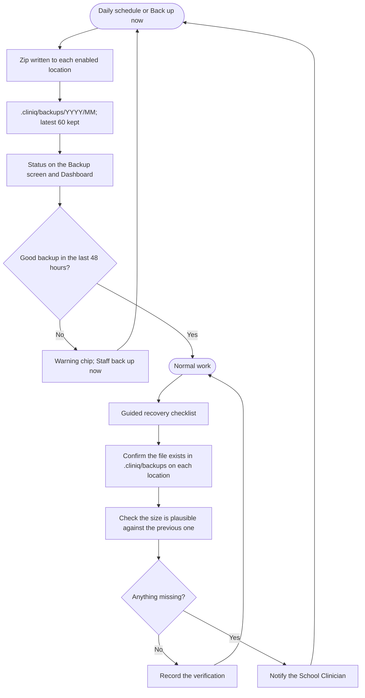

# Backup and Recovery Flow

Added Tuesday, November 10, 2026 — 17:27 PHT. Sources: [ADR-037](../06-Decisions/ADR-037-Backup-And-Audit-Log-For-Both-Roles-Retention-And-Password-Re-entry.md), [ADR-039](../06-Decisions/ADR-039-Backup-Stays-Local-No-Cloud-No-Extra-Copy-Planned.md), [ADR-052](../06-Decisions/ADR-052-Backup-Locations-Chosen-In-The-System-With-Automatic-Folders.md), [ADR-079](../06-Decisions/ADR-079-Clinic-PC-Only-Principal-Gets-Monthly-PDF.md), Screen Inventory #32, [Environment Setup](../04-Development/Environment-Setup.md) ("Clinic PC only", "Scheduler on Windows"). The backup run itself is [Activity diagram 9](Database/Activity-Diagram.md#9-backup-run). Exports: [`Database/Diagrams/Backup-Recovery.svg`](Database/Diagrams/Backup-Recovery.svg), [`.png`](Database/Diagrams/Backup-Recovery.png).

**Figure: from daily backup to restored clinic.** The backup runs daily, or on "Back up now", to every enabled location; at least one is a drive kept away from the room. The Dashboard warns after 48 hours without a good backup. The guided checklist on the Backup screen verifies a backup. Real backups need the backend; today the screen shows sample records.

The three checklist steps are the ones on the Backup screen today. A step-by-step **restore** procedure (reinstalling on a new PC and loading a backup) is not written yet; it belongs to backend phase B10. When it is, `APP_KEY` must come from the password-protected key file, or every authenticator stops working ([Environment Setup](../04-Development/Environment-Setup.md#authenticator-recovery-the-encryption-key-and-the-administrators-break-glass)).
