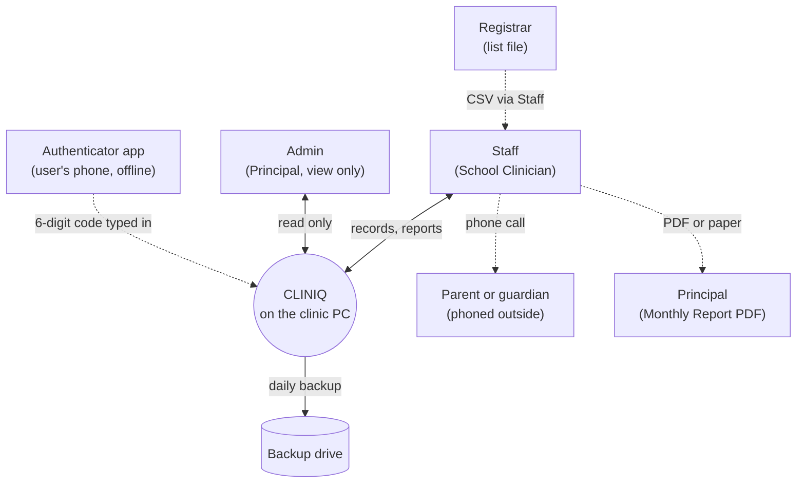

# Context Diagram

Added Tuesday, November 10, 2026 — 17:27 PHT. Sources: Project Plan §1.4 and §2.1, [Data Flow Diagram](Database/Data-Flow-Diagram.md) level 0, [ADR-029](../06-Decisions/ADR-029-Local-Deployment-Roles.md), [ADR-073](../06-Decisions/ADR-073-Password-Recovery-With-An-Authenticator-App.md), [ADR-079](../06-Decisions/ADR-079-Clinic-PC-Only-Principal-Gets-Monthly-PDF.md). Exports: [`Database/Diagrams/Context.svg`](Database/Diagrams/Context.svg), [`.png`](Database/Diagrams/Context.png).

**Figure: CLINIQ and the people and things around it.** Two kinds of user sign in, both on the clinic PC: Staff (the School Clinician) and the Admin (the Principal). Everyone else is outside the system: the registrar hands over the yearly list file, parents are phoned outside the system and only the outcome is logged, the Principal receives the Monthly Report as a PDF, the authenticator app on a user's phone produces recovery codes without talking to CLINIQ, and backups go to a drive kept away from the room. There is no email, SMS, internet or school-network connection.

