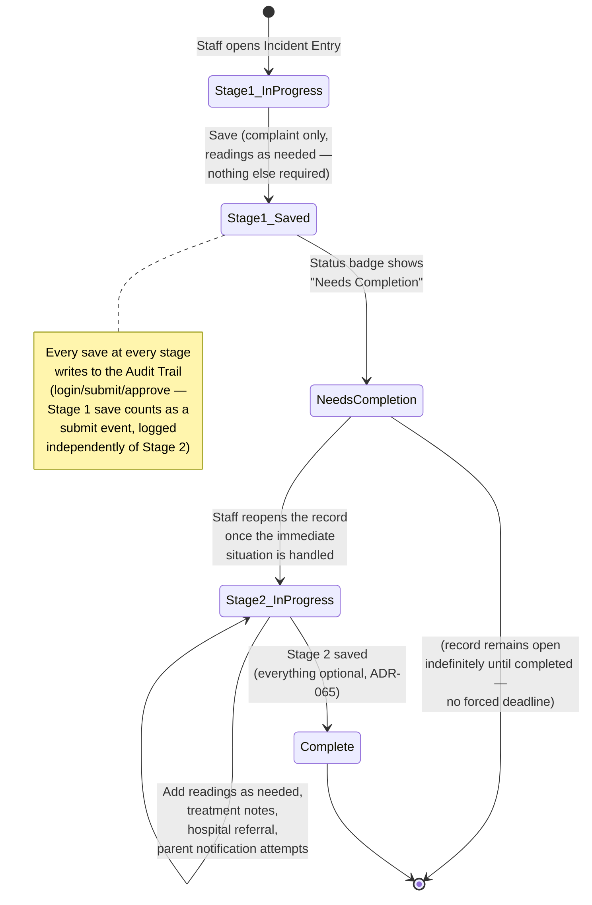
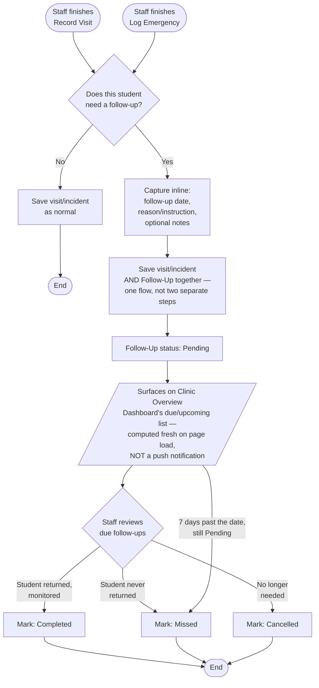
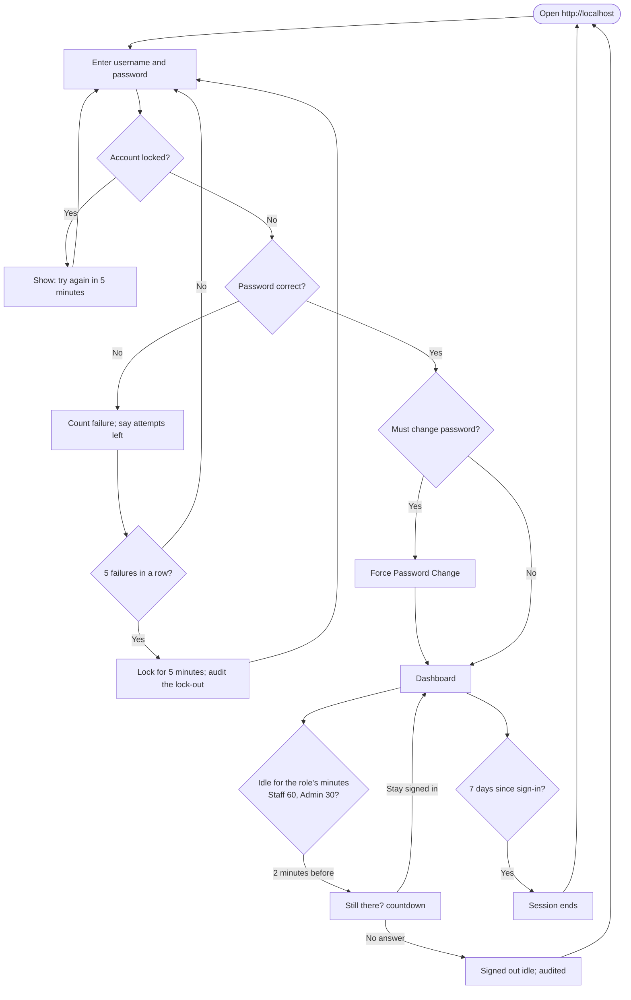
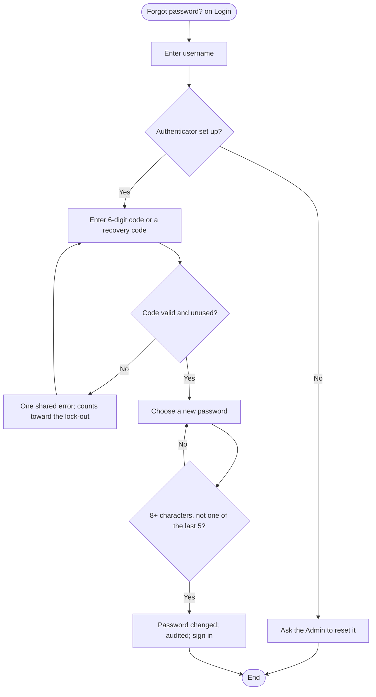
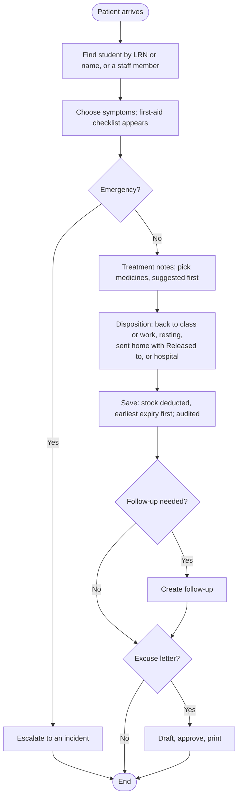
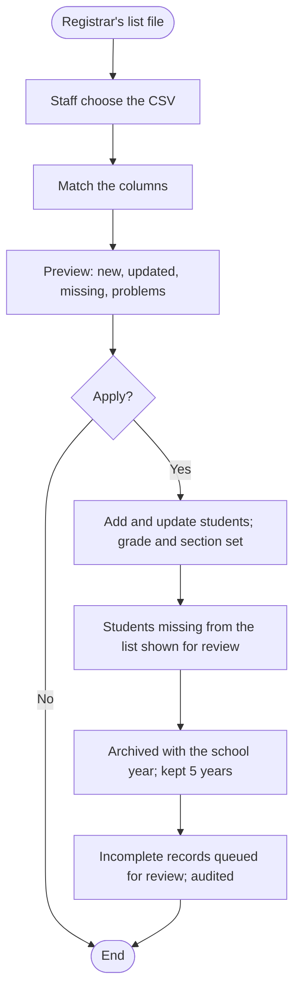
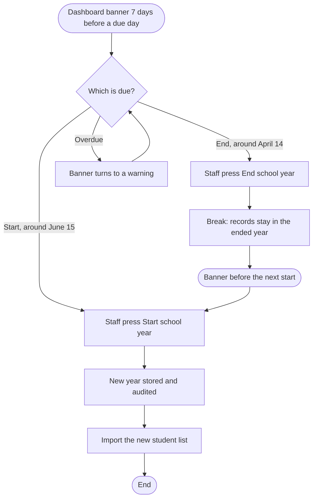
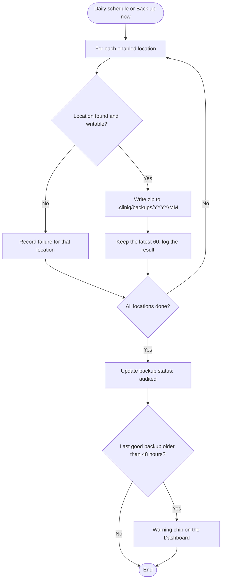

# Activity Diagrams

**Status: first draft, built from already-documented requirements.** These flows (two remain) were identified (in this same file, before this draft existed) as the highest-priority candidates — the ones with the most non-obvious branching logic already written out in prose across the Frontend Context Brief, Frontend Design Reference, and Modules & Features. Built directly from that prose, not invented.

## 1. (Removed)

This flow described the QR scan and its quick actions, which were removed from the app (ADR-027). The section number is kept so the other flows keep theirs.

## 2. Two-Stage Emergency Response Flow

The clearest case of a genuine state machine in the whole system — modeled as one, not a linear flowchart.

**Why this matters as its own diagram:** the entire design rationale for the two-stage flow is "speed over completeness in the first moment" — a flowchart that treated this as one linear "fill out the incident form" process would misrepresent the actual requirement. The state diagram makes explicit that `NeedsCompletion` is a real, potentially long-lived state, not a transient step.

## 3. Follow-Up Handling Flow

Shared between Clinic Visit Monitoring and Emergency Response — same feature, two entry points, converging on one flow.

**The one design constraint this diagram exists to make visible:** the "surfaces on Dashboard" step is explicitly a *pull* mechanism (Staff has to look), not a *push* one — there's no background job or notification service anywhere in this architecture (Project Plan §1.4, SMS/push explicitly out of scope). Any implementation that tries to add a scheduled reminder job would be solving a problem this flow was deliberately designed not to need.

## 4. Sign-In with Lock-Out, Forced Change and Idle Sign-Out

Added Tuesday, November 10, 2026 — 17:27 PHT (ADR-015, ADR-057, ADR-078). Exports: `Diagrams/Activity-4-Sign-In.svg` and `.png`.

## 5. Password Recovery with an Authenticator App

Added Tuesday, November 10, 2026 — 17:27 PHT (ADR-073; no email). Exports: `Diagrams/Activity-5-Recovery.svg` and `.png`.

## 6. Visit, from Arrival to Release

Added Tuesday, November 10, 2026 — 17:27 PHT (ADR-018, ADR-036, ADR-049, ADR-070, ADR-071). Exports: `Diagrams/Activity-6-Visit.svg` and `.png`.

## 7. Yearly Student List Import and Archive

Added Tuesday, November 10, 2026 — 17:27 PHT (ADR-047, ADR-051, ADR-072). Exports: `Diagrams/Activity-7-Import.svg` and `.png`.

## 8. Ending and Starting a School Year

Added Tuesday, November 10, 2026 — 17:27 PHT (ADR-072, ADR-075). Exports: `Diagrams/Activity-8-School-Year.svg` and `.png`.

## 9. Backup Run

Added Tuesday, November 10, 2026 — 17:27 PHT (ADR-037, ADR-039, ADR-052, ADR-079). Exports: `Diagrams/Activity-9-Backup.svg` and `.png`.

## Notes

- These two aren't the *only* flows in the system — they're the ones worth diagramming first because they're the ones with real branching/state logic. Most other flows (a standard CRUD form, a report generation) are straightforward enough that a diagram would just restate the obvious.
- If a new flow gets added later with comparable complexity (the barcode-scanner proposal, if it's ever approved, likely qualifies), add it here rather than leaving it undiagrammed.
