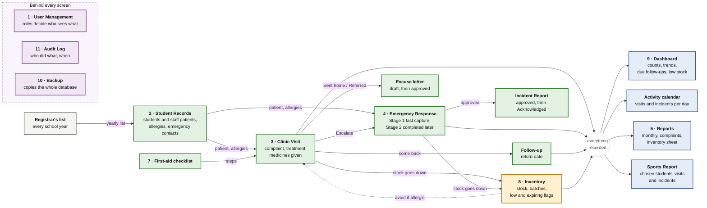

# Module Linkage Diagram

**Status: first draft, drawn from the requirements already written down.** Drawn on Saturday, October 31, 2026 — 14:10 PHT from `09-References/Canonical-Documents/CLINIQ_Modules_and_Features.md` and the decisions up to ADR-053 (on `main` at `f1bd18b`). Nothing here grants or denies access differently from the Access Summary in Modules & Features.

**Why it exists.** At the October 2 presentation a reviewer (named only as "Reviewer" in the transcript) asked to see in the SRS how the modules link, because the features looked separate: do Student Records, User Management and Reports share data, and does giving a student medicine lower the inventory? She closed by saying she needed to visualize how the modules work. The existing Level 1 data flow diagram shows processes and stores but not which module feeds which, and it predates QR removal, batches, staff patients and the Activity calendar. This page answers that one question.

## The diagram

If your viewer does not draw Mermaid, the same picture is exported as an image:  (`Diagrams/Module-Linkage.svg` zooms better). Both files are exported from the Mermaid block above, so change the block first and re-export the two files from it.

**How to read it.**
- A solid arrow means data or work passes to the next module. A dotted arrow means information is shown back.
- Boxes are numbered as in Modules & Features. Excuse letter, Follow-up, Incident Report, the Activity calendar and the Sports Report are parts of numbered modules and carry no number.
- Green is records and care, amber is stock, blue is what the clinic reads to see the picture, purple is what sits behind every screen. Grey is the school's own list.
- The small round node "everything recorded" stands for visits, incidents, follow-ups and stock together. It keeps the picture readable: the four blue boxes read from it, and the table below says exactly which of them takes what.
- "Behind every screen" is not drawn with arrows because it touches every module: User Management decides who may do what, the Audit Log records each action, and Backup copies the whole database.
- Left out of the drawing and written only in the table: visit history and approved letters showing on the Student Profile, and the Dashboard also taking incomplete records, low stock, due follow-ups and the age of the last backup.

## The links, one by one

| From | To | What passes | Where it is written |
|---|---|---|---|
| Registrar's list | Student Records | The yearly import adds new students, updates continuing ones and archives those missing from the new list. Not built yet: the import waits for the school's data privacy agreement | ADR-047, ADR-051 |
| Student Records | Clinic Visit, Emergency Response | The patient is picked by LRN or name (a staff patient by name or Staff No.); allergies and conditions show beside the form and the medicine picker | Modules 2, 3, 4; ADR-018, ADR-043 |
| First-aid checklist | Clinic Visit | Suggested steps for the complaint chosen | Module 7 |
| Clinic Visit | Emergency Response | "Escalate to incident"; an escalated visit counts once, as the incident | ADR-036 |
| Clinic Visit | Excuse letter | Sent home or Referred prepares a draft; the clinician approves it | Module 3, ADR-049 |
| Clinic Visit | Follow-up | A return date; due, then overdue after 3 days, then read as Missed after 7 days | ADR-051 |
| Emergency Response | Incident Report | A completed Stage 2 record can be approved; the Admin / Principal can Acknowledge it | Module 4, ADR-048 |
| Clinic Visit, Emergency Response | Inventory | Medicines given lower the stock, earliest-expiry batch first; editing the lines returns the stock | Module 8, ADR-018, ADR-030 |
| Inventory | Clinic Visit, Emergency Response | An "avoid if allergic to" warning at the medicine picker; it never blocks | ADR-049 |
| Clinic Visit, Emergency Response, Excuse letter | Student Records | Visit and incident history and approved letters show on the profile | Module 2 |
| Visits, incidents, follow-ups, Inventory, Student Records, Backup | Dashboard | Counts, complaints, frequent visitors, a clinician-only possible-cluster alert, due and overdue follow-ups, low and expiring stock, incomplete records, a stale-backup chip | Module 9, ADR-037, ADR-050, ADR-051 |
| Visits, incidents | Activity calendar | Counts per day; school events and national holidays are added on the calendar | Module 9, ADR-019, ADR-020, ADR-050 |
| Visits, incidents | Reports | Monthly report with a weekly breakdown, Complaint summary, Incident register | Module 5, ADR-050 |
| Inventory | Reports | The monthly inventory sheet: New Purchase, Total Available, Ending Inventory | ADR-050 |
| Student Records, visits, incidents | Sports Report | The students the clinician picks and their visits and incidents in the chosen window; the Admin cannot open it | ADR-034 |
| User Management | every module | Accounts and roles decide who may see and do what; the Admin / Principal is signed out after 30 idle minutes | ADR-033, ADR-038, ADR-048 |
| every module | Audit Log | Every save, approval, print and opened profile or incident report is recorded with who and when; Staff and the Admin read it | Audit Trail section, ADR-016 |
| Backup | the whole database | Copies it to each backup location chosen in the system; local only, no cloud. In the frontend phase the mock only records the run | ADR-039, ADR-052 |

## What is not connected, on purpose

- **No parent portal, SMS or automatic notification.** The parent phone call happens outside the system and the clinic logs the outcome (Project Plan §1.4; see the notes in `Data-Flow-Diagram.md`).
- **No QR or ID-card link, and no link to the school's own ID system.** QR was removed (ADR-027), and CLINIQ is built as an independent system first.
- **No link to the school's attendance records.** Nothing in the current requirements asks for one. The excuse letter is the only attendance-related output, and it is a clinic document for school attendance records, not a feed.

## Related

- [Data-Flow-Diagram.md](./Data-Flow-Diagram.md) (processes and stores), [Use-Case-Diagram.md](./Use-Case-Diagram.md) (who does what), [Activity-Diagram.md](./Activity-Diagram.md) (two flows).
- `09-References/Canonical-Documents/CLINIQ_Modules_and_Features.md`, the source for every module named here.
