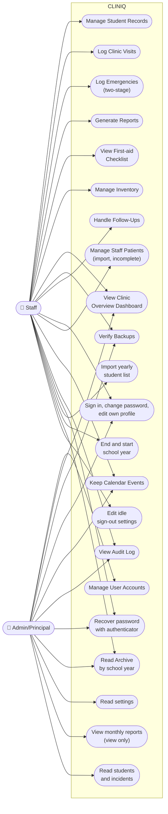

# Use-Case Diagram

**Status: first draft, built from already-documented requirements.** Actors and access levels come directly from the Access Summary table already established in Modules & Features — nothing here grants or denies access differently than what's already decided. Represented as both a visual overview (Mermaid) and a detailed table (Mermaid's UML use-case notation support is too limited for a system this size to be genuinely readable as a diagram — a table communicates the same facts more clearly for ~50+ individual use cases across 2 roles).

## Visual Overview

Updated Tuesday, November 10, 2026 — 17:27 PHT for ADR-066 to ADR-079: the account menu and own profile (ADR-066), staff import (ADR-069), authenticator recovery (ADR-073, no email reset), Archive and school years (ADR-072, ADR-075), the Admin's view-only monthly reports (ADR-077) and the idle settings (ADR-078). Exports: `Diagrams/Use-Case.svg` and `.png`.

## Detailed Use Cases by Role

### 👤 Staff (Nurse / Clinic Assistant) — Full access across every module

| Use Case | Module |
|---|---|
| Log in / log out | User Management |
| Add/edit/archive student records | Student Records |
| Resolve incomplete-record queue entries | Student Records |
| Add/edit/archive staff patients (ADR-043) | Staff Patients |
| Log a clinic visit, with the first-aid checklist | Clinic Visit Monitoring |
| Generate/approve excuse letters | Clinic Visit Monitoring |
| Log PE/Sports injury referrals | Clinic Visit Monitoring |
| Record an emergency incident (Stage 1: fast-capture) | Emergency Response |
| Complete an incident record (Stage 2) | Emergency Response |
| Log hospital referral details | Emergency Response |
| Log parent notification attempts and outcomes | Emergency Response |
| Prompt and record a Follow-Up (from a visit or incident) | Clinic Visit Monitoring / Emergency Response |
| Resolve a Follow-Up's status | Clinic Visit Monitoring / Emergency Response |
| Generate and print (or save as PDF for the Principal) the Monthly Report, Incident register, Symptom summary and Inventory sheet (ADR-074, ADR-079) | Reports Generation |
| Import the yearly student list and the staff list (ADR-047, ADR-069) | Student Records / Staff Patients |
| End and start a school year; read the Archive by school year (ADR-072, ADR-075) | Student Records |
| Edit the idle sign-out minutes for both roles (ADR-078) | User Management |
| Set up an authenticator app and recover a forgotten password with it (ADR-073) | User Management |
| Edit own name and picture, change own password (ADR-066) | User Management |
| Build and print Sports Reports (ADR-034) | Reports Generation |
| Dispense/restock inventory items | Inventory Tracker |
| Manage inventory item thresholds and expiration dates | Inventory Tracker |
| View Clinic Overview Dashboard, keep calendar events | Clinic Overview Dashboard |
| Check/verify backup status, back up now, manage backup locations (ADR-052) | Backup Verification Assistant |
| View and print the audit log | Audit Log Viewer |

### 👤 Admin/Principal — Reports, Dashboard, accounts and read-only records

| Use Case | Module |
|---|---|
| Log in / log out, change a password when required at sign-in | User Management |
| Manage user accounts (add, edit, disable, enable, reset password; never the last active Admin) | User Management |
| View the four monthly reports by month, on screen only, never print or save (ADR-038, ADR-077) | Reports Generation |
| Read the Archive and the Settings page (ADR-072, ADR-078) | Student Records / User Management |
| Set up an authenticator app and recover a forgotten password with it; edit own name and picture (ADR-066, ADR-073) | User Management |
| Read the Student List and Student Profile (ADR-038) | Student Records |
| Read the Incident Log and Incident Report (ADR-038) | Emergency Response |
| View Clinic Overview Dashboard, keep calendar events (ADR-042) | Clinic Overview Dashboard |
| Check/verify backup status, back up now (ADR-037) | Backup Verification Assistant |
| View the audit log, never print (ADR-038) | Audit Log Viewer |

PE/Sports Instructors are not actors: they have no account (ADR-029). An instructor asks the clinician, who decides what to share.

## Notes

- Every use case above, regardless of role, implicitly includes "gets logged to the audit trail" — not listed as a separate use case per row, since it's a cross-cutting requirement applying to all of them uniformly (Modules & Features, "Audit Trail" section).
- Future-development roles (Canteen Staff) are deliberately excluded from this diagram — it reflects current, built scope only. See `08-Logs/Frontend-Issues-and-TODOs.md` for what that role would add if undeferred.
