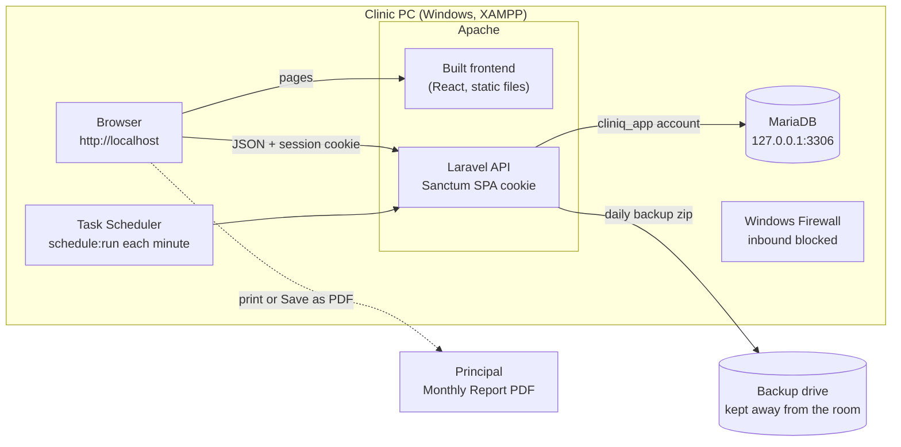

# Deployment and System Architecture Diagram

Added Tuesday, November 10, 2026 — 17:27 PHT. Sources: [ADR-029](../06-Decisions/ADR-029-Local-Deployment-Roles.md), [ADR-039](../06-Decisions/ADR-039-Backup-Stays-Local-No-Cloud-No-Extra-Copy-Planned.md), [ADR-052](../06-Decisions/ADR-052-Backup-Locations-Chosen-In-The-System-With-Automatic-Folders.md), [ADR-056](../06-Decisions/ADR-056-Backend-Preparation-Sanctum-SPA-Cookie-Mode-Own-Branch-Nothing-Wired-No-Migrations-Before-ERD-Approval.md), [ADR-079](../06-Decisions/ADR-079-Clinic-PC-Only-Principal-Gets-Monthly-PDF.md), [Environment Setup](../04-Development/Environment-Setup.md) ("Clinic PC only", "Scheduler on Windows"). Exports: [`Database/Diagrams/Deployment.svg`](Database/Diagrams/Deployment.svg), [`.png`](Database/Diagrams/Deployment.png).

**Figure: CLINIQ on the clinic PC.** Everything runs on one Windows PC. The browser on that PC is the only client; Apache serves the built frontend and the Laravel API from the same origin, `http://localhost`. MariaDB listens on `127.0.0.1` only, and Windows Firewall blocks inbound connections. Task Scheduler runs Laravel's scheduler every minute for the daily backup, which writes to a second drive or a USB drive kept away from the room. The Principal receives the Monthly Report as a PDF or on paper; no other computer reaches CLINIQ. This is the decided deployment; it is not yet installed on the clinic PC.

What is built today: the frontend (on sample data), and the backend's foundation and migrations. During development the frontend runs on Vite's dev server (`http://localhost:5173`) and the backend separately; see [System Architecture](System-Architecture.md).
