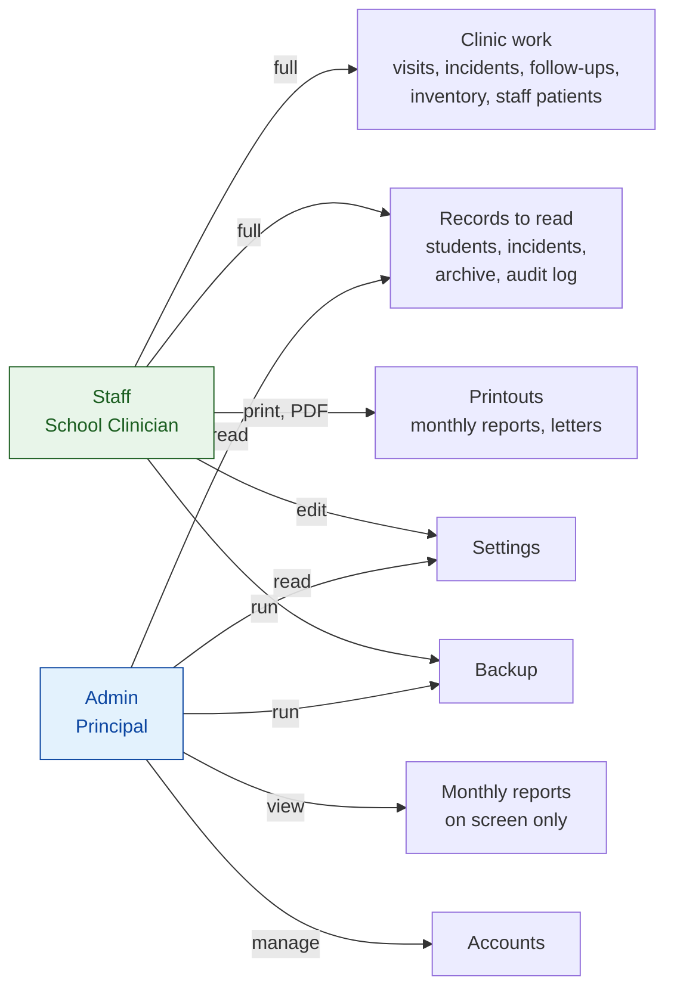

# Role and Permission Matrix

Added Tuesday, November 10, 2026 — 17:27 PHT. Sources: the router's role list (`frontend/src/routes/AppRoutes.tsx`, listed in the [Facts sheet](../00-Project-Core/Facts-Sheet.md#signed-in-routes-by-role)), [User Roles and Permissions](../01-Requirements/User-Roles-and-Permissions.md), ADR-029, ADR-033, ADR-037, ADR-038, ADR-042, ADR-043, ADR-066, ADR-072, ADR-073, ADR-077, ADR-078. Exports: [`Database/Diagrams/Role-Permissions.svg`](Database/Diagrams/Role-Permissions.svg), [`.png`](Database/Diagrams/Role-Permissions.png).

**Figure: what each role may do.** Staff (the School Clinician) works every clinic module. The Admin (the Principal) reads a narrower set, manages accounts, and never prints. PE/Sports Instructors have no account.

| Area | Staff | Admin |
|---|---|---|
| Dashboard, Activity calendar | Use, keep events | Read, keep events |
| Students: list and profile | Full | Read |
| Students: add, edit, import, incomplete | Full | — |
| Staff patients | Full | — |
| Visits, excuse letters, PE referrals | Full | — |
| Incidents: log and report | Full | Read |
| Follow-ups | Full | — |
| Inventory | Full | — |
| Monthly reports | Print or save PDF | View by month, on screen |
| Sports Reports | Full | — |
| Archive and school years | Read; end and start years | Read |
| Audit Log | Read | Read |
| Accounts | Own profile only | Manage all |
| Backup | Status, back up now, locations | Status, back up now |
| Settings (idle minutes) | Edit | Read |
| Authenticator, own profile, password | Own | Own |
| Print anything | Yes | Never |

