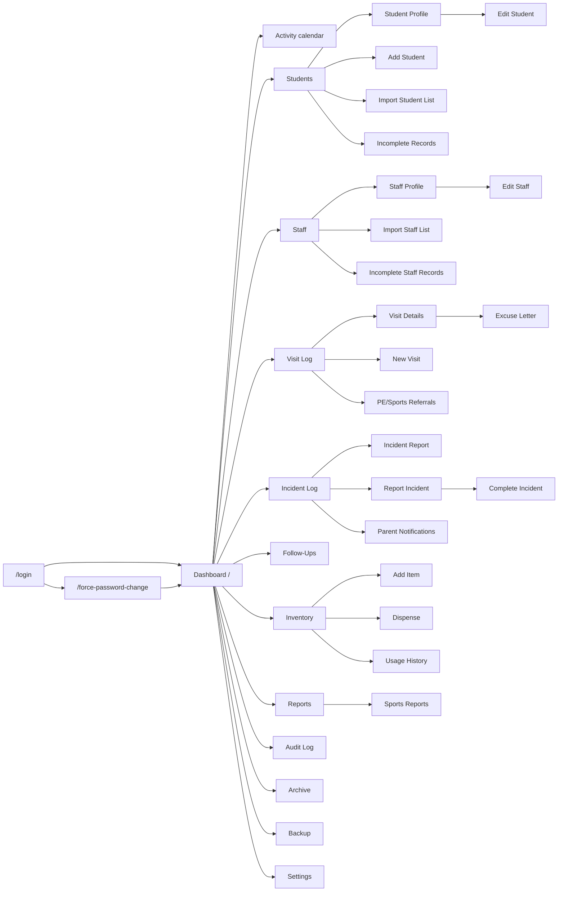
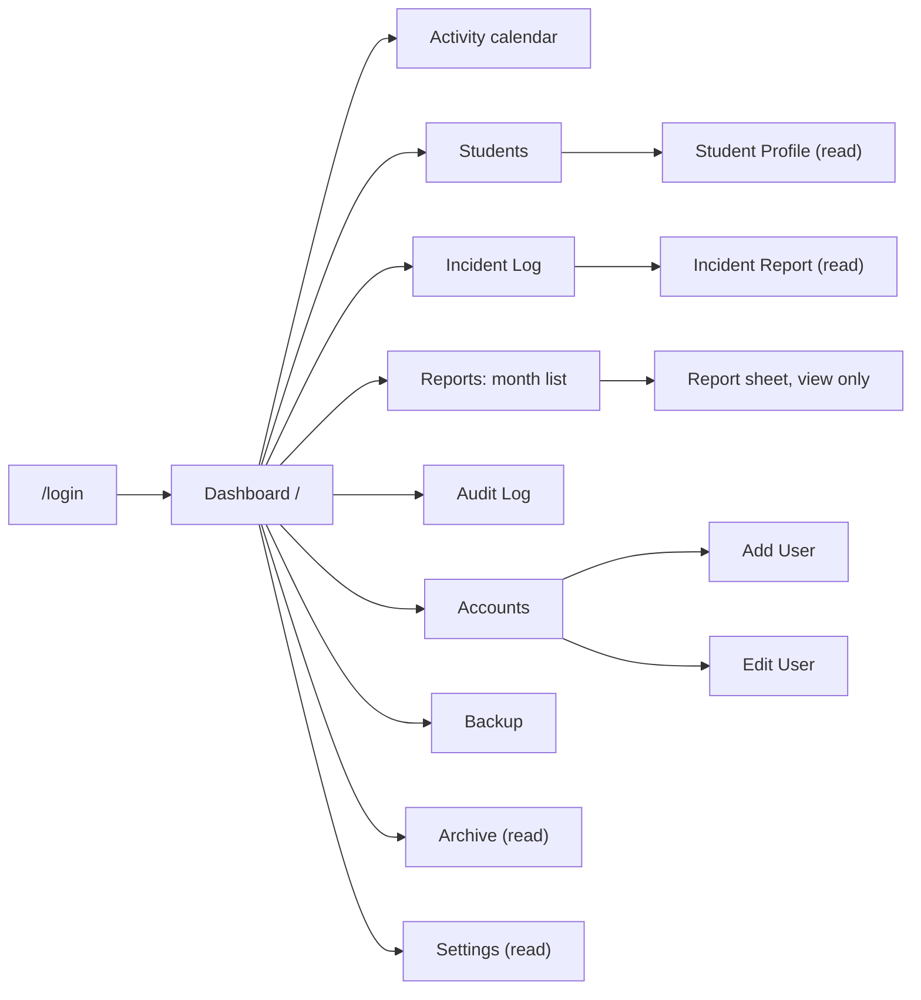

# Screen-Flow and Navigation Map

Added Tuesday, November 10, 2026 — 17:27 PHT, built from the router (`frontend/src/routes/AppRoutes.tsx` and `paths.ts`; the full list with roles is in the [Facts sheet](../00-Project-Core/Facts-Sheet.md#signed-in-routes-by-role)). Exports: `Database/Diagrams/Screen-Flow-Staff` and `Screen-Flow-Admin`, `.svg` and `.png`.

**Figure 1: Staff (School Clinician).** After sign-in, the sidebar reaches every group; arrows show the main drill-downs.

**Figure 2: Admin (Principal).** Read-only screens, Accounts, and the month list of reports. A Staff-only route sends the Admin to the Dashboard, or to Reports for a Sports Report link.

Both roles reach Change Password, Privacy Policy, Edit profile, the authenticator app, Keyboard shortcuts and Report an issue from the account menu in the header.
