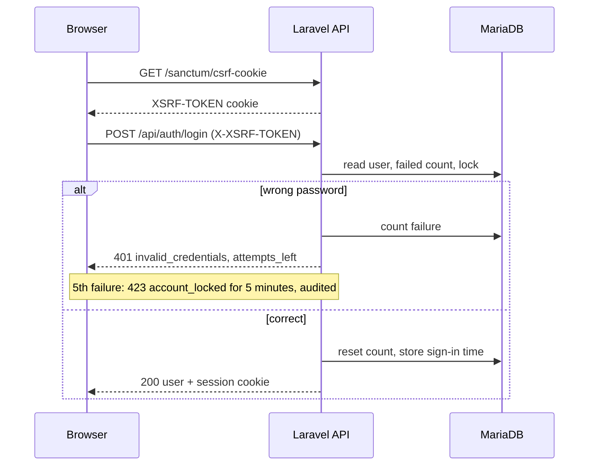
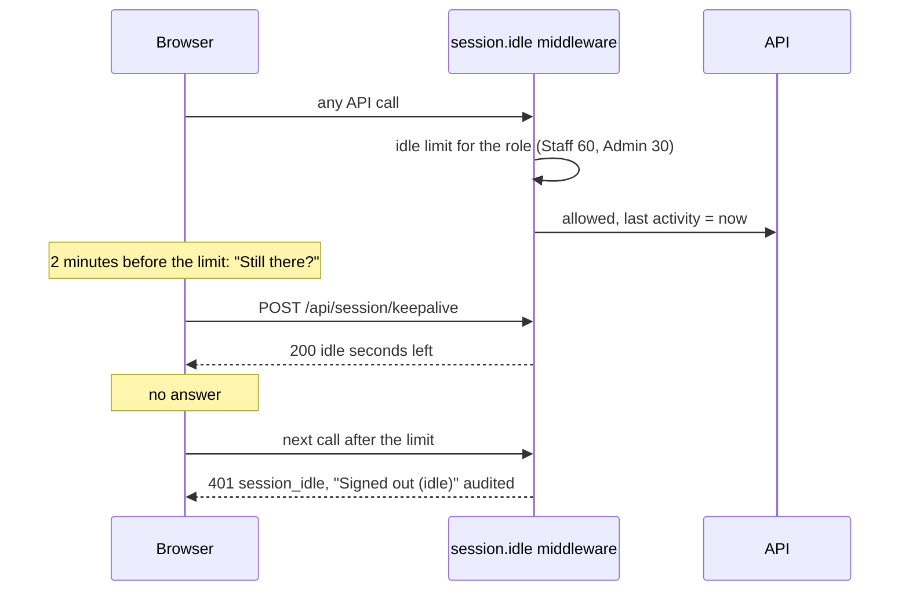
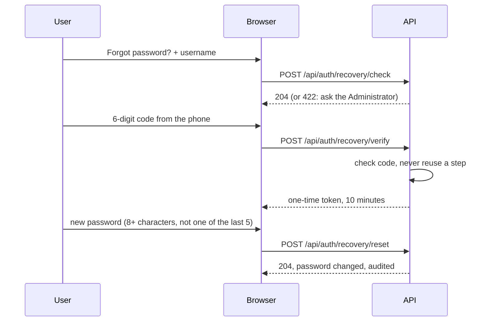
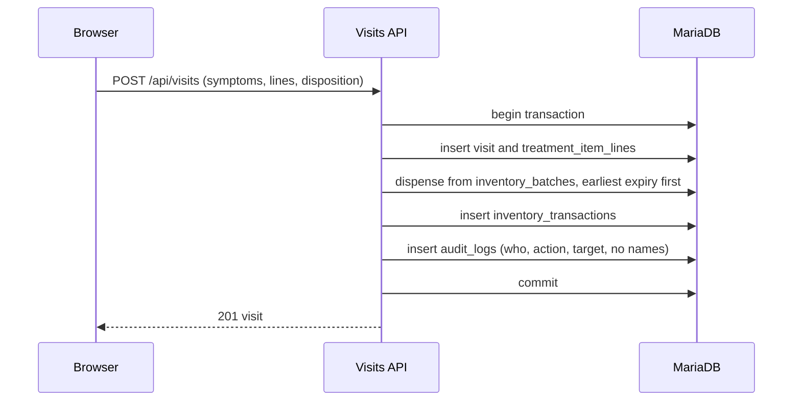

# Sequence Diagrams

Added Tuesday, November 10, 2026 — 17:27 PHT. Sources: [API Contract](../04-Development/API-Contract.md) ("Sign-in", "Idle sign-out", authentication entries), `backend/app/Shared/Http/KeepAliveController.php` and the `session.fixed` / `session.idle` middleware, [ADR-018](../06-Decisions/ADR-018-Stock-Integrity-For-Items-Given.md), [ADR-056](../06-Decisions/ADR-056-Backend-Preparation-Sanctum-SPA-Cookie-Mode-Own-Branch-Nothing-Wired-No-Migrations-Before-ERD-Approval.md), [ADR-073](../06-Decisions/ADR-073-Password-Recovery-With-An-Authenticator-App.md), [ADR-078](../06-Decisions/ADR-078-Staff-Idle-Signout-Idle-Times-Are-Settings.md). The keep-alive and the session middleware are built and tested; the other endpoints are contract entries, not yet built. Exports: `Database/Diagrams/Sequence-1-Sign-In` to `Sequence-4-Visit`, `.svg` and `.png`.

## 1. Sign-in with the Sanctum SPA cookie

**Figure:** the browser first fetches a CSRF cookie, then signs in; every later request carries the session cookie and echoes the token. No API token is issued.

## 2. Idle sign-out and keep-alive

**Figure:** every API call counts as activity. The warning dialog's "Stay signed in" sends a keep-alive; once the role's idle minutes pass, the next call is refused and the browser returns to Login.

## 3. Password recovery with an authenticator app

**Figure:** recovery works offline: the app on the phone and the server derive the same 6-digit code from a shared secret.

## 4. Recording a visit with stock deduction and its audit entry

**Figure:** one transaction saves the visit, its medicine lines and the stock movements, earliest-expiring batch first, and writes one audit entry with field names only.

