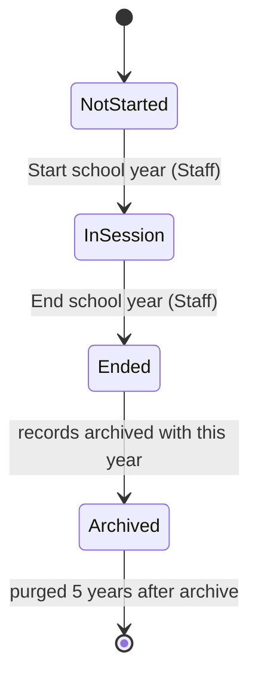
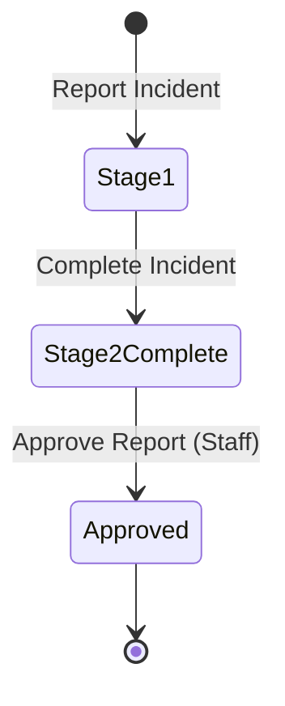
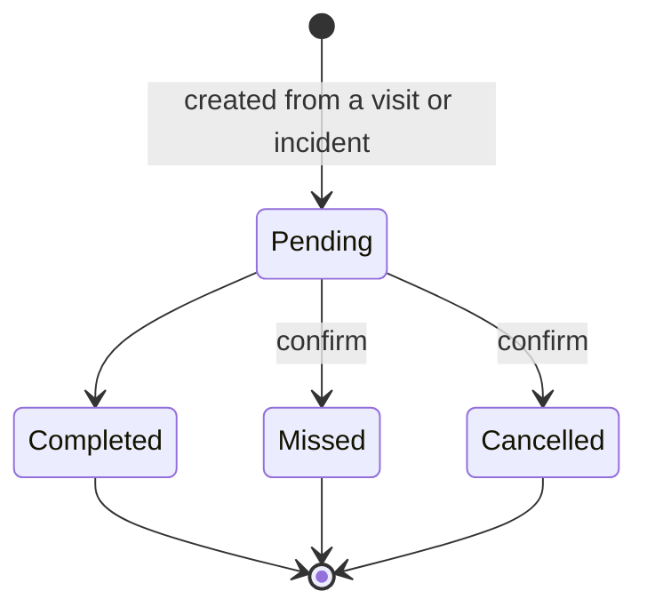

# State Diagrams

Added Tuesday, November 10, 2026 — 17:27 PHT. Sources: `Reference-Schema.sql` (`school_years.in_session`, `chk_incidents_stage`, `chk_followups_status`), [ADR-051](../06-Decisions/ADR-051-Starting-Values-Follow-Up-Closing-Vitals-Ranges-Automatic-Archive-And-Required-Marks.md), [ADR-065](../06-Decisions/ADR-065-Incident-Stage-2-Care-Is-Optional.md), [ADR-072](../06-Decisions/ADR-072-Archive-By-School-Year.md), [ADR-075](../06-Decisions/ADR-075-School-Year-Started-By-Hand.md). Exports: `Database/Diagrams/State-1-School-Year` to `State-3-Follow-Up`, `.svg` and `.png`.

## 1. School year

**Figure:** a school year exists once Staff start it, stays in session until Staff end it, and then holds its archived records. Only one year is in session at a time (a unique generated column).

## 2. Incident

**Figure:** Stage 1 is the fast capture; Stage 2 completes the record (every Stage 2 field is optional); a completed record can be approved and printed.

## 3. Follow-up

**Figure:** a follow-up starts Pending and ends Completed, Missed or Cancelled; Missed and Cancelled ask before saving.

