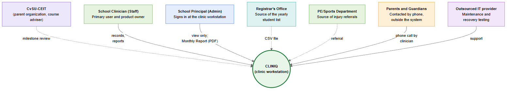
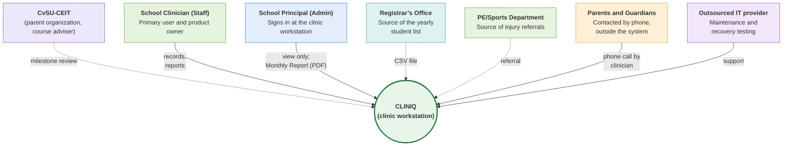
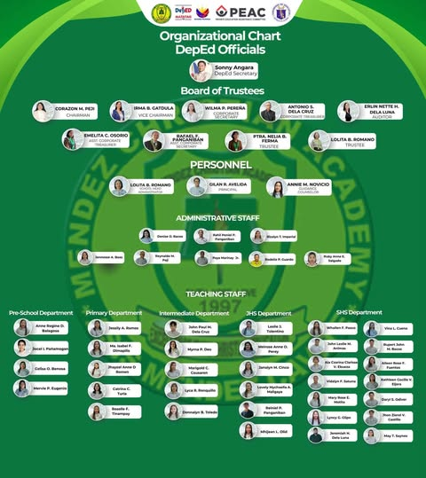
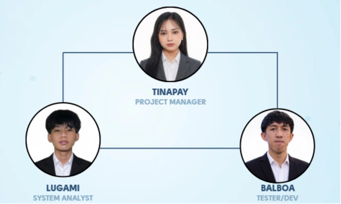

<!-- p.12 -->

## 2. Project Organization

### 2.1. External Interface

Cavite State University, through the College of Engineering and Information Technology (CEIT), supervises the project as the parent organization, and the clinic of Mendez Christian Academy uses the system as the customer. The team answers to the School Clinician for requirements and acceptance and to the course adviser for academic milestones. Figure 1 and Table 1 show the external parties. Figure 2 shows the Organizational structure of Mendez Christian Academy.

Figure 1. External Interface

Diagram source (Mermaid)

<!-- diagram: figure-01-external-interface -->

**Table 1.** External parties and their roles in the project

<table>
<tr><th>Party</th><th>Role in the Project</th></tr>
<tr><td>Cavite State University, CEIT (Prof. Kryss Coleen Creus, Course Adviser)</td><td>Parent organization. Provides academic oversight, milestone review, and grading.</td></tr>
<tr><td>Ms. Jennesse Baas, School Clinician</td><td>Customer and product owner. Validates requirements, participates in user acceptance testing (UAT), and receives training.</td></tr>
<tr><td>MCA Administration / Principal</td><td>Sponsor of the digitalization effort. The Admin account is used at the clinic workstation, often with the Principal present, to read the dashboard, reports, student profiles, and incident reports on screen and to manage accounts. The Admin account does not print. The Principal receives the Monthly Report as a PDF from the School Clinician.</td></tr>
<tr><td>Registrar’s Office</td><td>Source of authoritative student information, including the yearly list that sets each student’s grade and section. The import waits for the school’s data privacy agreement.</td></tr>
<!-- p.13 -->
<tr><td>PE/Sports Department</td><td>Source of injury referrals that the Staff log. Requests a printed Sports Report. Has no system account.</td></tr>
<tr><td>Outsourced IT provider</td><td>Maintains the clinic workstation and network. Partners in quarterly backup-recovery testing and major hardware issues.</td></tr>
</table>

Figure 2. Organizational structure of Mendez Christian Academy

### 2.2. Internal Structure

The team has three members: Ghenly B. Tinapay (Project Manager and client liaison), Christian John C. Lugami (System Analyst), and Zean Kurt G. Balboa (Developer/Tester). The structure mirrors the clinic’s own limited manpower and enforces clear roles, no duplicated effort, and standardized handoffs. All members report jointly to the client and to the course adviser, with no separate management layer between the developers and the client.

Figure 3. Team hierarchy of the CLINIQ project

<!-- p.14 -->

### 2.3. Roles and Responsibilities

Each member leads the activities in Table 2 and helps in the others when needed. For example, all three members join the client interviews and UAT.

**Table 2.** Roles and responsibilities of the team

<table>
<tr><th>Activity</th><th>Nature</th><th>Supporting processes</th><th>Responsible</th></tr>
<tr><td>Project management</td><td>Planning, coordination, scope and risk control, and communication with the client and adviser</td><td>Weekly planning; risk register; scope decision log; status reports to the adviser; document consolidation</td><td>Ghenly B. Tinapay, Project Manager</td></tr>
<tr><td>Requirements and analysis</td><td>Understanding clinic work and converting needs into requirements</td><td>Interviews with the School Clinician and the ICT Head; functional and non-functional requirements; traceability table; UAT scenarios and test cases</td><td>Christian John C. Lugami, System Analyst (all members join interviews)</td></tr>
<tr><td>System design</td><td>Architecture, database, and interface design</td><td>ERD and data dictionary; context, use-case, state, and sequence diagrams; design system; screen inventory; wireframes</td><td>Christian John C. Lugami, System Analyst</td></tr>
<tr><td>Frontend development</td><td>Screens built first on sample data</td><td>React and TypeScript; shared components; role-guarded routes; keyboard shortcuts; accessibility review</td><td>Zean Kurt G. Balboa, Developer/Tester</td></tr>
<!-- p.15 -->
<tr><td>Backend development</td><td>API, database, sign-in, audit, and backup</td><td>Laravel modules; migrations from the approved ERD; Sanctum sign-in; task scheduler; Pest tests</td><td>Zean Kurt G. Balboa, Developer/Tester</td></tr>
<tr><td>Testing</td><td>Verifying that the system meets the requirements</td><td>Vitest and React Testing Library; Pest; database constraint tests; UAT with the School Clinician</td><td>Zean Kurt G. Balboa, Developer/Tester (all members join testing)</td></tr>
<tr><td>Deployment and training</td><td>Installation on the clinic workstation and staff training</td><td>XAMPP installation and hardening; Windows Task Scheduler for backups; hands-on training session; user manual</td><td>Zean Kurt G. Balboa (lead); Ghenly B. Tinapay</td></tr>
<tr><td>Documentation and defense</td><td>Project documents and the final presentation</td><td>Project plan; software requirements specification; decision log; manuals; source repository handover; defense materials</td><td>Ghenly B. Tinapay, Project Manager (all members)</td></tr>
</table>

### 2.4. Deliverables

The team delivers CLINIQ, a web application hosted on the clinic workstation. It brings together user management, student records, staff patients, clinic visits, emergency response, a first-aid checklist, an inventory tracker, a dashboard, report generation, backup verification, and an audit log viewer. Table 3 lists the outputs that the team hands over, from the project plan to the working system and the training that lets the clinic run it without outside help.

<!-- p.16 -->

**Table 3.** Project deliverables and target weeks

| Deliverable | Target |
| --- | --- |
| System design artifacts (SRS draft and analysis models) | September 18, 2026 |
| Working prototype (frontend on sample data) | November 13, 2026 |
| Project plan | November 19, 2026 |
| Backend (API and database) | November 20, 2026 |
| Test plan and test results | To be scheduled |
| Deployed system at Mendez Christian Academy | To be scheduled |
| User manual and training materials | To be scheduled |
| Source code repository (handover copy) | To be scheduled |
| Final defense and presentation | To be scheduled |
