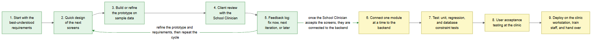

## 4. Approach to be Taken in this Subject

### 4.1. Theoretical Framework / Methods to be Used

<!-- p.21 -->

CLINIQ is developed through evolutionary iterative prototyping (Pressman & Maxim, 2020; Sommerville, 2016). The team builds a working prototype from the best-understood requirements, the client uses it, and the team refines it after each round of feedback. The prototype is never restarted: each version builds on the previous one, and the accepted prototype becomes the final system, unlike throwaway prototyping, in which each prototype is discarded after use. This variant suits projects whose requirements are unclear at the start and change as users see the system.

Each iteration plans the modules from the best-understood or most important requirements, quick-designs their screens, data, and rules, builds or refines them on the previous version with unit and regression tests, demonstrates the result to the School Clinician and staff with sample data, classifies the feedback as fix now, next iteration, or later, and refines the version and requirements. The cycle repeats until the clinic staff accept the prototype (Figure 4).

Figure 4. Evolutionary iterative prototyping process used for CLINIQ

```mermaid
flowchart LR
  S1["1. Start with the<br>best-understood<br>requirements"] --> S2["2. Quick design<br>of the next<br>screens"] --> S3["3. Build or refine<br>the prototype on<br>sample data"] --> S4["4. Client review<br>with the<br>School Clinician"] --> S5["5. Feedback log:<br>fix now, next<br>iteration, or later"]
  S6["6. Connect one module<br>at a time to the<br>backend"] --> S7["7. Test: unit, regression,<br>and database<br>constraint tests"] --> S8["8. User acceptance<br>testing at the clinic"] --> S9["9. Deploy on the clinic<br>workstation, train<br>staff, and hand over"]
  S5 -- "refine the prototype and requirements, then repeat the cycle" --> S2
  S5 -- "once the School Clinician accepts the screens, they are connected to the backend" --> S6
  classDef green fill:#e3f4e6,stroke:#2e8b3a
  classDef yellow fill:#fdf8c8,stroke:#a8a020
  class S1,S2,S3,S4,S5 green
  class S6,S7,S8,S9 yellow
  linkStyle 7,8 stroke:#2e8b3a
```

Diagram source (Mermaid)

<!-- diagram: figure-04-evolutionary-iterative-prototyping -->

Supporting concepts:

- Privacy by design (Republic Act No. 10173, 2012). Least-privilege roles, a display rule that hides names on shared screens, an append-only audit trail, and defined retention.
- Usability engineering (Nielsen, 2026). Efficiency for the expert user, clear system status, and error prevention for busy clinic staff.
- Modularity. The frontend and backend are organized by module, so each module can be developed, tested, and handed off on its own.

Design principles, methods, and models:

- Process models. Context diagram, data-flow diagram, use-case diagram, activity diagrams for the visit and emergency workflows, state diagrams (school year, incident, and follow-up), and sequence
<!-- p.22 -->
  diagrams (sign-in, idle sign-out, password recovery, and visit recording).
- Data models. Entity-relationship diagram, data dictionary, and a reference schema whose CHECK, UNIQUE, and foreign-key rules are verified by constraint tests.
- Interface models. A design system based on the school’s brand colors (green #039935 and gold #EAEA09), a screen inventory, a screen-flow map, and reference screens that all other screens follow.
- Architecture. A three-tier, API-first design with business rules on the server and a single local origin.

Testing methods and assessment scheme:

Every iteration includes unit tests of new logic, regression tests of earlier modules, and functional checks before the review session. The frontend uses Vitest and React Testing Library, the backend uses Pest, and database constraint tests verify the schema rules. Integration testing, usability testing, and UAT follow after the modules are connected. The project is assessed through four measures:

- Review sessions with the School Clinician after each iteration.
- Automated test results for the frontend, the backend, and the database constraints.
- UAT at the clinic, using a questionnaire based on the product quality characteristics of ISO/IEC 25010 (International Organization for Standardization & International Electrotechnical Commission [ISO/IEC], 2023).
- The measurable targets in the specific objectives, namely documentation time, error reduction, report automation, backup status, and implementation cost. For the first objective, the team measures the current manual documentation time as a baseline during UAT preparation and compares it with the time in the system.

### 4.2. Rationale for the Framework / Methods

This approach fits the project for three reasons:

- The clinic workflow (first-aid treatment, emergency referral, visit logging, and medicine dispensing) is difficult to specify on paper alone. A working prototype lets the School Clinician react to something tangible and exposes gaps that interviews and documents miss.
<!-- p.23 -->
- The team has three members. Building, testing, and refining one version at a time keeps the workload manageable without parallel workstreams.
- The client has one workstation and limited time away from clinic duties. An early usable version allows the staff to validate and adjust the system while changes are still inexpensive, instead of discovering mismatches at turnover.

Compared with a sequential approach, which fixes the requirements before the client sees any software, evolutionary prototyping reduces the risk of building the wrong system. Compared with throwaway prototyping, it avoids rebuilding accepted screens, which saves effort for a small team. The use of iterative development with user feedback in ClinicSync (Erio et al., 2025) also shows that this style fits school clinic projects. The course adviser/professors checks each iteration, and the team revises it with client feedback before the next round. The cycle ends with formal UAT and turnover once the system is functional and ready for operation.

### 4.3. Technologies you plan to consider or use

The table below lists the technology stack CLINIQ will use.

**Table 5.** Technology stack of CLINIQ

<table>
<tr><th>Category</th><th>Technology</th><th>Reason</th></tr>
<tr><td>Frontend</td><td>React 19, TypeScript 6, Vite 8, and Tailwind CSS 4</td><td>Builds a fast single-page application that compiles to static files, so the clinic workstation needs no Node.js at run time.</td></tr>
<tr><td>Routing and data</td><td>React Router 7 and a promise-based data hook with feature-level API files</td><td>Provides path-based screens with one role-guarded route table. The same hook later switches from sample data to the real API.</td></tr>
<tr><td>Charts</td><td>Chart.js 4 with react-chartjs-2</td><td>Is lighter than the alternative considered, which matters on a 4 GB workstation. Each chart has a table fallback.</td></tr>
<tr><td>Backend</td><td>Laravel 13 (PHP 8.3 or newer) with Laravel Sanctum 4 in SPA cookie mode</td><td>Is a mature framework with built-in validation, scheduling, and testing. Sanctum suits a React and Laravel pairing and avoids storing tokens in the browser (Laravel, n.d.).</td></tr>
<!-- p.24 -->
<tr><td>Database</td><td>MariaDB 10.11 (from XAMPP)</td><td>Is free, MySQL-compatible, and enforces schema rules through CHECK, UNIQUE, and foreign-key constraints.</td></tr>
<tr><td>Local server</td><td>XAMPP (Apache 2.4 and PHP 8.5)</td><td>Gives the same environment on every development machine and on the clinic workstation, and serves the frontend and API from one origin.</td></tr>
<tr><td>Testing and quality</td><td>Vitest, React Testing Library, Pest, Laravel Pint, and Larastan</td><td>Provide automated checks for both sides, code style, and static analysis.</td></tr>
<tr><td>Scheduling</td><td>Laravel scheduler run by Windows Task Scheduler</td><td>Runs the daily backup without extra software.</td></tr>
<tr><td>Version control</td><td>Git and GitHub</td><td>Records the change history, supports review, and provides the handover copy of the source.</td></tr>
</table>

The closest existing product in scope is Medical Tracker. Compared with it, the chosen stack lets CLINIQ run on the clinic computer without internet or subscription. It also supports features specific to the MCA clinic: a two-stage incident form for emergencies, an excuse-letter approval workflow, Sports Reports for PE instructors, batch-level stock tracking with disposal of expired items, archiving by school year with a retention rule, a display-privacy rule for shared screens, and self-checking backups. All tools are free and open source.
