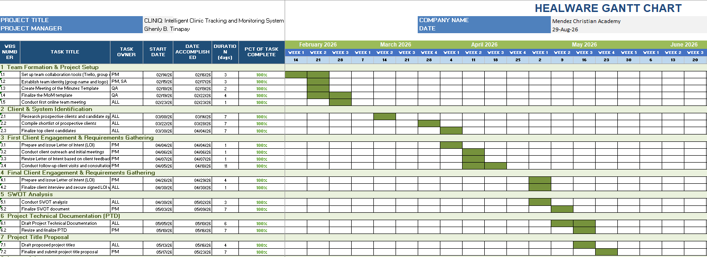
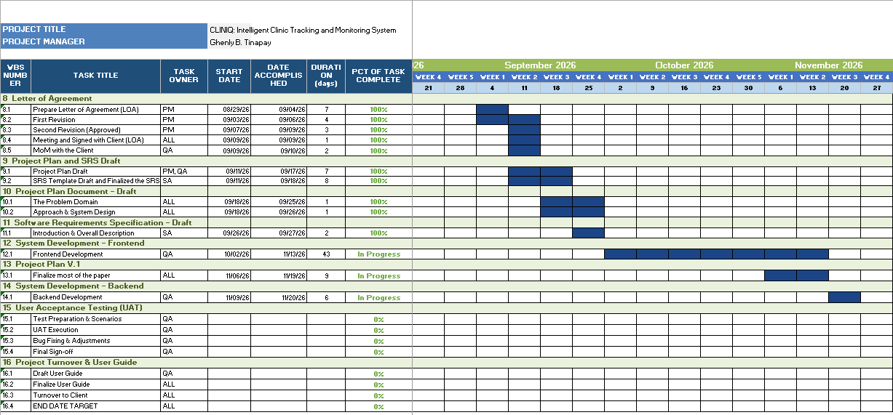

<!-- p.44 -->

## 6. Project Timeline

### 6.1. Gantt Chart

Figures 39 and 40 show the Gantt chart of the project for Software Engineering I and Software Engineering II.

Figure 39. Gantt chart: Software Engineering I

Figure 40. Gantt chart: Software Engineering II

### 6.2. Work Breakdown Structure

Table 9 divides each phase of the Gantt chart into tasks and uses the same numbers, owners, and dates. The owners are PM (Project Manager, Ghenly B. Tinapay), SA (System Analyst, Christian John C. Lugami), QA (Developer/Tester, Zean Kurt G. Balboa), and ALL (all members). The statuses are as of November 15, 2026.

**Table 9.** Work Breakdown Structure

<table>
<tr><th>WBS ID</th><th>Task</th><th>Owner</th><th>Start</th><th>End</th><th>Status</th></tr>
<tr><td colspan="6"><b>1. Team Formation and Project Setup</b></td></tr>
<tr><td>1.1</td><td>Set up team collaboration tools <!-- p.45 --> (Trello, group chat, Google Drive)</td><td>PM</td><td>Feb 14, 2026</td><td>Feb 16, 2026</td><td>Completed</td></tr>
<tr><td>1.2</td><td>Establish team identity (group name and logo)</td><td>PM, SA</td><td>Feb 15, 2026</td><td>Feb 17, 2026</td><td>Completed</td></tr>
<tr><td>1.3</td><td>Create Meeting of the Minutes Template</td><td>QA</td><td>Feb 18, 2026</td><td>Feb 19, 2026</td><td>Completed</td></tr>
<tr><td>1.4</td><td>Finalize the MoM template</td><td>QA</td><td>Feb 19, 2026</td><td>Feb 22, 2026</td><td>Completed</td></tr>
<tr><td>1.5</td><td>Conduct first online team meeting</td><td>ALL</td><td>Feb 23, 2026</td><td>Feb 23, 2026</td><td>Completed</td></tr>
<tr><td colspan="6"><b>2. Client and System Identification</b></td></tr>
<tr><td>2.1</td><td>Research prospective clients and candidate system concepts</td><td>ALL</td><td>Mar 8, 2026</td><td>Mar 14, 2026</td><td>Completed</td></tr>
<tr><td>2.2</td><td>Compile shortlist of prospective clients</td><td>ALL</td><td>Mar 22, 2026</td><td>Mar 28, 2026</td><td>Completed</td></tr>
<tr><td>2.3</td><td>Finalize top client candidates</td><td>ALL</td><td>Mar 30, 2026</td><td>Apr 4, 2026</td><td>Completed</td></tr>
<tr><td colspan="6"><b>3. First Client Engagement and Requirements Gathering</b></td></tr>
<tr><td>3.1</td><td>Prepare and issue Letter of Intent (LOI)</td><td>PM</td><td>Apr 4, 2026</td><td>Apr 4, 2026</td><td>Completed</td></tr>
<tr><td>3.2</td><td>Conduct client outreach and initial meetings</td><td>PM</td><td>Apr 6, 2026</td><td>Apr 6, 2026</td><td>Completed</td></tr>
<tr><td>3.3</td><td>Revise Letter of Intent based on client feedback</td><td>PM</td><td>Apr 7, 2026</td><td>Apr 7, 2026</td><td>Completed</td></tr>
<tr><td>3.4</td><td>Conduct follow-up client visits and consultations</td><td>PM</td><td>Apr 5, 2026</td><td>Apr 18, 2026</td><td>Completed</td></tr>
<tr><td colspan="6"><b>4. Final Client Engagement and Requirements Gathering</b></td></tr>
<tr><td>4.1</td><td>Prepare and issue Letter of Intent (LOI)</td><td>PM</td><td>Apr 26, 2026</td><td>Apr 29, 2026</td><td>Completed</td></tr>
<tr><td>4.2</td><td>Finalize client interview and secure signed LOI with principal</td><td>ALL</td><td>Apr 30, 2026</td><td>Apr 30, 2026</td><td>Completed</td></tr>
<tr><td colspan="6"><b>5. SWOT Analysis</b></td></tr>
<!-- p.46 -->
<tr><td>5.1</td><td>Conduct SWOT analysis</td><td>ALL</td><td>Apr 30, 2026</td><td>May 2, 2026</td><td>Completed</td></tr>
<tr><td>5.2</td><td>Finalize SWOT document</td><td>PM</td><td>May 3, 2026</td><td>May 9, 2026</td><td>Completed</td></tr>
<tr><td colspan="6"><b>6. Project Technical Documentation (PTD)</b></td></tr>
<tr><td>6.1</td><td>Draft Project Technical Documentation</td><td>ALL</td><td>May 5, 2026</td><td>May 10, 2026</td><td>Completed</td></tr>
<tr><td>6.2</td><td>Revise and finalize PTD</td><td>PM</td><td>May 10, 2026</td><td>May 16, 2026</td><td>Completed</td></tr>
<tr><td colspan="6"><b>7. Project Title Proposal</b></td></tr>
<tr><td>7.1</td><td>Draft proposed project titles</td><td>ALL</td><td>May 13, 2026</td><td>May 16, 2026</td><td>Completed</td></tr>
<tr><td>7.2</td><td>Finalize and submit project title proposal</td><td>PM</td><td>May 17, 2026</td><td>May 23, 2026</td><td>Completed</td></tr>
<tr><td colspan="6"><b>8. Letter of Agreement</b></td></tr>
<tr><td>8.1</td><td>Prepare Letter of Agreement (LOA)</td><td>PM</td><td>Aug 29, 2026</td><td>Sep 4, 2026</td><td>Completed</td></tr>
<tr><td>8.2</td><td>First Revision</td><td>PM</td><td>Sep 3, 2026</td><td>Sep 6, 2026</td><td>Completed</td></tr>
<tr><td>8.3</td><td>Second Revision (Approved)</td><td>PM</td><td>Sep 7, 2026</td><td>Sep 9, 2026</td><td>Completed</td></tr>
<tr><td>8.4</td><td>Meeting and Signed with Client (LOA)</td><td>ALL</td><td>Sep 9, 2026</td><td>Sep 9, 2026</td><td>Completed</td></tr>
<tr><td>8.5</td><td>MoM with the Client</td><td>QA</td><td>Sep 9, 2026</td><td>Sep 10, 2026</td><td>Completed</td></tr>
<tr><td colspan="6"><b>9. Project Plan and SRS Draft</b></td></tr>
<tr><td>9.1</td><td>Project Plan Draft</td><td>PM, QA</td><td>Sep 11, 2026</td><td>Sep 17, 2026</td><td>Completed</td></tr>
<tr><td>9.2</td><td>SRS Template Draft and Finalized the SRS</td><td>SA</td><td>Sep 11, 2026</td><td>Sep 18, 2026</td><td>Completed</td></tr>
<tr><td colspan="6"><b>10.Project Plan Document - Draft</b></td></tr>
<tr><td>10.1</td><td>The Problem Domain</td><td>ALL</td><td>Sep 18, 2026</td><td>Sep 25, 2026</td><td>Completed</td></tr>
<tr><td>10.2</td><td>Approach and System Design</td><td>ALL</td><td>Sep 18, 2026</td><td>Sep 26, 2026</td><td>Completed</td></tr>
<tr><td colspan="6"><b>11.Software Requirements Specification - Draft</b></td></tr>
<!-- p.47 -->
<tr><td>11.1</td><td>Introduction and Overall Description</td><td>SA</td><td>Sep 26, 2026</td><td>Sep 27, 2026</td><td>Completed</td></tr>
<tr><td colspan="6"><b>12.System Development - Frontend</b></td></tr>
<tr><td>12.1</td><td>Frontend Development (screens built on sample data in three prototypes; reference screens reviewed with the client; the demo-ready check is still open)</td><td>QA</td><td>Oct 2, 2026</td><td>Nov 13, 2026</td><td>Completed</td></tr>
<tr><td colspan="6"><b>13.Project Plan V.2</b></td></tr>
<tr><td>13.1</td><td>Finalize most of the paper</td><td>ALL</td><td>Nov 6, 2026</td><td>Nov 19, 2026</td><td>In Progress</td></tr>
<tr><td colspan="6"><b>14.System Development - Backend</b></td></tr>
<tr><td>14.1</td><td>Backend Development (API, database migrations on MariaDB, sign-in and audit, module endpoints, reports, and backup; not yet connected to the frontend)</td><td>QA</td><td>Nov 9, 2026</td><td>Nov 20, 2026</td><td>In Progress</td></tr>
<tr><td colspan="6"><b>15.User Acceptance Testing (UAT)</b></td></tr>
<tr><td>15.1</td><td>Test Preparation and Scenarios (including a baseline measurement of the current documentation time)</td><td>QA</td><td></td><td></td><td>Not started</td></tr>
<tr><td>15.2</td><td>UAT Execution (the School Clinician tests all modules under real clinic conditions and answers the ISO/IEC 25010 questionnaire)</td><td>QA</td><td></td><td></td><td>Not started</td></tr>
<tr><td>15.3</td><td>Bug Fixing and Adjustments</td><td>QA</td><td></td><td></td><td>Not started</td></tr>
<tr><td>15.4</td><td>Final Sign-off</td><td>QA</td><td></td><td></td><td>Not started</td></tr>
<!-- p.48 -->
<tr><td colspan="6"><b>16.Project Turnover and User Guide</b></td></tr>
<tr><td>16.1</td><td>Draft User Guide</td><td>QA</td><td></td><td></td><td>Not started</td></tr>
<tr><td>16.2</td><td>Finalize User Guide</td><td>ALL</td><td></td><td></td><td>Not started</td></tr>
<tr><td>16.3</td><td>Turnover to Client (workstation installation and hardening, backup and recovery setup, seed data, and staff training)</td><td>ALL</td><td></td><td></td><td>Not started</td></tr>
<tr><td>16.4</td><td>End Date Target (final manuscript, source repository handover, and defense)</td><td>ALL</td><td></td><td></td><td>Not started</td></tr>
</table>
