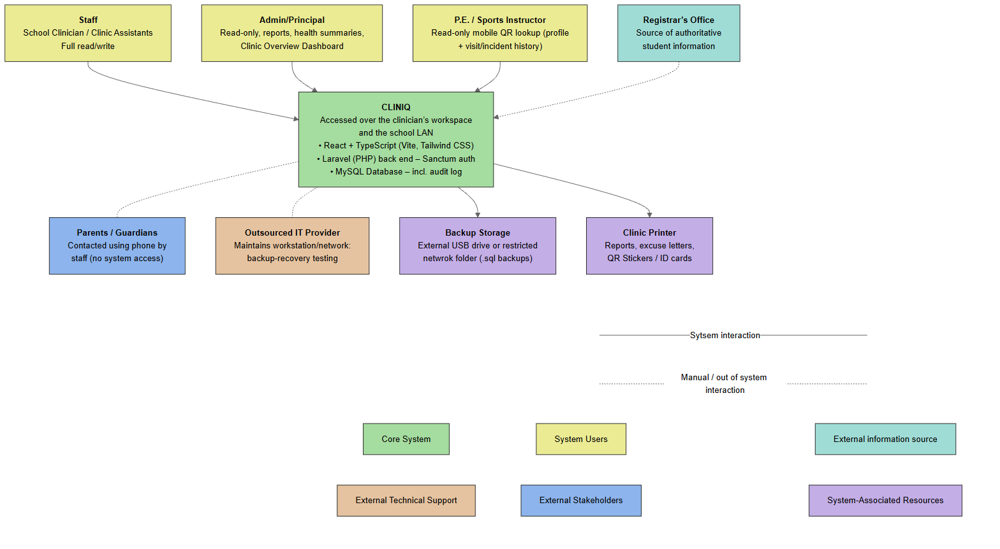
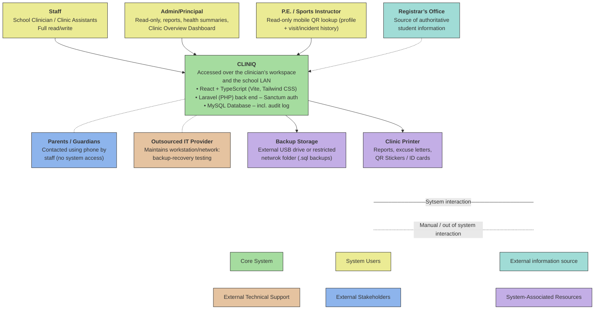
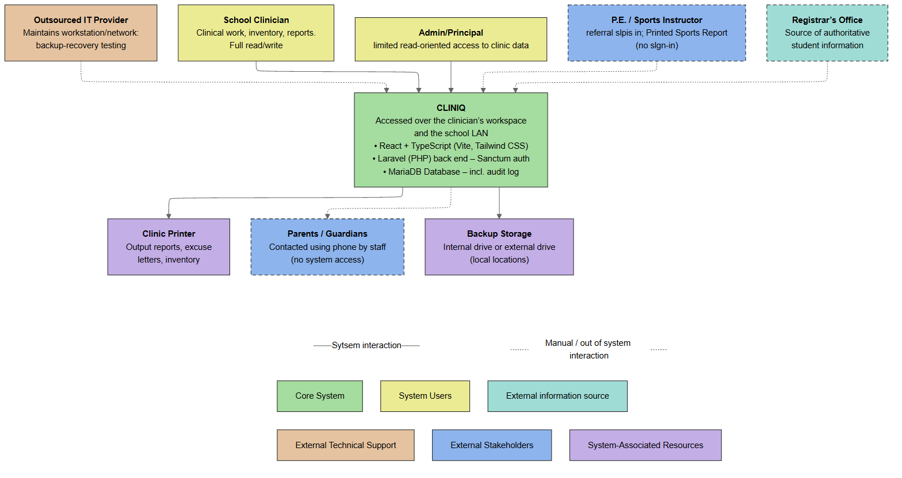
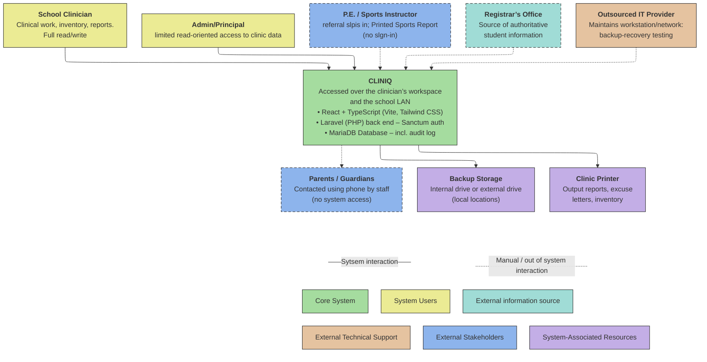

<!-- Built from the section files in SRS/ by docs-documents-build.mjs. Do not edit. -->

<!-- p.1 -->

Republic of the Philippines **CAVITE STATE UNIVERSITY** College of Engineering and Information Technology Don Severino delas Alas Campus, Indang, Cavite

# Software Requirements Specification

for

## (System Name)

**Version 1.0**

Prepared for: (Client Address)

Prepared by: (Group Name) (Name) – Project Manager (Name) – System Analyst (Name) – Tester/Developer

DATE:MM/DD/YYYY

<!-- p.2 -->

## Table of Contents

<table>
<tr><td><b>Table of Contents</b></td><td><b>2</b></td></tr>
<tr><td><b>Revision History</b></td><td><b>2</b></td></tr>
<tr><td>1. Introduction</td><td>2</td></tr>
<tr><td>1.1. Document Conventions</td><td>2</td></tr>
<tr><td>1.2. Purpose</td><td>3</td></tr>
<tr><td>1.3. Project Scope</td><td>3</td></tr>
<tr><td>1.4. Product Perspective</td><td>3</td></tr>
<tr><td>1.5. Product Functions</td><td>3</td></tr>
<tr><td>1.6. Design and Implementation Constraints</td><td>3</td></tr>
<tr><td>1.7. User Documentation</td><td>3</td></tr>
<tr><td>1.8. Assumptions and Dependencies</td><td>3</td></tr>
<tr><td><b>2. Data Requirements</b></td><td><b>3</b></td></tr>
<tr><td>2.1. Data Validation Rules</td><td>3</td></tr>
<tr><td>2.2. Data Security and Privacy Requirements</td><td>3</td></tr>
<tr><td>2.3. Data Retention and Backup Requirements</td><td>3</td></tr>
<tr><td><b>3. System Features</b></td><td><b>3</b></td></tr>
<tr><td>3.1. Functional Requirements</td><td>3</td></tr>
<tr><td>3.2. Nonfunctional Requirements</td><td>4</td></tr>
<tr><td><b>4. System Model and Diagrams</b></td><td><b>4</b></td></tr>
<tr><td>4.1. Use Case Diagrams</td><td>4</td></tr>
<tr><td>4.2. Entity Relationship Diagrams</td><td>4</td></tr>
<tr><td>4.3. Activity Diagrams</td><td>4</td></tr>
<tr><td><b>5. Other Requirements</b></td><td><b>4</b></td></tr>
<tr><td>Appendix A: Glossary</td><td>4</td></tr>
<tr><td>Appendix B: To Be Determined List</td><td>4</td></tr>
<tr><td>Appendix C: References</td><td>4</td></tr>
<tr><td>Requirements Validation / Consistency Review</td><td>4</td></tr>
</table>

## Revision History

| Name | Date | Reason For Changes | Version |
| --- | --- | --- | --- |
| | | | |

<!-- p.3 -->

## 1. Introduction

### 1.1. Document Conventions

### 1.2. Purpose

### 1.3. Project Scope

#### 1.3.1. Scope

#### 1.3.2. Limitations

### 1.4. Product Perspective

### 1.5. Product Functions

### 1.6. Design and Implementation Constraints

### 1.7. User Documentation

### 1.8. Assumptions and Dependencies

## 2. Data Requirements

### 2.1. Data Validation Rules

### 2.2. Data Security and Privacy Requirements

### 2.3. Data Retention and Backup Requirements

## 3. System Features

### 3.1. Functional Requirements

#### 3.1.1. System Feature #1

#### 3.1.2. System Feature #2

<!-- p.4 -->

### 3.2. Nonfunctional Requirements

#### 3.2.1. Performance Requirements

#### 3.2.2. Safety Requirements

#### 3.2.3. Security Requirements

#### 3.2.4. Software Quality Attributes

#### 3.2.5. Business Rules

## 4. System Model and Diagrams

### 4.1. Use Case Diagrams

### 4.2. Entity Relationship Diagrams

### 4.3. Activity Diagrams

## 5. Other Requirements

### Appendix A: Glossary

### Appendix B: To Be Determined List

### Appendix C: References

### Requirements Validation / Consistency Review

<!-- p.5 -->

---

# Software Requirements Specification

**for**

## &lt;Project&gt;

**Version 1.0 approved**

**Prepared by &lt;author&gt;**

**&lt;organization&gt;**

**&lt;date created&gt;**

\*\*\*\* **Pls. pattern the title page with Project Plan title page**

*Copyright © 1999 by Karl E. Wiegers. Permission is granted to use, modify, and distribute this document.*

<!-- p.6 -->

## Table of Contents

<table>
<tr><td><b>Table of Contents</b></td><td><b>ii</b></td></tr>
<tr><td><b>Revision History</b></td><td><b>ii</b></td></tr>
<tr><td><b>1. Introduction</b></td><td><b>1</b></td></tr>
<tr><td>1.1 Purpose</td><td>1</td></tr>
<tr><td>1.2 Document Conventions</td><td>1</td></tr>
<tr><td>1.3 Intended Audience and Reading Suggestions</td><td>1</td></tr>
<tr><td>1.4 Product Scope</td><td>1</td></tr>
<tr><td>1.5 References</td><td>1</td></tr>
<tr><td><b>2. Overall Description</b></td><td><b>2</b></td></tr>
<tr><td>2.1 Product Perspective</td><td>2</td></tr>
<tr><td>2.2 Product Functions</td><td>2</td></tr>
<tr><td>2.3 User Classes and Characteristics</td><td>2</td></tr>
<tr><td>2.4 Operating Environment</td><td>2</td></tr>
<tr><td>2.5 Design and Implementation Constraints</td><td>2</td></tr>
<tr><td>2.6 User Documentation</td><td>2</td></tr>
<tr><td>2.7 Assumptions and Dependencies</td><td>3</td></tr>
<tr><td><b>3. External Interface Requirements</b></td><td><b>3</b></td></tr>
<tr><td>3.1 User Interfaces</td><td>3</td></tr>
<tr><td>3.2 Hardware Interfaces</td><td>3</td></tr>
<tr><td>3.3 Software Interfaces</td><td>3</td></tr>
<tr><td>3.4 Communications Interfaces</td><td>3</td></tr>
<tr><td><b>4. System Features</b></td><td><b>4</b></td></tr>
<tr><td>4.1 System Feature 1</td><td>4</td></tr>
<tr><td>4.2 System Feature 2 (and so on)</td><td>4</td></tr>
<tr><td><b>5. Other Nonfunctional Requirements</b></td><td><b>4</b></td></tr>
<tr><td>5.1 Performance Requirements</td><td>4</td></tr>
<tr><td>5.2 Safety Requirements</td><td>5</td></tr>
<tr><td>5.3 Security Requirements</td><td>5</td></tr>
<tr><td>5.4 Software Quality Attributes</td><td>5</td></tr>
<tr><td>5.5 Business Rules</td><td>5</td></tr>
<tr><td><b>6. Other Requirements</b></td><td><b>5</b></td></tr>
<tr><td><b>Appendix A: Glossary</b></td><td><b>5</b></td></tr>
<tr><td><b>Appendix B: Analysis Models</b></td><td><b>5</b></td></tr>
<tr><td><b>Appendix C: To Be Determined List</b></td><td><b>6</b></td></tr>
</table>

## Revision History

| Name | Date | Reason For Changes | Version |
| --- | --- | --- | --- |
| | | | |
| | | | |

<!-- p.7 -->

## 1. Introduction

### 1.1 Purpose

*&lt;Identify the product whose software requirements are specified in this document, including the revision or release number. Describe the scope of the product that is covered by this SRS, particularly if this SRS describes only part of the system or a single subsystem.&gt;*

### 1.2 Document Conventions

*&lt;Describe any standards or typographical conventions that were followed when writing this SRS, such as fonts or highlighting that have special significance. For example, state whether priorities for higher-level requirements are assumed to be inherited by detailed requirements, or whether every requirement statement is to have its own priority.&gt;*

### 1.3 Intended Audience and Reading Suggestions

*&lt;Describe the different types of reader that the document is intended for, such as developers, project managers, marketing staff, users, testers, and documentation writers. Describe what the rest of this SRS contains and how it is organized. Suggest a sequence for reading the document, beginning with the overview sections and proceeding through the sections that are most pertinent to each reader type.&gt;*

### 1.4 Product Scope

*&lt;Provide a short description of the software being specified and its purpose, including relevant benefits, objectives, and goals. Relate the software to corporate goals or business strategies. If a separate vision and scope document is available, refer to it rather than duplicating its contents here.&gt;*

### 1.5 References

*&lt;List any other documents or Web addresses to which this SRS refers. These may include user interface style guides, contracts, standards, system requirements specifications, use case documents, or a vision and scope document. Provide enough information so that the reader could access a copy of each reference, including title, author, version number, date, and source or location.&gt;*

<!-- p.8 -->

## 2. Overall Description

### 2.1 Product Perspective

*&lt;Describe the context and origin of the product being specified in this SRS. For example, state whether this product is a follow-on member of a product family, a replacement for certain existing systems, or a new, self-contained product. If the SRS defines a component of a larger system, relate the requirements of the larger system to the functionality of this software and identify interfaces between the two. A simple diagram that shows the major components of the overall system, subsystem interconnections, and external interfaces can be helpful.&gt;*

### 2.2 Product Functions

*&lt;Summarize the major functions the product must perform or must let the user perform. Details will be provided in Section 3, so only a high level summary (such as a bullet list) is needed here. Organize the functions to make them understandable to any reader of the SRS. A picture of the major groups of related requirements and how they relate, such as a top level data flow diagram or object class diagram, is often effective.&gt;*

### 2.3 User Classes and Characteristics

*&lt;Identify the various user classes that you anticipate will use this product. User classes may be differentiated based on frequency of use, subset of product functions used, technical expertise, security or privilege levels, educational level, or experience. Describe the pertinent characteristics of each user class. Certain requirements may pertain only to certain user classes. Distinguish the most important user classes for this product from those who are less important to satisfy.&gt;*

### 2.4 Operating Environment

*&lt;Describe the environment in which the software will operate, including the hardware platform, operating system and versions, and any other software components or applications with which it must peacefully coexist.&gt;*

### 2.5 Design and Implementation Constraints

*&lt;Describe any items or issues that will limit the options available to the developers. These might include: corporate or regulatory policies; hardware limitations (timing requirements, memory requirements); interfaces to other applications; specific technologies, tools, and databases to be used; parallel operations; language requirements; communications protocols; security considerations; design conventions or programming standards (for example, if the customer’s organization will be responsible for maintaining the delivered software).&gt;*

### 2.6 User Documentation

*&lt;List the user documentation components (such as user manuals, on-line help, and tutorials) that will be delivered along with the software. Identify any known user documentation delivery formats or standards.&gt;*

<!-- p.9 -->

### 2.7 Assumptions and Dependencies

*&lt;List any assumed factors (as opposed to known facts) that could affect the requirements stated in the SRS. These could include third-party or commercial components that you plan to use, issues around the development or operating environment, or constraints. The project could be affected if these assumptions are incorrect, are not shared, or change. Also identify any dependencies the project has on external factors, such as software components that you intend to reuse from another project, unless they are already documented elsewhere (for example, in the vision and scope document or the project plan).&gt;*

## 3. External Interface Requirements

### 3.1 User Interfaces

*&lt;Describe the logical characteristics of each interface between the software product and the users. This may include sample screen images, any GUI standards or product family style guides that are to be followed, screen layout constraints, standard buttons and functions (e.g., help) that will appear on every screen, keyboard shortcuts, error message display standards, and so on. Define the software components for which a user interface is needed. Details of the user interface design should be documented in a separate user interface specification.&gt;*

### 3.2 Hardware Interfaces

*&lt;Describe the logical and physical characteristics of each interface between the software product and the hardware components of the system. This may include the supported device types, the nature of the data and control interactions between the software and the hardware, and communication protocols to be used.&gt;*

### 3.3 Software Interfaces

*&lt;Describe the connections between this product and other specific software components (name and version), including databases, operating systems, tools, libraries, and integrated commercial components. Identify the data items or messages coming into the system and going out and describe the purpose of each. Describe the services needed and the nature of communications. Refer to documents that describe detailed application programming interface protocols. Identify data that will be shared across software components. If the data sharing mechanism must be implemented in a specific way (for example, use of a global data area in a multitasking operating system), specify this as an implementation constraint.&gt;*

### 3.4 Communications Interfaces

*&lt;Describe the requirements associated with any communications functions required by this product, including e-mail, web browser, network server communications protocols, electronic forms, and so on. Define any pertinent message formatting. Identify any communication standards that will be used, such as FTP or HTTP. Specify any communication security or encryption issues, data transfer rates, and synchronization mechanisms.&gt;*

<!-- p.10 -->

## 4. System Features

*&lt;This template illustrates organizing the functional requirements for the product by system features, the major services provided by the product. You may prefer to organize this section by use case, mode of operation, user class, object class, functional hierarchy, or combinations of these, whatever makes the most logical sense for your product.&gt;*

### 4.1 System Feature 1

*&lt;Don’t really say “System Feature 1.” State the feature name in just a few words.&gt;*

#### 4.1.1 Description and Priority

*&lt;Provide a short description of the feature and indicate whether it is of High, Medium, or Low priority. You could also include specific priority component ratings, such as benefit, penalty, cost, and risk (each rated on a relative scale from a low of 1 to a high of 9).&gt;*

#### 4.1.2 Stimulus/Response Sequences

*&lt;List the sequences of user actions and system responses that stimulate the behavior defined for this feature. These will correspond to the dialog elements associated with use cases.&gt;*

#### 4.1.3 Functional Requirements

*&lt;Itemize the detailed functional requirements associated with this feature. These are the software capabilities that must be present in order for the user to carry out the services provided by the feature, or to execute the use case. Include how the product should respond to anticipated error conditions or invalid inputs. Requirements should be concise, complete, unambiguous, verifiable, and necessary. Use “TBD” as a placeholder to indicate when necessary information is not yet available.&gt;*

*&lt;Each requirement should be uniquely identified with a sequence number or a meaningful tag of some kind.&gt;*

REQ-1: REQ-2:

### 4.2 System Feature 2 (and so on)

## 5. Other Nonfunctional Requirements

### 5.1 Performance Requirements

*&lt;If there are performance requirements for the product under various circumstances, state them here and explain their rationale, to help the developers understand the intent and make suitable design choices. Specify the timing relationships for real time systems. Make such requirements as specific as possible. You may need to state performance requirements for individual functional requirements or features.&gt;*

<!-- p.11 -->

### 5.2 Safety Requirements

*&lt;Specify those requirements that are concerned with possible loss, damage, or harm that could result from the use of the product. Define any safeguards or actions that must be taken, as well as actions that must be prevented. Refer to any external policies or regulations that state safety issues that affect the product’s design or use. Define any safety certifications that must be satisfied.&gt;*

### 5.3 Security Requirements

*&lt;Specify any requirements regarding security or privacy issues surrounding use of the product or protection of the data used or created by the product. Define any user identity authentication requirements. Refer to any external policies or regulations containing security issues that affect the product. Define any security or privacy certifications that must be satisfied.&gt;*

### 5.4 Software Quality Attributes

*&lt;Specify any additional quality characteristics for the product that will be important to either the customers or the developers. Some to consider are: adaptability, availability, correctness, flexibility, interoperability, maintainability, portability, reliability, reusability, robustness, testability, and usability. Write these to be specific, quantitative, and verifiable when possible. At the least, clarify the relative preferences for various attributes, such as ease of use over ease of learning.&gt;*

### 5.5 Business Rules

*&lt;List any operating principles about the product, such as which individuals or roles can perform which functions under specific circumstances. These are not functional requirements in themselves, but they may imply certain functional requirements to enforce the rules.&gt;*

## 6. Other Requirements

*&lt;Define any other requirements not covered elsewhere in the SRS. This might include database requirements, internationalization requirements, legal requirements, reuse objectives for the project, and so on. Add any new sections that are pertinent to the project.&gt;*

## Appendix A: Glossary

*&lt;Define all the terms necessary to properly interpret the SRS, including acronyms and abbreviations. You may wish to build a separate glossary that spans multiple projects or the entire organization, and just include terms specific to a single project in each SRS.&gt;*

## Appendix B: Analysis Models

*&lt;Optionally, include any pertinent analysis models, such as data flow diagrams, class diagrams, state-transition diagrams, or entity-relationship diagrams.&gt;*

<!-- p.12 -->

## Appendix C: To Be Determined List

*&lt;Collect a numbered list of the TBD (to be determined) references that remain in the SRS so they can be tracked to closure.&gt;*

\*\*\* REQUIRED PROCESS MODELS/DIAGRAMS \*\*\*

- Use Case Diagram
- Entity Relationship Diagram (ERD)
- Activity and Process Diagram/Model

<!-- p.13 -->

1. Introduction [All]
    - 1.1. Document Conventions
    - 1.2. Purpose
    - 1.3. Project Scope
    - 1.4. Product Perspective
    - 1.5. Product Functions
    - 1.6. Design and Implementation Constraints
    - 1.7. User Documentation
    - 1.8. Assumptions and Dependencies
2. Data Requirements[SA]
    - 2.1. Data Validation Rules
    - 2.2. Data Security and Privacy Requirements
    - 2.3. Data Retention and Backup Requirements
3. System Features [SA]
    - 3.1. Functional Requirements
    - 3.2. Nonfunctional Requirements
4. System Model and Diagrams [SA & QA]
    - 4.1. Use Case Diagrams
    - 4.2. Entity Relationship Diagrams
    - 4.3. Activity Diagrams
5. Other Requirements [SA & PM]
    - Appendix A: Glossary
    - Appendix B: To Be Determined List
    - Appendix C: References
    - Requirements Validation / Consistency Review

<!-- p.14 -->

 

Republic of the Philippines **CAVITE STATE UNIVERSITY** College of Engineering and Information Technology Don Severino delas Alas Campus, Indang, Cavite

# Software Requirements Specification

for

## CLINIQ: Intelligent Clinic Tracking and Monitoring System

**Version 1.0**

Prepared for: Mendez Christian Academy

Prepared by: HealWare Tinapay, Ghenly B.  – Project Manager Lugami, Christian John C. – System Analyst Balboa, Zean Kurt G. – Tester/Developer

DATE: 09/21/2026

<!-- p.15 -->

## Table of Contents

<table>
<tr><td><b>Table of Contents</b></td><td><b>2</b></td></tr>
<tr><td><b>Revision History</b></td><td><b>2</b></td></tr>
<tr><td><b>1. Introduction</b></td><td><b>2</b></td></tr>
<tr><td>1.1. Document Conventions</td><td>2</td></tr>
<tr><td>1.2. Purpose</td><td>3</td></tr>
<tr><td>1.3. Project Scope</td><td>3</td></tr>
<tr><td>1.4. Product Perspective</td><td>3</td></tr>
<tr><td>1.5. Product Functions</td><td>3</td></tr>
<tr><td>1.6. Design and Implementation Constraints</td><td>3</td></tr>
<tr><td>1.7. User Documentation</td><td>3</td></tr>
<tr><td>1.8. Assumptions and Dependencies</td><td>3</td></tr>
<tr><td><b>2. Data Requirements</b></td><td><b>3</b></td></tr>
<tr><td>2.1. Data Validation Rules</td><td>3</td></tr>
<tr><td>2.2. Data Security and Privacy Requirements</td><td>3</td></tr>
<tr><td>2.3. Data Retention and Backup Requirements</td><td>3</td></tr>
<tr><td><b>3. System Features</b></td><td><b>3</b></td></tr>
<tr><td>3.1. Functional Requirements</td><td>3</td></tr>
<tr><td>3.2. Nonfunctional Requirements</td><td>4</td></tr>
<tr><td><b>4. System Model and Diagrams</b></td><td><b>4</b></td></tr>
<tr><td>4.1. Use Case Diagrams</td><td>4</td></tr>
<tr><td>4.2. Entity Relationship Diagrams</td><td>4</td></tr>
<tr><td>4.3. Activity Diagrams</td><td>4</td></tr>
<tr><td><b>5. Other Requirements</b></td><td><b>4</b></td></tr>
<tr><td>Appendix A: Glossary</td><td>4</td></tr>
<tr><td>Appendix B: To Be Determined List</td><td>4</td></tr>
<tr><td>Appendix C: References</td><td>4</td></tr>
<tr><td>Requirements Validation / Consistency Review</td><td>4</td></tr>
</table>

## Revision History

| Name | Date | Reason For Changes | Version |
| --- | --- | --- | --- |
| | | | |

<!-- p.16 -->

## 6. Introduction

### 6.1. Document Conventions

*&lt;Describe any standards or typographical conventions that were followed when writing this SRS, such as fonts or highlighting that have special significance. For example, state whether priorities for higher-level requirements are assumed to be inherited by detailed requirements, or whether every requirement statement is to have its own priority.&gt;*

### 6.2. Purpose

*&lt;Identify the product whose software requirements are specified in this document, including the revision or release number. Describe the scope of the product that is covered by this SRS, particularly if this SRS describes only part of the system or a single subsystem.&gt;*

### 6.3. Project Scope

*&lt;Provide a short description of the software being specified and its purpose, including relevant benefits, objectives, and goals. Relate the software to corporate goals or business strategies. If a separate vision and scope document is available, refer to it rather than duplicating its contents here.&gt;*

#### 6.3.1. Scope

#### 6.3.2. Limitations

### 6.4. Product Perspective

*&lt;Describe the context and origin of the product being specified in this SRS. For example, state whether this product is a follow-on member of a product family, a replacement for certain existing systems, or a new, self-contained product. If the SRS defines a component of a larger system, relate the requirements of the larger system to the functionality of this software and identify interfaces between the two. A simple diagram that shows the major components of the overall system, subsystem interconnections, and external interfaces can be helpful.&gt;*

### 6.5. Product Functions

*&lt;Summarize the major functions the product must perform or must let the user perform. Details will be provided in Section 3, so only a high level summary (such as a bullet list) is needed here. Organize the functions to make them understandable to any reader of the SRS. A picture of the major <!-- p.17 --> groups of related requirements and how they relate, such as a top level data flow diagram or object class diagram, is often effective.&gt;*

### 6.6. Design and Implementation Constraints

*&lt;Describe any items or issues that will limit the options available to the developers. These might include: corporate or regulatory policies; hardware limitations (timing requirements, memory requirements); interfaces to other applications; specific technologies, tools, and databases to be used; parallel operations; language requirements; communications protocols; security considerations; design conventions or programming standards (for example, if the customer’s organization will be responsible for maintaining the delivered software).&gt;*

### 6.7. User Documentation

*&lt;List the user documentation components (such as user manuals, on-line help, and tutorials) that will be delivered along with the software. Identify any known user documentation delivery formats or standards.&gt;*

### 6.8. Assumptions and Dependencies

*&lt;List any assumed factors (as opposed to known facts) that could affect the requirements stated in the SRS. These could include third-party or commercial components that you plan to use, issues around the development or operating environment, or constraints. The project could be affected if these assumptions are incorrect, are not shared, or change. Also identify any dependencies the project has on external factors, such as software components that you intend to reuse from another project, unless they are already documented elsewhere (for example, in the vision and scope document or the project plan).&gt;*

## 7. Data Requirements

### 7.1. Data Validation Rules

### 7.2. Data Security and Privacy Requirements

### 7.3. Data Retention and Backup Requirements

<!-- p.18 -->

## 8. System Features

*&lt;This template illustrates organizing the functional requirements for the product by system features, the major services provided by the product. You may prefer to organize this section by use case, mode of operation, user class, object class, functional hierarchy, or combinations of these, whatever makes the most logical sense for your product.&gt;*

### 8.1. Functional Requirements

*&lt;Itemize the detailed functional requirements associated with this feature. These are the software capabilities that must be present in order for the user to carry out the services provided by the feature, or to execute the use case. Include how the product should respond to anticipated error conditions or invalid inputs. Requirements should be concise, complete, unambiguous, verifiable, and necessary. Use “TBD” as a placeholder to indicate when necessary information is not yet available.&gt;*

*&lt;Each requirement should be uniquely identified with a sequence number or a meaningful tag of some kind.&gt;*

#### 8.1.1. System Feature #1

#### 8.1.2. System Feature #2

### 8.2. Nonfunctional Requirements

#### 8.2.1. Performance Requirements

*&lt;If there are performance requirements for the product under various circumstances, state them here and explain their rationale, to help the developers understand the intent and make suitable design choices. Specify the timing relationships for real time systems. Make such requirements as specific as possible. You may need to state performance requirements for individual functional requirements or features.&gt;*

#### 8.2.2. Safety Requirements

*&lt;Specify those requirements that are concerned with possible loss, damage, or harm that could result from the use of the product. Define any safeguards or actions that must be taken, as well as actions that must be prevented. Refer to any external policies or regulations that state safety issues that affect the product’s design or use. Define any safety certifications that must be satisfied.&gt;*

<!-- p.19 -->

#### 8.2.3. Security Requirements

*&lt;Specify any requirements regarding security or privacy issues surrounding use of the product or protection of the data used or created by the product. Define any user identity authentication requirements. Refer to any external policies or regulations containing security issues that affect the product. Define any security or privacy certifications that must be satisfied.&gt;*

#### 8.2.4. Software Quality Attributes

*&lt;Specify any additional quality characteristics for the product that will be important to either the customers or the developers. Some to consider are: adaptability, availability, correctness, flexibility, interoperability, maintainability, portability, reliability, reusability, robustness, testability, and usability. Write these to be specific, quantitative, and verifiable when possible. At the least, clarify the relative preferences for various attributes, such as ease of use over ease of learning.&gt;*

#### 8.2.5. Business Rules

*&lt;List any operating principles about the product, such as which individuals or roles can perform which functions under specific circumstances. These are not functional requirements in themselves, but they may imply certain functional requirements to enforce the rules.&gt;*

## 9. System Model and Diagrams

### 9.1. Use Case Diagrams

### 9.2. Entity Relationship Diagrams

### 9.3. Activity Diagrams

## 10. Other Requirements

*&lt;Define any other requirements not covered elsewhere in the SRS. This might include database requirements, internationalization requirements, legal requirements, reuse objectives for the project, and so on. Add any new sections that are pertinent to the project.&gt;*

<!-- p.20 -->

### Appendix A: Glossary

*&lt;Define all the terms necessary to properly interpret the SRS, including acronyms and abbreviations. You may wish to build a separate glossary that spans multiple projects or the entire organization, and just include terms specific to a single project in each SRS.&gt;*

### Appendix B: To Be Determined List

*&lt;Collect a numbered list of the TBD (to be determined) references that remain in the SRS so they can be tracked to closure.&gt;*

### Appendix C: References

*&lt;List any other documents or Web addresses to which this SRS refers. These may include user interface style guides, contracts, standards, system requirements specifications, use case documents, or a vision and scope document. Provide enough information so that the reader could access a copy of each reference, including title, author, version number, date, and source or location.&gt;*

### Requirements Validation / Consistency Review

<!-- p.21 -->

 

Republic of the Philippines **CAVITE STATE UNIVERSITY** College of Engineering and Information Technology Don Severino delas Alas Campus, Indang, Cavite

# Software Requirements Specification

for

## CLINIQ: Intelligent Clinic Tracking and Monitoring System

**Version 1.0**

Prepared for: Mendez Christian Academy

Prepared by: HealWare Tinapay, Ghenly B.  – Project Manager Lugami, Christian John C. – System Analyst Balboa, Zean Kurt G. – Tester/Developer

DATE: 09/21/2026

<!-- p.22 -->

## Table of Contents

<table>
<tr><td><b>Table of Contents</b></td><td><b>2</b></td></tr>
<tr><td><b>Revision History</b></td><td><b>2</b></td></tr>
<tr><td>1. Introduction</td><td>2</td></tr>
<tr><td>1.1. Document Conventions</td><td>2</td></tr>
<tr><td>1.2. Purpose</td><td>3</td></tr>
<tr><td>1.3. Project Scope</td><td>3</td></tr>
<tr><td>1.4. Product Perspective</td><td>3</td></tr>
<tr><td>1.5. Product Functions</td><td>3</td></tr>
<tr><td>1.6. Design and Implementation Constraints</td><td>3</td></tr>
<tr><td>1.7. User Documentation</td><td>3</td></tr>
<tr><td>1.8. Assumptions and Dependencies</td><td>3</td></tr>
<tr><td><b>2. Data Requirements</b></td><td><b>3</b></td></tr>
<tr><td>2.1. Data Validation Rules</td><td>3</td></tr>
<tr><td>2.2. Data Security and Privacy Requirements</td><td>3</td></tr>
<tr><td>2.3. Data Retention and Backup Requirements</td><td>3</td></tr>
<tr><td><b>3. System Features</b></td><td><b>3</b></td></tr>
<tr><td>3.1. Functional Requirements</td><td>3</td></tr>
<tr><td>3.2. Nonfunctional Requirements</td><td>4</td></tr>
<tr><td><b>4. System Model and Diagrams</b></td><td><b>4</b></td></tr>
<tr><td>4.1. Use Case Diagrams</td><td>4</td></tr>
<tr><td>4.2. Entity Relationship Diagrams</td><td>4</td></tr>
<tr><td>4.3. Activity Diagrams</td><td>4</td></tr>
<tr><td><b>5. Other Requirements</b></td><td><b>4</b></td></tr>
<tr><td>Appendix A: Glossary</td><td>4</td></tr>
<tr><td>Appendix B: To Be Determined List</td><td>4</td></tr>
<tr><td>Appendix C: References</td><td>4</td></tr>
<tr><td>Requirements Validation / Consistency Review</td><td>4</td></tr>
</table>

## Revision History

| Name | Date | Reason For Changes | Version |
| --- | --- | --- | --- |
| | | | |

<!-- p.23 -->

## 11. Introduction

### 11.1. Document Conventions

### 11.2. Purpose

### 11.3. Project Scope

#### 11.3.1. Scope

#### 11.3.2. Limitations

### 11.4. Product Perspective

### 11.5. Product Functions

### 11.6. Design and Implementation Constraints

### 11.7. User Documentation

### 11.8. Assumptions and Dependencies

## 12. Data Requirements

### 12.1. Data Validation Rules

### 12.2. Data Security and Privacy Requirements

### 12.3. Data Retention and Backup Requirements

<!-- p.24 -->

## 13. System Features

### 13.1. Functional Requirements

#### 13.1.1. System Feature #1

#### 13.1.2. System Feature #2

### 13.2. Nonfunctional Requirements

#### 13.2.1. Performance Requirements

#### 13.2.2. Safety Requirements

#### 13.2.3. Security Requirements

#### 13.2.4. Software Quality Attributes

#### 13.2.5. Business Rules

## 14. System Model and Diagrams

### 14.1. Use Case Diagrams

### 14.2. Entity Relationship Diagrams

### 14.3. Activity Diagrams

## 15. Other Requirements

### Appendix A: Glossary

### Appendix B: To Be Determined List

### Appendix C: References

<!-- p.25 -->

### Requirements Validation / Consistency Review

<!-- p.26 -->

 

Republic of the Philippines **CAVITE STATE UNIVERSITY** College of Engineering and Information Technology Don Severino delas Alas Campus, Indang, Cavite

# Software Requirements Specification

for

## CLINIQ: Intelligent Clinic Tracking and Monitoring System

**Version 1.0**

Prepared for: Mendez Christian Academy

Prepared by: HealWare Tinapay, Ghenly B.  – Project Manager Lugami, Christian John C. – System Analyst Balboa, Zean Kurt G. – Tester/Developer

DATE: 09/21/2026

<!-- p.27 -->

## Table of Contents

<table>
<tr><td><b>Table of Contents</b></td><td><b>2</b></td></tr>
<tr><td><b>Revision History</b></td><td><b>2</b></td></tr>
<tr><td><b>1. Introduction</b></td><td><b>2</b></td></tr>
<tr><td>1.1. Document Conventions</td><td>2</td></tr>
<tr><td>1.2. Purpose</td><td>3</td></tr>
<tr><td>1.3. Project Scope</td><td>3</td></tr>
<tr><td>1.4. Product Perspective</td><td>3</td></tr>
<tr><td>1.5. Product Functions</td><td>3</td></tr>
<tr><td>1.6. Design and Implementation Constraints</td><td>3</td></tr>
<tr><td>1.7. User Documentation</td><td>3</td></tr>
<tr><td>1.8. Assumptions and Dependencies</td><td>3</td></tr>
<tr><td><b>2. Data Requirements</b></td><td><b>3</b></td></tr>
<tr><td>2.1. Data Validation Rules</td><td>3</td></tr>
<tr><td>2.2. Data Security and Privacy Requirements</td><td>3</td></tr>
<tr><td>2.3. Data Retention and Backup Requirements</td><td>3</td></tr>
<tr><td><b>3. System Features</b></td><td><b>3</b></td></tr>
<tr><td>3.1. Functional Requirements</td><td>3</td></tr>
<tr><td>3.2. Nonfunctional Requirements</td><td>4</td></tr>
<tr><td><b>4. System Model and Diagrams</b></td><td><b>4</b></td></tr>
<tr><td>4.1. Use Case Diagrams</td><td>4</td></tr>
<tr><td>4.2. Entity Relationship Diagrams</td><td>4</td></tr>
<tr><td>4.3. Activity Diagrams</td><td>4</td></tr>
<tr><td><b>5. Other Requirements</b></td><td><b>4</b></td></tr>
<tr><td>Appendix A: Glossary</td><td>4</td></tr>
<tr><td>Appendix B: To Be Determined List</td><td>4</td></tr>
<tr><td>Appendix C: References</td><td>4</td></tr>
<tr><td>Requirements Validation / Consistency Review</td><td>4</td></tr>
</table>

## Revision History

| Name | Date | Reason For Changes | Version |
| --- | --- | --- | --- |
| HealWare | 09/28/26 | Initial draft that includes Section 1 (Introduction) and Section 2 (Data Requirements). | 1.0 (Draft) |

<!-- p.28 -->

## 16. Introduction

### 16.1. Document Conventions

This Software Requirements Specification (SRS) defines the requirements and overall characteristics of **CLINIQ: Intelligent Clinic Tracking and Monitoring System**, a proposed system for the School Clinic/Health Services Department of Mendez Christian Academy.

The following conventions are used throughout this document:

<table>
<tr><th>Term</th><th>Description</th></tr>
<tr><td>CLINIQ</td><td>The proposed Intelligent Clinic Tracking and Monitoring System for Mendez Christian Academy.</td></tr>
<tr><td>SRS</td><td>Refers to this Software Requirements Specification.</td></tr>
<tr><td>Staff</td><td>Authorized clinic staff who use CLINIQ to record, update, and manage clinic information.</td></tr>
<tr><td>Admin/Principal</td><td>The school administration users who have read-only access to reports and health summaries.</td></tr>
<tr><td>The Registrar's Office</td><td>The school office that provides student information used by the clinic.</td></tr>
<tr><td>PE Instructor/Coach</td><td>Personnel who submit student injury referrals to the clinic.</td></tr>
<tr><td>Student Number</td><td>The system-generated student identifier in YYYY-NNNNN format.</td></tr>
<tr><td>TBD</td><td>“To Be Determined” identifies information that has not been established.</td></tr>
</table>

Requirements in this SRS are categorized and numbered as follows. Numbering is sequential within each category, starting at 001, and is kept consistent across revisions; a requirement is not renumbered once assigned and numbering. Unless a detailed requirement states its own priority, it inherits the priority of the module or feature it belongs to.

<table>
<tr><th>Requirement Number</th><th>Description</th></tr>
<tr><td>FR-XXX</td><td>Functional Requirements</td></tr>
<tr><td>NFR-XXX</td><td>Non-Functional Requirements</td></tr>
<tr><td>DR-XXX</td><td>Data Requirements</td></tr>
<tr><td>BR-XXX</td><td>Business Rules</td></tr>
</table>

<!-- p.29 -->

### 16.2. Purpose

This document specifies the requirements for CLINIQ: Intelligent Clinic Tracking and Monitoring System, Version 1.0, developed by the HealWare project team for Mendez Christian Academy. CLINIQ is intended to digitalize the daily operations of the school’s Health Services / Clinic Department — reducing manual and paper-based processes and improving the accuracy and availability of student health records.

This SRS covers the complete CLINIQ system as a single, self-contained application; it does not describe a subsystem of a larger platform. It will serve as the foundation for the system’s design, development, and User Acceptance Testing (UAT) phases, and as the shared reference that keeps the development team, the subject professor, and the client (represented by the School Clinician) aligned on what CLINIQ will do.

### 16.3. Project Scope

#### 16.3.1. Scope

The system will provide centralized management of student health and clinic information around the following in scope:

- **User Management** – authentication and role-based access for Staff, Admin/Principal, and PE/Sports Instructor accounts.
- **Student Records**: encoding, medical history, allergies, and contact validation.
- **Clinic Visit Monitoring** – daily logging, complaints, treatment, excuse letters, PE/Sports referrals, and follow-up handling.
- **Emergency Response** – two-stage incident logging (fast capture, then completed detail), hospital referral tracking, and timestamped parent/guardian notification outcome logging.
- **Reports Generation** – monthly reports, incident reports, and health summaries.
- **Proposed enhancements** – QR Digital Health ID, Smart Triage Quick-Reference, and Medicine & Supply Inventory Tracker.
- PE/Sports Instructor read-only QR access to a student’s profile and injury history (brought into scope at the September 19, 2026 team meeting).
- A cross-cutting audit trail of logins, QR scans, form submissions, approvals, and record changes.
- Deployment on the school’s existing single workstation via XAMPP over the employee-tier intranet.
- RA 10173 (Data Privacy Act of 2012)–aligned data handling, audit logging, and daily backups.
- Staff training and a User Acceptance Testing (UAT) phase at the client site.

<!-- p.30 -->

The system will operate on the school’s existing desktop workstation and its internal intranet, with Staff-tier access for clinic personnel and read-only Admin/Principal-tier access for the School Principal and Administration.

#### 16.3.2. Limitations

The current implementation of CLINIQ has the following documented limitations:

- The system is intended to operate within the school's existing workstation and intranet environment.
- Parent/guardian self-service access is outside the current system scope.
- Remote or cloud access beyond the school intranet is outside the current implementation scope.
- Activities that require clinical judgment remain the responsibility of clinic staff.
- The system supports clinic personnel by providing organized and timely information but does not replace their professional responsibilities.
- The current environment has limited device availability, including dependence on a single workstation.
- Future remote access for the principal and school nurse is identified as a possible enhancement and is not part of the current implementation.
- Automated SMS or push-notification gateways; parents continue to be contacted by phone with the clinic staff.
- A fuller, separately managed school-events calendar. The current phase keeps a free-text event tag on visit and incident entries; ownership of a fuller calendar is an open decision.
- RFID, or biometric hardware.
- Billing, insurance, or Medicaid-style billing modules.
- Multi-school or cloud multi-tenant hosting.

**Functional limitations**:

- CLINIQ supports, but does not replace, clinical judgment. Steps that need human judgment — the parent phone call, print, review and signing of incident reports, and confirmation of treatment dispositions remain with clinic staff.
- Frequent-visitor flags and symptom-clustering alerts are warnings only, never a diagnosis or a suggested action.
- The excuse letter is a clinic-issued document distinct from a hospital-issued medical certificate, which CLINIQ does not generate.

<!-- p.31 -->

### 16.4. Product Perspective

CLINIQ is a new, self-contained system. Prior to this project, the School Clinic Department had no dedicated digital system: health records and clinic visits were managed manually through paper logbooks and partial Excel spreadsheets, with no backup system and no standardized data entry. CLINIQ is not a follow-on to, or replacement of, any prior digital clinic system, and it is not currently specified as a component of a larger, already-existing enterprise system.

CLINIQ interacts with Mendez Christian Academy’s stakeholders as follows:

- Staff (School Clinician, clinic assistants) – Primary operators; full read/write access on the clinic workstation and through mobile scan/lookup.
- School Administration / Principal – Read-only consumers of reports, health summaries, and the Clinic Overview Dashboard.
- PE/Sports Instructor – Refers injured students on a physical referral slip (logged by Staff); has read-only mobile QR access to a student’s profile and visit/incident history.
- Registrar’s Office – Source of authoritative student information; consulted to verify unreachable parent contact numbers.
- Parents and Guardians – Have no system access; receive emergency notifications, delivered through a phone call placed by clinic staff using contact information retrieved from the system (not through direct system access).
- Outsourced IT provider – Maintains the workstation and network; configures the automated backup script; performs quarterly recovery testing and major restoration.
- Existing clinic printer – Prints reports, excuse letters, and QR stickers/ID cards.
- Backup storage – External USB drive (locked cabinet) or restricted network folder that receives the .sql backups.

<!-- p.32 -->

*Figure 1. CLINIQ Components Interconnections.*

Diagram source (Mermaid)

<!-- diagram: figure-01-components-interconnections-draft-1.0 -->

The system will run on the school’s existing desktop workstation using XAMPP (Apache and MySQL) as the local server, and will be accessed only over the school’s intranet via the employee-tier Wi-Fi network. It does not interface with any external government, hospital, or health-information system; hospital referrals are recorded and tracked within CLINIQ but are not electronically transmitted to hospital systems.

### 16.5. Product Functions

CLINIQ consists of ten modules and one cross-cutting audit trail. Detailed functional requirements are given in Section 3. The table summarizes the major functions and role access.

1. **User Management**
    - Login/logout
    - 15-minute idle timeout
    - Account lockout
    - User account management
    - Password management
    - Role assignment
2. **Student Records**
    - Student encoding with auto-generated Student Number
    - Medical history
    - Allergy/food-restriction monitoring
    <!-- p.33 -->
    - Emergency contacts
    - Duplicate detection
    - Incomplete-record query
    - Parent-contact validation
    - Archiving
3. **Clinic Visit Monitoring**
    - Daily visit logging
    - Complaints
    - Treatment
    - Nurse-approved excuse letters
    - PE/Sports injury referral logging
    - Follow-up handling
4. **Emergency Response**
    - Two-stage incident recording
    - Hospital referral monitoring
    - Parent/guardian notification logging
    - Follow-up handling
5. **Reports Generation**
    - Monthly reports
    - Incident reports with nurse sign-off
    - Health summaries
    - Print/export
6. **QR Digital Health ID**
    - QR generation
    - Printing
    - Regeneration per student
    - Mobile scan/lookup with manual Student Number fallback
    - Quick-actions:
        - Record Visit
        - Log Emergency
        - View Full Profile
        - Dispense Medicine
7. **Smart Triage Quick-Reference**
    - Complaint-based standardized first-aid checklists during visit entry
    - Completion saved with the visit
    - Content edited by the School Clinician only
8. **Medicine & Supply Inventory Tracker**
    - Item management
    - Dispensing and restocking with usage history
    - Low-stock and expiration flags
    <!-- p.34 -->
9. **Clinic Overview Dashboard**
    - Clinic counts
    - Pending records
    - Common complaints
    - Symptom-clustering alerts
    - Frequent-visitor flags
    - Due follow-ups
    - Weekly/monthly/yearly calendar view
    - Date-range filter
    - Export/print
10. **Backup Verification Assistant**
    - Backup status
    - Manual status check
    - Guided recovery checklist
    - Nurse verification
    - Backup history

**Audit Trail (cross-cutting)**

- Logs who did what and when:
    - Login/logouts
    - Every QR scan
    - Form submissions
    - Approvals
    - Record create/update/delete/archive actions

### 16.6. Design and Implementation Constraints

**Technical Constraints**

- The system runs on the school’s existing desktop workstation, selected because it matches hardware/software already in use, as confirmed by the ICT Head.
- The system is accessible only over the school’s intranet, through the employee-tier Wi-Fi network secured with WPA2 encryption, and not exposed to the public internet.
- Minimum recommended hardware for the proposed stack is Intel Core i3 (or equivalent), 4GB RAM, and 100GB storage; the exact specifications of the existing clinic workstation were not recalled by the ICT Head at the time of the interview.
- Minimum network bandwidth is 20 Mbps; the school currently uses PLDT Fiber with two lines in a star topology (LAN/Wi-Fi) with separate access tiers for students, guests, and employees.
- Only one clinic workstation and one printer are currently available; no barcode reader, RFID, or biometric device is required or planned.

<!-- p.35 -->

**Technology Stack**

- Frontend: React, TypeScript, and Tailwind CSS.
- Backend: Laravel (PHP framework), handling system logic, routing, validation, authentication, and server-side processes.
- Database: MySQL, storing student records, clinic visits, user accounts, and reports.
- Authentication: Laravel Authentication, managing login, passwords, and role-based access.
- Testing: Playwright, for automated browser testing of key workflows.
- Collaboration tooling: Trello or ClickUp, for task organization and progress tracking.

**Regulatory Constraints**

- The system SHALL align with Republic Act No. 10173 (Data Privacy Act of 2012) in its handling of student health information (see Section 2.2).

**Business/Project Constraints**

- The development team is small — a Project Manager, a System Analyst, and a Tester/Developer — which the Project Plan gives as a reason for using a combined Iterative and Prototyping development approach, building and refining one working version at a time rather than running multiple parallel workstreams.
- The project follows the phased Gantt-chart timeline in the Project Plan, running from team formation (February 2026) through project turnover (targeted November 2026).
- Each development iteration is checked with the subject professor and revised with client feedback before the next round of fixes, culminating in formal User Acceptance Testing (UAT) and turnover.
- Total implementation cost should not exceed approximately PHP 10,000; an itemized breakdown has not yet been completed in the Project Plan's Budget Allocation section

**User Constraints**

- The system’s primary end user is a single School Clinician who also handles day-to-day clinic duties with limited time to spare for using or learning a new system, so the interface must minimize the workload added by digitalization rather than compound it.
- Clinic staff and the School Clinician are non-technical and will require hands-on training before full deployment; there is no dedicated IT staff. The solution must be inexpensive to acquire and run and simple enough to operate without ongoing dependence on paid support.

<!-- p.36 -->

### 16.7. User Documentation

The following documentation and training components are committed as deliverables. It will be produced and delivered alongside the system at project turnover.

- **User manual** — provides instructions for operating the deployed CLINIQ functions within the user's authorized role.
- **Training materials** — Materials used to conduct the staff training session.
- **Hands-on staff training** — Session(s) for the School Clinician and designated clinic staff before full deployment, led by the Developer/Tester. Topics include: login and password management; Student Records encoding, duplicate detection, and incomplete-record resolution; daily visit logging and excuse letters; emergency workflow; PE/Sports referral processing; backup verification and basic troubleshooting.
- **UAT at client site** — The School Clinician tests all modules under real clinic conditions; feedback is addressed before production use.
- **In-system guided recovery checklist** — A checklist inside the Backup Verification Assistant (a system feature, listed here for completeness).

### 16.8. Assumptions and Dependencies

**Assumptions**

- The client (Ms. Jenne Baas / Mendez Christian Academy) will continue to provide timely access, validation, and feedback during requirements confirmation, prototype review, and UAT.
- The clinic will continue to have access to at least the one existing workstation and the one existing printer used for health reports, excuse letters, and medical certificates.
- The school’s PLDT Fiber network connection and employee-tier Wi-Fi access will remain available at or above the stated minimum bandwidth of 20 Mbps.
- Student information supplied by the Registrar’s Office is assumed to be accurate and available when needed for encoding into Student Records.
- The project will continue to follow the combined Iterative and Prototyping approach described in the Project Plan, with successive rounds of client feedback and professor consultation before final turnover.
- Applicable data-privacy obligations under RA 10173 will remain in effect for the duration of the project and the system’s operation.

**Dependencies**

- The school’s outsourced IT provider is dependent on major system restoration, hardware replacement, quarterly recovery-testing, security patching, and configuration of the automated backup script.
<!-- p.37 -->
- The school’s ICT Head and outsourced IT provider are dependent on the network infrastructure (routers/switches) that CLINIQ’s intranet access relies on.
- Client sign-off from the School Clinician is depended on at the end of each development iteration, per the Iterative/Prototyping approach.
- Completion of earlier phases in the Project Plan’s Gantt chart (e.g., the System Development phase, targeted Oct 2–17, 2026) is a prerequisite for the System Consultation and User Acceptance Testing (UAT) phases that follow it.

## 17. Data Requirements

This section specifies CLINIQ's data-level requirements: the rules used to validate data as it is entered, the controls that protect data confidentiality and privacy, and the rules governing how long data is kept and how it is backed up.

### 17.1. Data Validation Rules

The following data validation rules are established for CLINIQ, which will be applied at the point of data entry.

<table>
<tr><th>ID</th><th>Requirement</th></tr>
<tr><td>DR-001</td><td>The system shall generate each Student Number automatically in the format YYYY-NNNNN (enrollment year plus a zero-padded 5-digit sequence, e.g., 2026-00001). The number shall not be entered manually, and the sequence shall restart each enrollment year.</td></tr>
<tr><td>DR-002</td><td>The database shall enforce UNIQUE and NOT NULL constraints at the database level.</td></tr>
<tr><td>DR-003</td><td>The system shall require the following fields before a new student record can be saved: full name, grade level, emergency contact, known allergies, and existing medical conditions.</td></tr>
<tr><td>DR-004</td><td>On saving a new student, the system shall check existing records for a full-name and grade-level match. If a potential match exists, the system shall show a warning and require Staff to confirm or cancel before a new entry is created.</td></tr>
<tr><td>DR-005</td><td>The system shall automatically flag any student record that is missing required fields as Incomplete, list it in the incomplete-records review queue, and log which Staff member resolved each flag.</td></tr>
<!-- p.38 -->
<tr><td>DR-006</td><td>The system shall not allow a record flagged Incomplete to be used in clinic visits or notifications until Staff supplements the missing information.</td></tr>
<tr><td>DR-007</td><td>On the first save of a student record, the system shall prompt Staff to verify the parent/guardian contact number before it is used for emergency notification. Staff shall be able to mark a contact number as verified or unverified.</td></tr>
<tr><td>DR-008</td><td>If a contact number proves unreachable during an emergency, the system shall re-flag the record and prompt Staff to verify the number with the class adviser or Registrar’s Office; the verification shall be logged.</td></tr>
<tr><td>DR-009</td><td>The system shall archive or deactivate a student record instead of deleting it. Archived records shall be excluded from default active-student lists, search results, and dropdowns unless Staff explicitly includes them.</td></tr>
<tr><td>DR-010</td><td>The QR code for a student shall encode the Student Number. Regenerating a QR code shall invalidate the previous one.</td></tr>
</table>

**Student recordsClinic visits, emergencies, and follow-ups**

<table>
<tr><th>ID</th><th>Requirement</th></tr>
<tr><td>DR-011</td><td>The system shall enforce mandatory fields on clinic-visit and incident records and shall not save a record until its required fields are complete, except for the Stage 1 emergency capture in the next requirement.</td></tr>
<tr><td>DR-012</td><td>For an emergency incident, Stage 1 shall require only the essential fields (complaint and immediate vitals) and shall save immediately. The record shall remain marked as an incomplete Stage 1 record until Staff completes Stage 2, and incident lists shall show each incident’s stage.</td></tr>
<tr><td>DR-013</td><td>A visit or PE/Sports referral disposition shall be one of: returned to class, sent home, or referred to hospital.</td></tr>
<tr><td>DR-014</td><td>A hospital referral shall record destination, mode of transport, and departure time.</td></tr>
<tr><td>DR-015</td><td>Each parent/guardian notification attempt shall be timestamped, tied to its incident record, and recorded with an outcome of exactly one of: Reached, Not Reached, Voicemail, or Left Message.</td></tr>
<tr><td>DR-016</td><td>A follow-up shall record the student, the related visit or incident, the follow-up date, the reason or monitoring <!-- p.39 --> instruction, and notes. Its status shall follow the lifecycle Pending → Completed, Missed, or Cancelled.</td></tr>
<tr><td>DR-017</td><td>An excuse letter shall be generated from a visit record and routed for nurse check and approval. Only after approval shall it be stored as a permanent, printable document in the student’s record. It shall be kept distinct from a hospital-issued medical certificate.</td></tr>
<tr><td>DR-018</td><td>An incident report shall be routed for nurse review and sign-off.</td></tr>
<tr><td>DR-019</td><td>A visit or incident entry may carry a free-text event tag (e.g., “MCA Dance Program”).</td></tr>
</table>

**Inventory**

<table>
<tr><th>ID</th><th>Requirement</th></tr>
<tr><td>DR-020</td><td>Each inventory item shall carry a current stock count, a low-stock threshold, and a single expiration date, tracked per item and not per batch.</td></tr>
<tr><td>DR-021</td><td>Dispensing shall decrease stock by the entered quantity and log the item, quantity, linked visit or incident (if any), staff member, and timestamp. If dispensing would take stock below zero, the system shall warn but shall not block the save.</td></tr>
<tr><td>DR-022</td><td>Restocking shall be a separate, manually initiated action that records the quantity received and the date, increases stock, clears a low-stock flag when the new total is back above the threshold, and requires Staff to confirm or update the item’s expiration date.</td></tr>
<tr><td>DR-023</td><td>After any stock decrease, the system shall automatically compare the new level with the item’s low-stock threshold and flag the item when it is crossed. The expiration check shall run independently, and both flags shall be shown as distinct badges.</td></tr>
</table>

**User accounts**

<table>
<tr><th>ID</th><th>Requirement</th></tr>
<tr><td>DR-024</td><td>Each user account shall have a unique username and exactly one role: Staff, Admin/Principal, or PE/Sports Instructor.</td></tr>
<!-- p.40 -->
<tr><td>DR-025</td><td>Passwords shall be at least 8 characters, shall be changed on first login, and shall not repeat any of the user’s last 5 passwords.</td></tr>
</table>

**Placeholders and proposals**

<table>
<tr><th>ID</th><th>Requirement</th></tr>
<tr><td>(TBD)</td><td>(Information needed: field-level formats — maximum lengths, allowed characters, contact-number format, grade-level values, date/time formats)</td></tr>
<tr><td>(TBD)</td><td>(Information needed: mandatory-field lists for visit and incident records, the vital signs captured, and the Stage 1 / Stage 2 field split beyond complaint and immediate vitals)</td></tr>
<tr><td>(TBD)</td><td>(Information needed: how “no known allergies” or “no existing medical conditions” is entered, since both fields are mandatory)</td></tr>
<tr><td>(TBD)</td><td>(Information needed: low-stock comparison rule and the “nearing expiration” window)</td></tr>
<tr><td>Proposed</td><td>Proposed: The Student Number shall be unique across all student records, including archived ones. (General data-integrity practice; not stated in the sources.)</td></tr>
<tr><td>Proposed</td><td>Proposed: Once the contact-number format is defined (TBD-08), the system shall reject contact numbers that do not match it.</td></tr>
</table>

### 17.2. Data Security and Privacy Requirements

CLINIQ handles student health information and these requirements protect it in line with RA 10173 (Data Privacy Act of 2012). The sources do not include a legal review; this SRS is not legal advice.

**Authentication, sessions, and role-based access**

<table>
<tr><th>ID</th><th>Requirement</th></tr>
<tr><td>DR-026</td><td>Every user shall authenticate with a unique username and password. The system shall not allow anonymous access.</td></tr>
<tr><td>DR-027</td><td>The system shall store passwords only in hashed form, never in plaintext.</td></tr>
<tr><td>DR-028</td><td>The system shall log a user out automatically after 15 minutes of inactivity.</td></tr>
<tr><td>DR-029</td><td>The system shall lock an account for 30 minutes after 5 consecutive failed login attempts.</td></tr>
<!-- p.41 -->
<tr><td>DR-030</td><td>The system shall enforce the role-based access levels in Table 4: Staff have full read/write access to all clinic modules; Admin/Principal have read-only access to reports, health summaries, and the Clinic Overview Dashboard, with no direct access to Student Records; PE/Sports Instructors have read-only access to a student’s full profile and visit/incident history and no operational actions.</td></tr>
<tr><td>DR-031</td><td>Only Staff shall create, edit, deactivate, and assign roles to user accounts.</td></tr>
<tr><td>DR-032</td><td>Only the School Clinician shall add or edit the standardized first-aid checklist content.</td></tr>
<tr><td>DR-033</td><td>Parents and guardians shall have no access to the system. Canteen Staff shall have no access in this phase.</td></tr>
<tr><td>(TBD)</td><td>(Information needed: session-cookie settings and hashing details under Laravel Sanctum — the PTD describes HTTP-only session cookies for the earlier plain-PHP design)</td></tr>
</table>

**Privacy and data exposure**

<table>
<tr><th>ID</th><th>Requirement</th></tr>
<tr><td>DR-034</td><td>The system shall operate on the school intranet only, over the employee-tier Wi-Fi/LAN secured with WPA2, and shall not expose student health records to the public internet.</td></tr>
<tr><td>DR-035</td><td>Visit Log, Incident Log, and the Dashboard’s frequent-visitor section shall display the Student Number by default instead of the full name.</td></tr>
<tr><td>DR-036</td><td>Screens for a single deliberate lookup — the QR scan result, the full profile, search results, and the masterlist — may show the full name. The masterlist shall not show medical or confidential fields (allergies, conditions, visit reasons) inline; these require opening the individual profile.</td></tr>
<tr><td>DR-037</td><td>Student health data shall be used only within the clinic context, and data shall be collected and used only for clinic operations.</td></tr>
<tr><td>DR-038</td><td>Parent/guardian notification records shall be retained as acknowledgment of data use for emergency purposes.</td></tr>
<tr><td>(TBD)</td><td>(Information needed: whether the database, backup files, and LAN traffic are encrypted, e.g., HTTPS on the intranet)</td></tr>
<tr><td>(TBD)</td><td>(Information needed: procedure for requests to access, correct, or delete personal data under RA 10173)</td></tr>
</table>

<!-- p.42 -->

**Audit trail**

<table>
<tr><th>ID</th><th>Requirement</th></tr>
<tr><td>DR-039</td><td>The system shall log, with the acting user and a timestamp: every login and logout; every QR scan (by Staff or PE/Sports Instructor) and which student was viewed; every form submission; every approval (excuse letter and incident report sign-off); and every create, update, delete, and archive action on a record.</td></tr>
<tr><td>DR-040</td><td>Every student profile opened by a PE/Sports Instructor shall be attributable to that instructor’s account and timestamped.</td></tr>
<tr><td>(TBD)</td><td>(Information needed: audit-log retention period and protection against alteration)</td></tr>
</table>

### 17.3. Data Retention and Backup Requirements

**Data retention**

<table>
<tr><th>ID</th><th>Requirement</th></tr>
<tr><td>DR-041</td><td>Archived student records shall be kept in the system for historical and audit continuity and shall not be deleted by the archive action.</td></tr>
<tr><td>DR-042</td><td>Daily backups shall be kept for a rolling 30 days; older backups shall be rotated out automatically by the backup script.</td></tr>
<tr><td>DR-043</td><td>Printed monthly health reports shall be retained as a supplementary physical backup of critical summary data.</td></tr>
<tr><td>(TBD)</td><td>(Information needed: retention periods for archived student, visit, incident, and inventory records — see conflict C-03)</td></tr>
</table>

**Backup and verification**

<table>
<tr><th>ID</th><th>Requirement</th></tr>
<tr><td>DR-044</td><td>The system shall run an automated database backup once daily, at the end of each school day, exporting the MySQL database as a .sql file using mysqldump.</td></tr>
<tr><td>DR-045</td><td>If the scheduled script does not run, the School Clinician shall be able to start the export manually (through phpMyAdmin per the PTD).</td></tr>
<!-- p.43 -->
<tr><td>DR-046</td><td>Each backup file shall be saved to an external USB drive kept in a locked cabinet in the clinic office, or to a designated network folder restricted to clinic and IT-provider access.</td></tr>
<tr><td>DR-047</td><td>The Backup Verification Assistant shall show the last backup date, file size, and status; let Staff (the School Clinician) trigger a manual backup-status check; let the nurse mark a backup as verified; and show the backup history/log. The backup status shall be visible to the nurse.</td></tr>
<tr><td>DR-048</td><td>The School Clinician shall verify that the backup file is accessible and intact before ending the workday, and a backup log shall record each backup’s date, file size, and verification status.</td></tr>
<tr><td>DR-049</td><td>The system shall provide a guided recovery checklist.</td></tr>
<tr><td>DR-050</td><td>Recovery shall follow this procedure: contact the outsourced IT provider; reinstall XAMPP on the replacement workstation; retrieve the most recent .sql backup; and restore it through phpMyAdmin import or the MySQL command line. Restoration is estimated at about 30 minutes once the IT provider begins, excluding response and travel time.</td></tr>
<tr><td>DR-051</td><td>The outsourced IT provider shall test backup integrity and restoration readiness quarterly.</td></tr>
<tr><td>DR-052</td><td>Responsibility shall be split as follows. The School Clinician monitors daily backups, checks that the scheduled script ran, and keeps the backup log. The outsourced IT provider handles major restoration, hardware replacement, quarterly recovery testing, and configuration of the automated backup script.</td></tr>
<tr><td>(TBD)</td><td>(Information needed: an additional backup layer beyond the local workstation and the external USB/network-folder copy — under evaluation; the current mysqldump design does not change)</td></tr>
<tr><td>(TBD)</td><td>(Information needed: Recovery Time Objective and Recovery Point Objective)</td></tr>
<tr><td>(TBD)</td><td>(Information needed: whether a UPS is procured; power loss was identified as the main operational risk but a UPS is not costed into the current scope)</td></tr>
</table>

<!-- p.44 -->

## 18. System Features

### 18.1. Functional Requirements

#### 18.1.1. System Feature #1

#### 18.1.2. System Feature #2

### 18.2. Nonfunctional Requirements

#### 18.2.1. Performance Requirements

#### 18.2.2. Safety Requirements

#### 18.2.3. Security Requirements

#### 18.2.4. Software Quality Attributes

#### 18.2.5. Business Rules

## 19. System Model and Diagrams

### 19.1. Use Case Diagrams

### 19.2. Entity Relationship Diagrams

### 19.3. Activity Diagrams

## 20. Other Requirements

### Appendix A: Glossary

### Appendix B: To Be Determined List

### Appendix C: References

### Requirements Validation / Consistency Review

<!-- p.45 -->

 

Republic of the Philippines **CAVITE STATE UNIVERSITY** College of Engineering and Information Technology Don Severino delas Alas Campus, Indang, Cavite

# Software Requirements Specification

for

## CLINIQ: Intelligent Clinic Tracking and Monitoring System

**Version 1.0**

Prepared for: Mendez Christian Academy

Prepared by: HealWare Tinapay, Ghenly B.  – Project Manager Lugami, Christian John C. – System Analyst Balboa, Zean Kurt G. – Tester/Developer

DATE: 09/21/2026

<!-- p.46 -->

## Table of Contents

<table>
<tr><td><b>Table of Contents</b></td><td><b>2</b></td></tr>
<tr><td><b>Revision History</b></td><td><b>2</b></td></tr>
<tr><td><b>1. Introduction</b></td><td><b>2</b></td></tr>
<tr><td>1.1. Document Conventions</td><td>2</td></tr>
<tr><td>1.2. Purpose</td><td>3</td></tr>
<tr><td>1.3. Project Scope</td><td>3</td></tr>
<tr><td>1.4. Product Perspective</td><td>3</td></tr>
<tr><td>1.5. Product Functions</td><td>3</td></tr>
<tr><td>1.6. Design and Implementation Constraints</td><td>3</td></tr>
<tr><td>1.7. User Documentation</td><td>3</td></tr>
<tr><td>1.8. Assumptions and Dependencies</td><td>3</td></tr>
<tr><td><b>2. Data Requirements</b></td><td><b>3</b></td></tr>
<tr><td>2.1. Data Validation Rules</td><td>3</td></tr>
<tr><td>2.2. Data Security and Privacy Requirements</td><td>3</td></tr>
<tr><td>2.3. Data Retention and Backup Requirements</td><td>3</td></tr>
<tr><td><b>3. System Features</b></td><td><b>3</b></td></tr>
<tr><td>3.1. Functional Requirements</td><td>3</td></tr>
<tr><td>3.2. Nonfunctional Requirements</td><td>4</td></tr>
<tr><td><b>4. System Model and Diagrams</b></td><td><b>4</b></td></tr>
<tr><td>4.1. Use Case Diagrams</td><td>4</td></tr>
<tr><td>4.2. Entity Relationship Diagrams</td><td>4</td></tr>
<tr><td>4.3. Activity Diagrams</td><td>4</td></tr>
<tr><td><b>5. Other Requirements</b></td><td><b>4</b></td></tr>
<tr><td>Appendix A: Glossary</td><td>4</td></tr>
<tr><td>Appendix B: To Be Determined List</td><td>4</td></tr>
<tr><td>Appendix C: References</td><td>4</td></tr>
<tr><td>Requirements Validation / Consistency Review</td><td>4</td></tr>
</table>

## Revision History

| Name | Date | Reason For Changes | Version |
| --- | --- | --- | --- |
| HealWare | 09/28/26 | Initial draft that includes Section 1 (Introduction) and Section 2 (Data Requirements). | 1.0 (Draft) |
| HealWare | 11/07/26 | Sections 1 and 2 updated to the current system scope and technology; Section 3 (System Features) and section 4  added. | 1.1 (Draft) |

<!-- p.47 -->

## 21. Introduction

### 21.1. Document Conventions

This Software Requirements Specification (SRS) defines the requirements and overall characteristics of **CLINIQ: Intelligent Clinic Tracking and Monitoring System**, a proposed system for the School Clinic/Health Services Department of Mendez Christian Academy.

The following conventions are used throughout this document:

<table>
<tr><th>Term</th><th>Description</th></tr>
<tr><td>CLINIQ</td><td>The proposed Intelligent Clinic Tracking and Monitoring System for Mendez Christian Academy.</td></tr>
<tr><td>SRS</td><td>Refers to this Software Requirements Specification.</td></tr>
<tr><td>School Clinician</td><td>Authorized clinic user who records, updates, and manages clinic information in CLINIQ and performs the clinical work. The School Head Nurse is the main School Clinician; other designated staff who cover the clinic each have their own School Clinician account.</td></tr>
<tr><td>Admin/Principal</td><td>The school administration user who manages user accounts and has limited, read-oriented access to clinic data.</td></tr>
<tr><td>Student Patient</td><td>A student who receives care at the clinic, identified by Learner Reference Number (LRN).</td></tr>
<tr><td>Staff Patient</td><td>A teacher or school employee who receives care at the clinic, identified by Staff No. A staff patient is not a user account.</td></tr>
<tr><td>LRN</td><td>Learner Reference Number: the 12-digit identifier the school uses for each student.</td></tr>
<tr><td>Staff No.</td><td>The system-generated identifier of a staff patient, in the pattern STF-0001.</td></tr>
<tr><td>The Registrar's Office</td><td>The school office that provides student information used by the clinic.</td></tr>
<tr><td>PE Instructor/Coach</td><td>Personnel who submit student injury referrals to the clinic and receive the Sports Reports the School Clinician prepares. They do not sign in to CLINIQ.</td></tr>
<tr><td>TBD</td><td>“To Be Determined” identifies information that has not been established.</td></tr>
</table>

Requirements in this SRS are categorized and numbered as follows. Numbering is sequential within each category, starting at 001, and is kept consistent across revisions; a requirement is not renumbered once assigned, and the number of a withdrawn requirement is not reused.Unless a detailed <!-- p.48 --> requirement states its own priority, it inherits the priority of the module or feature it belongs to.

<table>
<tr><th>Requirement Number</th><th>Description</th></tr>
<tr><td>FR-XXX</td><td>Functional Requirements</td></tr>
<tr><td>NFR-XXX</td><td>Non-Functional Requirements</td></tr>
<tr><td>DR-XXX</td><td>Data Requirements</td></tr>
<tr><td>BR-XXX</td><td>Business Rules</td></tr>
</table>

### 21.2. Purpose

This document specifies the requirements for CLINIQ: Intelligent Clinic Tracking and Monitoring System, Version 1.1, developed by the HealWare project team for Mendez Christian Academy. CLINIQ is intended to digitalize the daily operations of the school’s Health Services / Clinic Department — reducing manual and paper-based processes and improving the accuracy and availability of student and staff health records.

This SRS covers the complete CLINIQ system as a single, self-contained application; it does not describe a subsystem of a larger platform. It will serve as the foundation for the system’s design, development, and User Acceptance Testing (UAT) phases, and as the shared reference that keeps the development team, the subject professor, and the client (represented by the School Clinician) aligned on what CLINIQ will do.

### 21.3. Project Scope

#### 21.3.1. Scope

The system will provide centralized management of student health and clinic information around the following in scope:

- **User Management** – authentication, role-based access for School Clinician and Admin/Principal accounts, and offline account recovery.
- **Student Records** – encoding, lookup by LRN or name, medical history, allergies, contact validation, and the annual registrar-list import.
- **Staff Patient Records** – records for teachers and school employees receiving care, with their own import and incomplete-record review.
- **Clinic Visit Monitoring** – daily logging, symptoms, treatment, excuse letters, PE/Sports referrals, and follow-up handling.
- **Emergency Response** – two-stage incident logging (fast capture, then completed detail), hospital referral tracking, <!-- p.49 --> timestamped parent/guardian call logging, and a printed incident report for the Principal’s signature.
- **Reports Generation** – four monthly report views, the Monthly Report as a PDF for the Principal, and clinician-prepared Sports Reports.
- First-Aid Checklist Quick-Reference, Medicine & Supply Inventory Tracker, and Backup Verification Assistant.
- **Clinic Overview Dashboard** and a separate **Activity Calendar** with school events and Philippine holidays.
- **Archive and School Year** – a read-only year-indexed Archive and manual school-year management.
- A cross-cutting **audit trail** of sign-ins, record opens, form submissions, approvals, with a read-only Audit Log Viewer, and a cross-cutting issue reporting window on every screen.
- Deployment on the school’s existing single workstation via XAMPP over the school’s internal network.
- RA 10173 (Data Privacy Act of 2012) – aligned data handling, audit logging, and local backups.
- Staff training and a User Acceptance Testing (UAT) phase at the client site.

The system will operate on the school’s existing desktop workstation and its internal network, with School Clinician access for clinic personnel and limited, read-oriented Admin/Principal access for the School Principal and Administration. Core work is available without public internet.

#### 21.3.2. Limitations

The current implementation of CLINIQ has the following documented limitations:

- The system is intended to operate on the clinic workstation only. It has no LAN access, no hostname, and no HTTPS, and it is not used from other computers.
- Parent/guardian self-service access is outside the current system scope.
- Remote or cloud access, including remote or cloud hosting, is outside the current implementation scope.
- Activities that require clinical judgment remain the responsibility of clinic staff.
- The system supports clinic personnel by providing organized and timely information but does not replace their professional responsibilities.
- The current environment has limited device availability, including dependence on a single workstation. When the workstation is unavailable during an emergency, the event is captured on paper and encoded later.
<!-- p.50 -->
- Future remote access for the principal and school nurse is identified as a possible enhancement and is not part of the current implementation.
- Automated SMS or push-notification gateways are not provided; parents continue to be contacted by phone by clinic staff.
- There is no patient QR code or integration with the school’s ID system, and no instructor sign-in or dedicated mobile interface.
- Cloud or off-site backup is not provided; backups are written to local drives only.
- RFID, barcode, or biometric hardware is not used.
- Billing, insurance, or Medicaid-style billing modules, immunization tracking, clinic passes, and queues are not provided.
- Multi-school or cloud multi-tenant hosting is not supported.
- Reports are printed on A4 or saved as PDF through the browser; Excel export is not provided.

**Functional limitations:**

- CLINIQ supports, but does not replace, clinical judgment. Steps that need human judgment — the parent phone call, contact verification with the Registrar’s Office, printing and handwritten signing of incident reports, and confirmation of treatment dispositions remain with clinic staff.
- Frequent-visitor flags and symptom-clustering alerts are warnings only, never a diagnosis or a suggested action.
- Allergy wording and vital-sign warnings are informational, and the system makes no automated dosing or safety decisions.
- The excuse letter is a clinic-issued document distinct from a hospital-issued medical certificate, which CLINIQ does not generate.
- Pain ratings, incident severity levels, and a head-injury watch list are not part of the system.

### 21.4. Product Perspective

CLINIQ is a new, self-contained system. Prior to this project, the School Clinic Department had no dedicated digital system: health records and clinic visits were managed manually through paper logbooks and partial Excel spreadsheets, with no backup system and no standardized data entry. CLINIQ is not a follow-on to, or replacement of, any prior digital clinic system, and it is not currently specified as a component of a larger, already-existing enterprise system.

CLINIQ interacts with Mendez Christian Academy’s stakeholders as follows:

<!-- p.51 -->

- School Clinician – Primary operator; performs clinical work, inventory, reports, backups, and printing on the clinic workstation. Other designated staff who cover the clinic when the School Clinician is away each have their own account.
- School Administration / Principal – Manages user accounts and has limited, read-oriented access to clinic data, reports, and the Clinic Overview Dashboard. Signs the printed incident report by hand.
- PE/Sports Instructor – Refers injured students on a physical referral slip (logged by the School Clinician); receives Sports Reports the School Clinician prepares. Has no system access.
- Registrar’s Office – Source of authoritative student information, including the yearly student list; consulted to verify unreachable parent contact numbers.
- Parents and Guardians – Have no system access; receive emergency notifications through a phone call placed by clinic staff using contact information retrieved from the system.
- Outsourced IT provider – Maintains the workstation and network and supports the clinic with backup recovery.
- Existing clinic printer – Prints reports, excuse letters, and incident reports on A4.
- Backup storage – Local backup locations (an internal drive and an external drive) that receive the backup files.

<!-- p.52 -->

*Figure 1. CLINIQ Components Interconnections.*

Diagram source (Mermaid)

<!-- diagram: figure-01-components-interconnections -->

The system will run on the school’s existing desktop workstation using XAMPP (Apache and MariaDB) as the local server. The compiled web application and the Laravel API are served from one origin on the clinic workstation, and the system is used at the clinic workstation only, at http://localhost. It is not reachable from the school network. It does not interface with any external government, hospital, or health-information system; hospital referrals are recorded and tracked within CLINIQ but are not electronically transmitted to hospital systems. The only use of the internet is an optional monthly refresh of the holiday list.

### 21.5. Product Functions

CLINIQ consists of ten modules and one cross-cutting audit trail. Detailed functional requirements are given in Section 3. The list below summarizes the major functions of each module.

1. **User Management**
    - Sign-in/sign-out
    - Fixed-length sessions and Admin idle cutoff
    - Account lockout
    - User account management (Admin)
    - Password management
    <!-- p.53 -->
    - Authenticator-based account recovery and an offline administrator reset
    - Role assignment
2. **Student Records**
    - Student encoding with LRN
    - Medical history
    - Allergy and condition recording
    - Ordered emergency contacts
    - Duplicate detection
    - Incomplete-record review queue
    - Parent-contact validation
    - Annual registrar-list import
    - Archiving
3. **Staff Patient Records**
    - Staff encoding with generated Staff No.
    - Allergy, condition, and emergency-contact recording
    - Incomplete-record review queue
    - Staff list import
    - Archiving
4. **Clinic Visit Monitoring**
    - Daily visit logging for student and staff patients
    - Symptoms and treatment
    - Dispositions, including resting in clinic
    - Excuse letters approved by the School Clinician
    - PE/Sports injury referral logging
    - Follow-up handling, including automatic closing of missed follow-ups
    - Entered-in-error handling
5. **Emergency Response**
    - Two-stage incident recording
    - Hospital referral monitoring
    - Parent/guardian and emergency-contact call logging
    - Incident report approval, printing, and Principal signature
    - Follow-up handling
6. **Reports Generation**
    - Four monthly report views: Monthly Report, Incident register, Symptom summary, Inventory sheet
    - Sports Reports for PE/Sports instructors
    - A4 print and Save as PDF (School Clinician)
7. **First-Aid Checklist Quick-Reference**
    <!-- p.54 -->
    - Symptom-based standardized first-aid checklists during visit entry
    - Completion saved with the visit
8. **Medicine & Supply Inventory Tracker**
    - Item management
    - Batch-based restocking with expiry dates
    - Dispensing and stock adjustment with usage history
    - Low-stock, near-expiry, and expired-stock flags
9. **Clinic Overview Dashboard**
    - Overview of urgent attention and routine to-do items
    - Clinic counts and pending records
    - Trends of common symptoms, activity over time, sex and grade
    - Symptom-clustering alerts
    - Frequent-visitor flags
    - Due and upcoming follow-ups
10. **Activity Calendar**
    - Weekly, monthly, yearly, and table views
    - School events managed by both roles
    - Read-only Philippine holidays with a monthly refresh that needs internet
11. **Archive and School Year**
    - Read-only year-indexed Archive
    - School-year date settings
    - Manual end and start of a school year
12. **Backup Verification Assistant**
    - Daily, sign-out, and manual backups to local locations
    - Backup status and history
    - Location management
    - Backup verification by the nurse
    - Guided recovery checklist

**Audit Trail (cross-cutting)**

- Logs who did what and when:
- Sign-in, sign-out, and lockouts
- Opening of student and staff profiles and incident reports
- Form submissions and record changes
- Approvals, archiving, stock movements, calendar changes, backup actions, and authorized prints
- Read-only Audit Log Viewer

<!-- p.55 -->

### 21.6. Design and Implementation Constraints

**Technical Constraints**

- The system runs on the school’s existing desktop workstation, selected because it matches hardware/software already in use, as confirmed by the ICT Head.
- The system is used at the clinic workstation only, at http://localhost. It is not reachable from the school network, has no HTTPS, and is not exposed to the public internet. Core work is available without public internet; the only use of the internet is the optional holiday-list refresh.
- Minimum recommended hardware for the proposed stack is Intel Core i3 (or equivalent), 4GB RAM, and 100GB storage; the exact specifications of the existing clinic workstation were not recalled by the ICT Head at the time of the interview.
- Only one clinic workstation and one printer are currently available; no barcode reader, RFID, or biometric device is required or planned.
- The clinic room is shared and unlocked; other staff use the workstation when the School Clinician is away (see Sections 2.2 and 3.2.3).

**Technology Stack**

- **Frontend:** React, TypeScript, Vite, Tailwind CSS, React Router, and Chart.js.
- **Backend:** Laravel (PHP framework) REST API, handling system logic, routing, validation, authentication, and server-side processes.
- **Database:** MariaDB via XAMPP, storing patient records, clinic visits, user accounts, inventory, and reports.
- **Authentication:** Laravel Sanctum in SPA cookie mode, managing sign-in, sessions, and role-based access.
- **Testing:** Vitest and React Testing Library for the frontend, Pest, Pint, and Larastan for the backend.
- **Collaboration tooling:** Trello, for task organization and progress tracking.

**Regulatory Constraints**

- The system SHALL align with Republic Act No. 10173 (Data Privacy Act of 2012) in its handling of student health information (see Section 2.2).

**Business/Project Constraints**

- The development team is small — a Project Manager, a System Analyst, and a Tester/Developer — which the Project Plan gives as a reason for using a combined Iterative and Prototyping development <!-- p.56 --> approach, building and refining one working version at a time rather than running multiple parallel workstreams.
- The project follows the phased Gantt-chart timeline in the Project Plan, running from team formation (February 2026): frontend development from October 2 to November 13, 2026, and backend development from November 14 to 20, 2026. The dates for UAT and turnover are TBD.
- Each development iteration is checked with the subject professor and revised with client feedback before the next round of fixes, culminating in formal User Acceptance Testing (UAT) and turnover.
- Total implementation cost should not exceed approximately PHP 10,000; the itemized budget in the Project Plan’s Budget Allocation (Tables 11 to 14) totals PHP 4,015.

**User Constraints**

- The system’s primary end user is the School Clinician, who also handles day-to-day clinic duties with limited time to spare for using or learning a new system, so the interface must minimize the workload added by digitalization rather than compound it. Other designated staff cover the clinic when the School Clinician is away, each with their own account.
- Clinic staff and the School Clinician are non-technical and will require hands-on training before full deployment; there is no dedicated IT staff. The solution must be inexpensive to acquire and run and simple enough to operate without ongoing dependence on paid support.

### 21.7. User Documentation

The following documentation and training components are committed as deliverables. It will be produced and delivered alongside the system at project turnover.

- **User manual** — provides instructions for operating the deployed CLINIQ functions within the user's authorized role.
- **Training materials** — materials used to conduct the staff training session.
- **Hands-on staff training** — session(s) for the School Clinician and designated clinic staff before full deployment, led by the Developer/Tester. Topics include: sign-in, password management, and account recovery; student and staff patient record encoding, duplicate detection, and incomplete-record resolution; daily visit logging and excuse letters; emergency workflow; PE/Sports referral processing and Sports Reports; inventory batches and stock adjustment; backup verification and basic troubleshooting.
- **UAT at client site** — the School Clinician tests all modules under real clinic conditions; feedback is addressed before production use.
<!-- p.57 -->
- **In-system guided recovery checklist** — a checklist inside the Backup Verification Assistant (a system feature, listed here for completeness).

### 21.8. Assumptions and Dependencies

**Assumptions**

- The client (Ms. Jenne Baas / Mendez Christian Academy) will continue to provide timely access, validation, and feedback during requirements confirmation, prototype review, and UAT.
- The clinic will continue to have access to at least the one existing workstation and the one existing printer used for health reports, excuse letters, and incident reports.
- Student information supplied by tAhe Registrar’s Office, including the yearly student list, is assumed to be accurate and available when needed for encoding into Student Records. Every student is assumed to have an LRN.
- The project will continue to follow the combined Iterative and Prototyping approach described in the Project Plan, with successive rounds of client feedback and professor consultation before final turnover.
- Applicable data-privacy obligations under RA 10173 will remain in effect for the duration of the project and the system’s operation.
- During an emergency, if the workstation is unavailable, clinic staff capture the event on paper and encode it later.
- Other staff use the clinic workstation when the School Clinician is away, and each covering person signs in with their own account.

**Dependencies**

- The school’s outsourced IT provider is depended on for major system restoration, hardware replacement, security patching, and support of the backup and recovery process.
- Client sign-off from the School Clinician is depended on at the end of each development iteration, per the Iterative/Prototyping approach.
- Completion of the frontend development phase (October 2 to November 13, 2026) and the backend development phase (November 14 to 20, 2026) in the Project Plan’s Gantt chart is a prerequisite for the System Consultation and User Acceptance Testing (UAT) phases that follow them.
- Connection of the frontend to the completed backend is a prerequisite for UAT; until then every screen runs on a sample-data layer.
- An internet connection is depended on only for the monthly holiday-list refresh.

<!-- p.58 -->

## 22. Data Requirements

This section specifies CLINIQ's data-level requirements: the rules used to validate data as it is entered, the controls that protect data confidentiality and privacy, and the rules governing how long data is kept and how it is backed up.

### 22.1. Data Validation Rules

The following data validation rules are established for CLINIQ, which will be applied at the point of data entry.

**Student records**

<table>
<tr><th>ID</th><th>Requirement</th></tr>
<tr><td><b>DR-001</b></td><td>The system shall identify each student by the Learner Reference Number (LRN). The LRN shall be required, entered as exactly 12 digits with leading zeros preserved, and stored as text; formatting separators shall be removed at entry. The system shall not generate a separate student number.</td></tr>
<tr><td><b>DR-002</b></td><td>The database shall enforce UNIQUE and NOT NULL constraints at the database level, including a unique LRN for each student. A duplicate LRN shall be refused.</td></tr>
<tr><td><b>DR-003</b></td><td>The system shall require the following fields before a new student record can be saved: first name, last name, LRN, grade level, and sex as recorded by the school. Middle name, section, birthdate, emergency contacts, known allergies, and existing medical conditions shall be optional.</td></tr>
<tr><td><b>DR-004</b></td><td>On saving a new student, the system shall check existing records for a full-name and grade-level match. If a potential match exists, the system shall show a warning and require the School Clinician to confirm or cancel before a new entry is created.</td></tr>
<tr><td><b>DR-005</b></td><td>The system shall automatically flag a student record that has no emergency contact as Incomplete, list it in the incomplete-records review queue, and log which School Clinician resolved each flag and when. A missing birthdate, section, allergy, or condition shall not make a record incomplete.</td></tr>
<tr><td><b>DR-006</b></td><td>A record flagged Incomplete shall remain usable in clinic visits and incident records. The system shall keep the record in the review queue until the missing information is supplied, and missing information shall not by itself deny routine care.</td></tr>
<tr><td><b>DR-007</b></td><td>The system shall hold a student’s emergency contacts in order, with the first contact as the primary contact. When a contact is saved, the system shall prompt the School Clinician to verify the contact number before it is used for emergency notification, and shall let the School Clinician mark a contact number as verified or unverified.</td></tr>
<!-- p.59 -->
<tr><td><b>DR-008</b></td><td>If a contact number proves unreachable during an emergency, the system shall re-flag the record and prompt the School Clinician to verify the number with the class adviser or Registrar’s Office; the verification shall be logged.</td></tr>
<tr><td><b>DR-009</b></td><td>The system shall archive or deactivate a student record instead of deleting it. Archived records shall be excluded from default active-student lists, search results, and dropdowns unless the School Clinician explicitly includes them. A manual archive shall require a reason, and an archived record shall keep its archive date, reason, and school year.</td></tr>
<tr><td><b>DR-010</b></td><td>An existing LRN shall be locked against change in the normal edit form. An authorized correction process outside the normal edit form is TBD.</td></tr>
<tr><td><b>DR-011</b></td><td>A student’s name shall be stored as a first name (maximum 50 characters), a last name (maximum 50 characters), and an optional middle name (maximum 40 characters); the display name shall be derived from these parts. A correction to a name shall require a reason.</td></tr>
<tr><td><b>DR-012</b></td><td>Birthdate shall be optional and shall not be in the future. The student’s age shall be calculated from the birthdate and not stored. The system shall hold no personal phone number for the student.</td></tr>
<tr><td><b>DR-013</b></td><td>When a birthdate is entered, the system shall show a non-blocking note if the student’s age is far from the usual age for the grade. The distance is a configurable number of years; the starting value is 3.</td></tr>
<tr><td><b>DR-014</b></td><td>Allergy and condition fields shall be free text. An empty field shall display “None recorded”, and the system shall not infer that a student has no allergies or conditions.</td></tr>
<tr><td><b>DR-015</b></td><td>

Student search shall match name words across the name parts, ignoring case and accents and tolerating spacing differences, and shall sort by last, first, and middle name. **$\textcolor{green}{\text{Typed LRN digits shall match the start of the LRN or, for up to four digits, its last four digits.}}$** A search that could contain an LRN shall not place it in a URL.

</td></tr>
</table>

**Staff patient records**

<table>
<tr><th>ID</th><th>Requirement</th></tr>
<tr><td><b>DR-016</b></td><td>The system shall generate each Staff No. automatically in the pattern STF-0001. The Staff No. shall not be entered manually and shall not change after creation.</td></tr>
<tr><td><b>DR-017</b></td><td>The system shall require the following fields before a new staff patient record can be saved: first name, last name, sex, and type. Type shall be one of Teacher, Non-teaching staff, Utility worker, or Other. Department or role, contact number, emergency contacts, allergies, and conditions shall be optional.</td></tr>
<!-- p.60 -->
<tr><td><b>DR-018</b></td><td>The system shall flag an older staff patient record that is missing sex or an emergency contact for review. Completing the record shall resolve the review and log who completed it and when.</td></tr>
<tr><td><b>DR-019</b></td><td>The system shall archive a staff patient record instead of deleting it. A manual archive shall require a reason.</td></tr>
<tr><td><b>DR-020</b></td><td>Each visit, incident, follow-up, and medicine dispensing record shall link to exactly one patient, either a student or a staff patient.</td></tr>
</table>

**Imports and school year**

<table>
<tr><th>ID</th><th>Requirement</th></tr>
<tr><td><b>DR-021</b></td><td>The student list import shall let the School Clinician select a CSV file, map its columns, preview the result, and apply it. Rows shall match by LRN: new students shall be added, returning students updated, and archived matches restored.</td></tr>
<tr><td><b>DR-022</b></td><td>Before a student list import is applied, the system shall show which current students are missing from the new list. Students absent from the list shall be archived with the import reason when the import is applied.</td></tr>
<tr><td><b>DR-023</b></td><td>The yearly student list shall drive each student’s grade level and section. Historical visits and incidents shall keep the grade level and section recorded at the time.</td></tr>
<tr><td><b>DR-024</b></td><td>The staff list import shall let the School Clinician map columns, preview, and apply a CSV file. Rows shall match by Staff No. when supplied, otherwise by normalized name and type. Unknown supplied numbers, ambiguous matches, and repeated rows shall be flagged and skipped, and a matching archived record may be restored.</td></tr>
<tr><td><b>DR-025</b></td><td>In a staff list import, empty cells shall preserve existing data, and a contact from the file shall be added only where the record has no contact. Staff absent from the file shall remain unchanged, and the applied changes shall be audited as counts.</td></tr>
<tr><td><b>DR-026</b></td><td>The system shall record each school year with its start date, end date, and the user who started or ended it. The School Clinician shall be able to edit the expected start and end dates and to end and start a school year manually through separate actions. Ending a school year shall set its last class day, and the next year may be started from a subsequent day.</td></tr>
</table>

**Clinic visits, emergencies, and follow-ups**

<table>
<tr><th>ID</th><th>Requirement</th></tr>
<tr><td><b>DR-027</b></td><td>The system shall enforce mandatory fields on clinic-visit and incident records and shall not save a record until its required fields <!-- p.61 --> are complete, except for the Stage 1 emergency capture in the next requirement. A visit shall require a patient and a main symptom.</td></tr>
<tr><td><b>DR-028</b></td><td>For an emergency incident, Stage 1 shall require only the patient and the main symptom, with vital readings and notes optional, and shall save immediately. The record shall remain marked as an incomplete Stage 1 record until the School Clinician completes Stage 2, and incident lists shall show each incident’s stage. Every Stage 2 field shall be optional, and a completed Stage 2 left empty may still be approved after a no-treatment warning.</td></tr>
<tr><td><b>DR-029</b></td><td>A visit or PE/Sports referral disposition shall be one of: returned to class, resting in clinic, sent home, or referred to hospital. For a staff patient, the first shall read “Returned to work”.</td></tr>
<tr><td><b>DR-030</b></td><td>A hospital referral shall record destination, mode of transport, and departure time.</td></tr>
<tr><td><b>DR-031</b></td><td>Each parent/guardian notification attempt shall be timestamped, tied to its incident record, and recorded with the person called, the number dialed, the relationship, and an outcome of exactly one of: Reached, No answer, Left message or voicemail, or Wrong number. For an incident involving a staff patient, the staff patient’s emergency contact shall be called.</td></tr>
<tr><td><b>DR-032</b></td><td>A follow-up shall record the patient (student or staff), the related visit or incident, the follow-up date, the reason or monitoring instruction, and notes. Its status shall follow the lifecycle Pending → Completed, Missed, or Cancelled. A manual change to Missed or Cancelled shall require a reason. A pending follow-up shall be overdue 3 days after its date, and a scheduled job shall close it automatically as Missed 7 days after its date.</td></tr>
<tr><td><b>DR-033</b></td><td>An excuse letter shall be prepared as a draft from a student visit whose disposition is sent home or referred to hospital, with excused dates and an optional teacher note, and routed for approval by the School Clinician. On approval the system shall store the final wording and recipient as a permanent, printable document in the student’s record. A draft shall carry a draft watermark and shall not be printable. The letter shall be kept distinct from a hospital-issued medical certificate.</td></tr>
<tr><td><b>DR-034</b></td><td>An incident report shall be approved by the School Clinician after Stage 2 is completed. Approval shall record the approver, a reference number, the time, and a snapshot of the approved text. The Principal shall sign the printed report by hand.</td></tr>
<tr><td><b>DR-035</b></td><td>A visit or incident entry may carry a free-text event tag (e.g., “MCA Dance Program”).</td></tr>
<tr><td><b>DR-036</b></td><td>A visit’s date and time shall default to now and may be set to a past time; a future time shall be refused. A visit entered more than <!-- p.62 --> 30 minutes after its visit time shall be marked late, with an optional reason.</td></tr>
<tr><td><b>DR-037</b></td><td>A visit shall record up to three other symptom tags besides the main symptom. It may also record who assisted, a time out, release details for a sent-home or hospital disposition, and an optional event tag. When the relationship of the person receiving the student is Other, the system shall require who it is to be specified.</td></tr>
<tr><td><b>DR-038</b></td><td>Marking a visit Entered in error shall require a reason. The record shall be kept, excluded from ordinary lists and metrics, and locked against editing. Linked stock shall be restored through adjustments, its excuse letter voided, and its pending follow-ups cancelled.</td></tr>
<tr><td><b>DR-039</b></td><td>A visit escalated to an incident shall keep its original medicine record and be shown as Escalated, and the event shall be counted once, as the incident. Medicines recorded on an incident shall be locked when Stage 2 is completed.</td></tr>
<tr><td><b>DR-040</b></td><td>A missed follow-up may be rescheduled into a new pending follow-up that keeps any “Stay home until cleared” instruction. A cancelled follow-up shall not be rescheduled.</td></tr>
<tr><td><b>DR-041</b></td><td>A PE/Sports referral shall record the student, the referring instructor, the activity, an injury summary, the clinical assessment, and the disposition. A PE/Sports referral applies to students only.</td></tr>
</table>

**Inventory**

<table>
<tr><th>ID</th><th>Requirement</th></tr>
<tr><td><b>DR-042</b></td><td>Each inventory item shall carry a name, category, unit, low-stock threshold, and the stock received in batches. Each batch shall carry its quantity, received date, and an expiration date or an explicit no-expiry confirmation. The item’s stock shall be derived from its batches.</td></tr>
<tr><td><b>DR-043</b></td><td>

Dispensing shall decrease stock by the entered quantity, using the usable batch with the earliest expiration date first, and log the item, quantity, batch allocation, linked visit or incident (if any), staff member, and timestamp. An item with only expired stock shall not be dispensable. If the usable batches cannot cover the quantity, the system shall ~~$\textcolor{red}{\text{warn and book the shortfall to the last usable batch}}$~~ **$\textcolor{green}{\text{refuse the dispense and record nothing}}$**.

</td></tr>
<tr><td><b>DR-044</b></td><td>Restocking shall be a separate, manually initiated action that records a positive quantity and adds a new batch with its own received date and expiration date. Editing an item shall not overwrite batch dates or stock.</td></tr>
<!-- p.63 -->
<tr><td><b>DR-045</b></td><td>The system shall show usable, expired, and total stock separately. An item shall be flagged low when its usable stock is at or below its low-stock threshold. The near-expiry and expired checks shall run independently, and the flags shall be shown as distinct badges.</td></tr>
<tr><td><b>DR-046</b></td><td>Adjust Stock shall be used for corrections and disposal. It shall require a selected batch, an add, remove, or counted quantity, and a reason; a note shall be optional. A manual adjustment shall not take a batch below zero, and removing at least 25% of an item on hand, or leaving it at zero, shall be flagged in the audit log.</td></tr>
<tr><td><b>DR-047</b></td><td>An item may carry optional allergy keywords and optional symptom tags (“Commonly used for”). Symptom tags shall prioritize suggestions for a visit’s symptom, while search shall still cover all items and the School Clinician chooses the item.</td></tr>
</table>

**Reference data, settings, and issue reports**

<table>
<tr><th>ID</th><th>Requirement</th></tr>
<tr><td><b>DR-048</b></td><td>Selection lists shall be read from stored reference settings: complaint types, vital-sign ranges, the number of days after which a medical-certificate warning appears, the unusual-age distance, the large write-off percent, grade levels, staff types, and staff departments.</td></tr>
<tr><td><b>DR-049</b></td><td>Starting values (frequent visitor, cluster alert, follow-up windows, near-expiry window, top symptoms, vital-sign ranges, and similar) shall be stored as settings. Only the idle sign-out minutes have a Settings screen; the other values are changed in the database by the developer or the IT provider.</td></tr>
<tr><td><b>DR-050</b></td><td>The holiday list shall be refreshed monthly by a scheduled job that needs internet access. If a refresh fails, the system shall keep the last good list. The system shall warn when the last good refresh is older than 45 days, or when next year’s list is missing in December.</td></tr>
<tr><td><b>DR-051</b></td><td>An issue report shall record its description, the screen it was reported from, and the role of the person who reported it.</td></tr>
</table>

**User accounts**

<table>
<tr><th>ID</th><th>Requirement</th></tr>
<tr><td><b>DR-052</b></td><td>Each user account shall have a unique username and exactly one role: School Clinician or Admin/Principal. Each account shall belong to one person; accounts shall not be shared, and each person who covers the clinic shall have their own account.</td></tr>
<tr><td><b>DR-053</b></td><td>Passwords shall be at least 8 characters, shall be changed on first login and after a temporary password reset, and shall not repeat any of the user’s last 5 passwords.</td></tr>
</table>

<!-- p.64 -->

**Placeholders and proposals**

<table>
<tr><th>ID</th><th>Requirement</th></tr>
<tr><td><b>(TBD)</b></td><td>(Information needed: field-level formats — contact-number format, grade-level and section values, date/time formats)</td></tr>
<tr><td><b>(TBD)</b></td><td>(Information needed: whether the disposition is mandatory when a visit is saved)</td></tr>
<tr><td><b>(TBD)</b></td><td>(Information needed: clinician confirmation of the starting symptom labels, vital-sign ranges, medical tags, and thresholds)</td></tr>
<tr><td><b>(TBD)</b></td><td>(Information needed: wording of the PE/Sports referral)</td></tr>
<tr><td><b>(TBD)</b></td><td>(Information needed: the real registrar file layout, access, and the data agreement)</td></tr>
<tr><td><b>(TBD)</b></td><td>(Information needed: whether the trend-bucket cluster calculation in the dashboard (settings cluster_min_count 8 and cluster_ratio 2) is a requirement or is retired)</td></tr>
<tr><td><b>Proposed</b></td><td>Proposed: Once the contact-number format is defined, the system shall reject contact numbers that do not match it. (General data-integrity practice; not stated in the sources.)</td></tr>
</table>

### 22.2. Data Security and Privacy Requirements

CLINIQ handles student health information and these requirements protect it in line with RA 10173 (Data Privacy Act of 2012). The sources do not include a legal review; this SRS is not legal advice.

**Authentication, sessions, and role-based access**

<table>
<tr><th>ID</th><th>Requirement</th></tr>
<tr><td><b>DR-054</b></td><td>Every user shall authenticate with a unique username and password. The system shall not allow anonymous access.</td></tr>
<tr><td><b>DR-055</b></td><td>The system shall store passwords only in hashed form (bcrypt, 12 rounds), never in plaintext.</td></tr>
<tr><td><b>DR-056</b></td><td>A session shall last seven days from sign-in for both roles. The system shall also sign a user out after a period of inactivity set for each role: 60 minutes for the School Clinician and 30 minutes for the Admin as starting values, each configurable from 10 to 240 minutes. The system shall warn the user two minutes before an idle sign-out. Disabling an account shall end access from its existing sessions.</td></tr>
<!-- p.65 -->
<tr><td><b>DR-057</b></td><td>The School Clinician shall be able to change the idle sign-out minutes of each role on the Settings screen, and the Admin shall be able to read them.</td></tr>
<tr><td><b>DR-058</b></td><td>The system shall lock an account for 5 minutes after 5 consecutive failed sign-in attempts and record the lockout in the audit log.</td></tr>
<tr><td><b>DR-059</b></td><td>The system shall enforce the role-based access levels in Table 1: the School Clinician performs the clinical work; the Admin/Principal manages accounts and has limited, read-oriented access to clinic data; and server-side checks shall enforce both.</td></tr>
<tr><td><b>DR-060</b></td><td>Only the Admin/Principal shall create, edit, disable, and enable user accounts, assign roles, and reset temporary passwords. Disabled accounts shall be kept for history, and the last active Admin shall not be disabled or demoted.</td></tr>
<tr><td><b>DR-061</b></td><td>The system shall present the standardized first-aid checklist prompts by symptom type. Who may add or edit the checklist content is TBD.</td></tr>
<tr><td><b>DR-062</b></td><td>Parents and guardians shall have no access to the system. PE/Sports Instructors shall not sign in; they receive Sports Reports prepared by the School Clinician. Canteen Staff shall have no access in this phase.</td></tr>
<tr><td><b>DR-063</b></td><td>A user shall be able to enroll an authenticator app by a setup QR code or a manual key, confirm a six-digit code, and then save eight one-time recovery codes. Replacing or disabling the authenticator shall require a current code or a recovery code.</td></tr>
<tr><td><b>DR-064</b></td><td>A user who forgot a password shall enter the username, which the system checks first; the check may tell the user that the username is unknown, disabled, or has no authenticator. The user shall then verify an authenticator or recovery code and choose a new password. Recovery failures shall count toward the same lockout rules. Routine sign-in shall remain username and password, and the Admin’s temporary password reset shall remain a fallback for the School Clinician. If an Admin has lost both the password and the authenticator, an offline administrator reset command run on the clinic workstation shall be the last resort.</td></tr>
<tr><td><b>DR-065</b></td><td>The authenticator secret shall be stored encrypted and recovery codes hashed with a slow hash, and a reused authenticator code step shall be rejected. A copy of the application key shall be kept in a password-protected file, with the password kept apart alongside the handover documents.</td></tr>
</table>

**Table 1. Role-based access**

<table>
<tr><th>Area</th><th>School Clinician</th><th>Admin/Principal</th></tr>
<!-- p.66 -->
<tr><td><b>Clinical work</b></td><td>Student and staff records, visits, incidents, follow-ups, triage, inventory, and referrals.</td><td>Reads the Student List and Profile and the student Incident Log and Report. Visit history on a student profile is read-only without visit-detail links. Staff-patient details and routine visit screens are restricted.</td></tr>
<tr><td><b>Reports</b></td><td>Previews and prints permitted A4 documents, including the Monthly Report as a PDF for the Principal. Creates Sports Reports.</td><td>Reads the four Reports views. No Sports Reports, printing, or Save as PDF of clinic documents.</td></tr>
<tr><td><b>Dashboard and calendar</b></td><td>Clinical Overview actions and alerts, Trends, calendar, and school-event management.</td><td>Overview activity summary, Trends, and calendar; can manage school events. Clinical action queues are School Clinician-only. Admin incident totals and the log omit staff incidents.</td></tr>
<tr><td><b>Archive and audit</b></td><td>Reads the Archive including the Staff tab, and the Audit Log, with authorized audit printing.</td><td>Reads the Archive without the Staff tab, and the Audit Log. Staff-record audit entries show the Staff No. and offer no record link.</td></tr>
<tr><td><b>Backup</b></td><td>Status, history, run, verify, and manage locations.</td><td>Status, history, run, verify, and manage locations.</td></tr>
<tr><td><b>Settings</b></td><td>Reads and changes the idle sign-out minutes of each role.</td><td>Reads the idle sign-out minutes.</td></tr>
<tr><td><b>Accounts</b></td><td>Own display name, profile picture, password, and authenticator settings.</td><td>Same own-account functions. Also manages users, roles, disable/enable, and temporary password resets.</td></tr>
</table>

**Privacy and data exposure**

<table>
<tr><th>ID</th><th>Requirement</th></tr>
<tr><td><b>DR-066</b></td><td>The system shall operate on the clinic workstation only, at http://localhost. It shall not be reachable from the school network and shall not be exposed to the public internet. Windows Firewall shall block inbound connections, and Apache and MariaDB shall accept connections from the workstation itself only (127.0.0.1). The only use of the network is the optional internet call that refreshes the holiday list.</td></tr>
<tr><td><b>DR-067</b></td><td>Rolling multi-patient screens (such as the Visit Log, Incident Log, and the Dashboard’s frequent-visitor section) shall identify a <!-- p.67 --> student by a masked LRN showing only the last four digits, and a staff patient by Staff No. Search results and rosters may show names for selection.</td></tr>
<tr><td><b>DR-068</b></td><td>Screens for a single deliberate lookup — an opened student record, the full profile, and relevant individual printouts — shall show the full LRN. The masterlist shall not show medical or confidential fields (allergies, conditions, contact details, visit reasons) inline; these require opening the individual profile. A Sports Report shall show full names, grade, and selected encounter summaries only, and shall omit LRNs, contacts, vitals, medicines, and private notes.</td></tr>
<tr><td><b>DR-069</b></td><td>Student and staff health data shall be used only within the clinic context, and data shall be collected and used only for clinic operations.</td></tr>
<tr><td><b>DR-070</b></td><td>Parent/guardian notification records shall be retained as acknowledgment of data use for emergency purposes.</td></tr>
<tr><td><b>DR-071</b></td><td>The Admin/Principal shall not receive staff patient details. Aggregates and approved-report references may include staff activity, but no staff patient record, name, or clinical detail.</td></tr>
<tr><td><b>DR-072</b></td><td>Print disclosure shall follow document-specific rules. Printouts that show a full LRN shall be available to the School Clinician only. Dashboard and Trends views shall have no direct print.</td></tr>
</table>

**Audit trail**

<table>
<tr><th>ID</th><th>Requirement</th></tr>
<tr><td><b>DR-073</b></td><td>The system shall log, with the acting user, role, and a timestamp: every sign-in, sign-out, and lockout; every form submission and record write; every approval (excuse letter and incident report); every archive, calendar change, stock movement, and backup action; and every authorized print.</td></tr>
<tr><td><b>DR-074</b></td><td>Opening a student or staff profile or an incident report shall be logged once per record per sign-in session, where the user’s role can open it, so every record opened is attributable to a user account and timestamped. Lists, searches, and audit reads shall not create view entries.</td></tr>
<tr><td><b>DR-075</b></td><td>Each audit entry shall hold the actor, the role at the time, the action, the timestamp, the target, and a compact summary. The summary shall name changed fields rather than health values or credentials. A name correction shall carry its reason and no old or new name.</td></tr>
<tr><td><b>DR-076</b></td><td>The Audit Log Viewer shall be read-only for both roles, shall show entries in pages with action labels that do not reveal health details, <!-- p.68 --> and shall provide date, actor, action, and target filters. The School Clinician may print the filtered matching set.</td></tr>
<tr><td><b>DR-077</b></td><td>The application’s database account shall have SELECT and INSERT permission on the audit log table and no UPDATE or DELETE permission.</td></tr>
</table>

**Placeholders and proposals**

<table>
<tr><th>ID</th><th>Requirement</th></tr>
<tr><td><b>(TBD)</b></td><td>(Information needed: who keeps the copy of the application key at the school, and production recovery operations)</td></tr>
<tr><td><b>(TBD)</b></td><td>(Information needed: whether backup files are encrypted)</td></tr>
<tr><td><b>(TBD)</b></td><td>(Information needed: procedure for requests to access, correct, or delete personal data under RA 10173)</td></tr>
<tr><td><b>(TBD)</b></td><td>(Information needed: school-approved privacy procedures)</td></tr>
<tr><td><b>(TBD)</b></td><td>(Information needed: production rule for reporting on very small groups)</td></tr>
</table>

### 22.3. Data Retention and Backup Requirements

**Data retention**

<table>
<tr><th>ID</th><th>Requirement</th></tr>
<tr><td><b>DR-078</b></td><td>Archived student and staff patient records shall be kept in the system for historical and audit continuity and shall not be deleted by the archive action. Archiving shall keep the record and its clinical history.</td></tr>
<tr><td><b>DR-079</b></td><td>Backups shall be rotated to the latest 60 copies per enabled backup location; older copies shall be rotated out automatically.</td></tr>
<tr><td><b>DR-080</b></td><td>Student and staff patient records shall be retained for five years from the archive date, and audit records for ten years. The retention periods shall be stored as settings. A purge action is not part of the current system and is future work; the system shall not delete the audit log.</td></tr>
</table>

**Backup and verification**

<table>
<tr><th>ID</th><th>Requirement</th></tr>
<tr><td><b>DR-081</b></td><td>The system shall run an automated backup once daily, and shall also back up at sign-out and on a manual “Back up now” action. <!-- p.69 --> Each backup shall be a zip file containing the database dump, the uploaded files, and a checksum manifest, written to every enabled local location in date-organized folders.</td></tr>
<tr><td><b>DR-082</b></td><td>If the scheduled backup does not run, a user shall be able to start a backup manually.</td></tr>
<tr><td><b>DR-083</b></td><td>Backup locations shall be drives chosen in the application: the clinic workstation’s drive and a second or USB drive that is kept away from the clinic room. A backup only on the clinic workstation’s own disk shall not be sufficient. Either role shall be able to choose a folder with a drive/folder picker, add locations, and enable or disable them. An existing location shall not be edited; to replace it, a new location shall be added and the old one disabled, and at least one location shall remain enabled.</td></tr>
<tr><td><b>DR-084</b></td><td>The Backup Verification Assistant shall show the last backup date, file size, and result for each location, and the backup history. It shall warn of the latest failure, of no successful backup, and of a successful backup older than 48 hours. It shall let either role run and verify a backup and mark a backup as verified.</td></tr>
<tr><td><b>DR-085</b></td><td>The School Clinician shall verify that the backup file is accessible and intact before ending the workday, and a backup log shall record each backup’s date, file size, checksum, and verification status. Marking a backup as verified is an attestation by the person who marks it.</td></tr>
<tr><td><b>DR-086</b></td><td>The system shall provide a guided recovery checklist.</td></tr>
</table>

**Operating procedures (outside the system)**

The following are procedures for the clinic and the IT provider. The system supports them only through the guided recovery checklist.

<table>
<tr><th>ID</th><th>Requirement</th></tr>
<tr><td><b>DR-087</b></td><td>Printed monthly health reports shall be retained as a supplementary physical backup of critical summary data.</td></tr>
<tr><td><b>DR-088</b></td><td>Recovery shall follow this procedure: contact the outsourced IT provider; reinstall XAMPP on the replacement workstation; retrieve the most recent backup; and restore the database from the backup file. Restoration is estimated at about 30 minutes once the IT provider begins, excluding response and travel time.</td></tr>
<tr><td><b>DR-089</b></td><td>The outsourced IT provider shall test backup integrity and restoration readiness quarterly.</td></tr>
<tr><td><b>DR-090</b></td><td>Responsibility shall be split as follows. The School Clinician monitors backups, checks that the scheduled backup ran, and keeps the backup log. The outsourced IT provider handles major restoration, hardware replacement, and recovery testing.</td></tr>
</table>

<!-- p.70 -->

**Placeholders and proposals**

<table>
<tr><th>ID</th><th>Requirement</th></tr>
<tr><td><b>(TBD)</b></td><td>(Information needed: retention period for inventory records, and confirmation of the five-year and ten-year retention periods against school policy)</td></tr>
<tr><td><b>(TBD)</b></td><td>(Information needed: paper storage and custody details for printed reports; the file-size trigger for purge tooling)</td></tr>
<tr><td><b>(TBD)</b></td><td>(Information needed: Recovery Time Objective and Recovery Point Objective; restore ownership; confirmation of the school and outsourced IT recovery roles and target times)</td></tr>
<tr><td><b>(TBD)</b></td><td>(Information needed: whether a UPS is procured; power loss was identified as the main operational risk but a UPS is not costed into the current scope)</td></tr>
</table>

## 23. System Features

### 23.1. Functional Requirements

The functional requirements are grouped by module. Data rules referenced here are given in Section 2, and business rules in Section 3.2.5.

#### 3.1.1. Account Access and Recovery

Lets the School Clinician and the Admin/Principal sign in, manage accounts, and recover access. Related data rules: DR-054 to DR-065 and DR-052 to DR-053.

<table>
<tr><th>ID</th><th>Requirement</th></tr>
<tr><td><b>FR-001</b></td><td>The system shall let a user sign in with a username and password and sign out. On invalid credentials it shall show a failure message that does not say which entry was wrong and shall count the attempt. When the failed-attempt limit in DR-058 is reached, it shall lock the account, tell the user the account is locked, and record the lockout in the audit log.</td></tr>
<tr><td><b>FR-002</b></td><td>The system shall require a user with a new or temporary password to change it before routine access. It shall reject a new password that breaks the rules in DR-053 and shall state the reason.</td></tr>
<tr><td><b>FR-003</b></td><td>The Admin shall be able to add, edit, disable, and enable user accounts, assign a role, search the user list, and reset a password to a temporary one. The system shall reject a duplicate username and shall refuse to disable or demote the last active Admin.</td></tr>
<!-- p.71 -->
<tr><td><b>FR-004</b></td><td>Each user shall be able to change their own display name, profile picture, and password from the account menu.</td></tr>
<tr><td><b>FR-005</b></td><td>A user shall be able to set up, replace, and disable an authenticator app, and to save the one-time recovery codes. The system shall reject an incorrect code, and failed attempts shall count toward the lockout in FR-001.</td></tr>
<tr><td><b>FR-006</b></td><td>A user who forgot their password shall be able to enter the username, verify an authenticator or recovery code, and choose a new password, as described in DR-064.</td></tr>
<tr><td><b>FR-007</b></td><td>The system shall end the existing sessions of a disabled account, and shall sign out an idle user according to DR-056, with a warning before the sign-out.</td></tr>
<tr><td><b>FR-008</b></td><td>The School Clinician shall be able to view and change the idle sign-out minutes of each role on the Settings screen, and the Admin shall be able to view them. The system shall refuse a value outside the allowed range.</td></tr>
<tr><td><b>FR-009</b></td><td>The system shall provide an offline console command, run on the clinic workstation, that resets the password of an Admin who has lost both the password and the authenticator.</td></tr>
</table>

#### 3.1.2. Patient Records and School Year

Maintains student and staff patient records, imports, archiving, and the school year. Related data rules: DR-001 to DR-015; DR-016 to DR-020; DR-021 to DR-026.

<table>
<tr><th>ID</th><th>Requirement</th></tr>
<tr><td><b>FR-010</b></td><td>The School Clinician shall be able to add and edit a student record. The system shall refuse to save a record with a missing required field and shall show a message beside each field concerned.</td></tr>
<tr><td><b>FR-011</b></td><td>The system shall refuse an LRN that is not exactly 12 digits or that duplicates another student’s LRN, and shall state which rule failed. An existing LRN shall not be editable in the normal edit form.</td></tr>
<tr><td><b>FR-012</b></td><td>On saving a student with the same name and grade as an existing record, the system shall warn and let the School Clinician confirm or cancel. A name correction shall require a reason.</td></tr>
<tr><td><b>FR-013</b></td><td>When a birthdate is entered, the system shall show the non-blocking note described in DR-013.</td></tr>
<tr><td><b>FR-014</b></td><td>

The School Clinician shall be able to look up a student by LRN or name, using a search that tolerates case, accents, and spacing, and shall be able to view the student list. **$\textcolor{green}{\text{A search field in the top bar shall find an active student or staff patient and open the profile.}}$**

</td></tr>
<!-- p.72 -->
<tr><td><b>FR-015</b></td><td>The School Clinician shall be able to record and order emergency contacts, mark each as verified or unverified, and record allergies and conditions. After an unreachable call, the system shall re-flag the contact for verification.</td></tr>
<tr><td><b>FR-016</b></td><td>The system shall list student and staff records that need review in incomplete-records queues, and shall let the School Clinician resolve each item, logging who resolved it and when.</td></tr>
<tr><td><b>FR-017</b></td><td>The School Clinician shall be able to add, edit, list, search, and open staff patient records. The system shall generate each Staff No. and shall refuse to save a staff record without first name, last name, sex, and type.</td></tr>
<tr><td><b>FR-018</b></td><td>The system shall provide one patient picker offering students and staff patients wherever a visit, incident, or dispensing record needs a patient.</td></tr>
<tr><td><b>FR-019</b></td><td>The School Clinician and the Admin shall be able to open a student profile, which shows the visit history read-only; the Admin shall see it without links to visit details. Only the School Clinician shall be able to open a staff profile.</td></tr>
<tr><td><b>FR-020</b></td><td>The School Clinician shall be able to print the Student Health Record.</td></tr>
<tr><td><b>FR-021</b></td><td>

The School Clinician shall be able to archive a student or staff record with a reason. The system shall refuse to archive without a reason and shall exclude archived records from active lists unless they are explicitly included. **$\textcolor{green}{\text{For eight seconds after an archive, the system shall offer an Undo that restores the record.}}$**

</td></tr>
<tr><td><b>FR-022</b></td><td>The Archive shall provide a read-only, school-year-indexed view of Students, Staff (School Clinician only), Reports by month, and the Audit Log.</td></tr>
<tr><td><b>FR-023</b></td><td>The School Clinician shall be able to import the yearly student list by selecting a CSV file, mapping columns, previewing, and applying. Before applying, the system shall show the students missing from the list, and on applying it shall archive them with the import reason.</td></tr>
<tr><td><b>FR-024</b></td><td>The School Clinician shall be able to import a staff list the same way. The system shall flag and skip unknown Staff Nos., ambiguous matches, and repeated rows, and shall audit the applied changes as counts.</td></tr>
<tr><td><b>FR-025</b></td><td>The School Clinician shall be able to edit the expected school-year dates and to end and start a school year. The system shall refuse to start a year while the current one is not ended or before a subsequent day, and shall show school-year reminders on the School Clinician’s Dashboard.</td></tr>
</table>

<!-- p.73 -->

#### 3.1.3. Clinical Care

Records routine visits, first-aid prompts, emergency incidents, letters, referrals, and follow-ups for student and staff patients. Available to the School Clinician, except where stated. Related data rules: DR-027 to DR-041.

<table>
<tr><th>ID</th><th>Requirement</th></tr>
<tr><td><b>FR-026</b></td><td>The School Clinician shall be able to add, view, search, filter by date, and edit visits. A visit shall record the patient, a main symptom, up to three other symptom tags, treatment, vital readings, and a disposition. The system shall refuse to save a visit with a missing required field and shall list the fields.</td></tr>
<tr><td><b>FR-027</b></td><td>The system shall refuse a visit time in the future, and shall mark a visit entered more than 30 minutes after its visit time as late, with an optional reason.</td></tr>
<tr><td><b>FR-028</b></td><td>The system shall display the first-aid checklist for the selected symptom type, let the School Clinician check items, and save the completion with the visit. The checklist shall not block saving.</td></tr>
<tr><td><b>FR-029</b></td><td>The system shall show vital-sign and allergy messages as information that does not block saving.</td></tr>
<tr><td><b>FR-030</b></td><td>The School Clinician shall be able to record care as notes and as stock-linked item lines. The system shall suggest items by the visit’s symptom, while search still covers all items.</td></tr>
<tr><td><b>FR-031</b></td><td>The system shall offer dispositions including Resting in clinic, shall show a resting patient on the Dashboard until the time out is recorded, and shall use “Returned to work” wording for staff patients.</td></tr>
<tr><td><b>FR-032</b></td><td>The School Clinician shall be able to mark a visit Entered in error. The system shall refuse to do so without a reason, shall keep and lock the record, restore its linked stock, void its excuse letter, and cancel its pending follow-ups.</td></tr>
<tr><td><b>FR-033</b></td><td>The School Clinician shall be able to prepare, review, approve, and print an excuse letter for a student visit that was sent home or referred to hospital. A draft shall carry a watermark and shall not be printable, and the system shall warn when the excused period exceeds the number of days in BR-017.</td></tr>
<tr><td><b>FR-034</b></td><td>The School Clinician shall be able to log a PE/Sports referral received from an instructor, with assessment and disposition, and to escalate it to an incident.</td></tr>
<tr><td><b>FR-035</b></td><td>The School Clinician shall be able to escalate a visit to an incident, or open Incident Stage 1 directly from a New Visit shortcut. The system may show a non-blocking hint when an emergency-type symptom is selected.</td></tr>
<!-- p.74 -->
<tr><td><b>FR-036</b></td><td>The School Clinician shall be able to save Stage 1 of an incident with the patient and main symptom, with the patient’s allergies, conditions, and contacts shown, and to return later to complete Stage 2. Incident lists shall show each incident’s stage.</td></tr>
<tr><td><b>FR-037</b></td><td>The School Clinician shall be able to record a hospital referral and to log each contact attempt, with the person called, number, relationship, time, and outcome, and view the attempt history.</td></tr>
<tr><td><b>FR-038</b></td><td>The School Clinician shall be able to approve a completed incident and print its report for the Principal’s handwritten signature. The system shall refuse approval before Stage 2 is completed and shall warn before approving an empty Stage 2.</td></tr>
<tr><td><b>FR-039</b></td><td>The Admin shall be able to view the student Incident Log and incident reports. The system shall not show staff patient incidents to the Admin.</td></tr>
<tr><td><b>FR-040</b></td><td>The School Clinician shall be able to create a follow-up after a visit or an incident, list follow-ups by status, set a status to Completed, Missed, or Cancelled, and reschedule a missed follow-up. The system shall refuse a Missed or Cancelled status without a reason and shall refuse to reschedule a cancelled follow-up.</td></tr>
<tr><td><b>FR-041</b></td><td>The system shall close a pending follow-up automatically as Missed after the period in DR-032 and shall show it as overdue after the period in BR-019.</td></tr>
</table>

#### 3.1.4. Inventory

Tracks medicine and supply stock in batches and links usage to clinical records. Available to the School Clinician only. Related data rules: DR-042 to DR-047.

<table>
<tr><th>ID</th><th>Requirement</th></tr>
<tr><td><b>FR-042</b></td><td>The School Clinician shall be able to add, edit, archive, search, and filter inventory items, and open an item’s detail.</td></tr>
<tr><td><b>FR-043</b></td><td>The School Clinician shall be able to restock an item by adding a batch. The system shall refuse a quantity that is not positive and a batch with neither an expiration date nor an explicit no-expiry confirmation.</td></tr>
<tr><td><b>FR-044</b></td><td>

The School Clinician shall be able to dispense an item from the Dispense screen or from a visit or incident. The system shall refuse to dispense an item that has only expired stock, and shall ~~$\textcolor{red}{\text{warn when usable batches cannot cover the quantity}}$~~ **$\textcolor{green}{\text{refuse a quantity that its usable batches cannot cover}}$**.

</td></tr>
<tr><td><b>FR-045</b></td><td>The School Clinician shall be able to adjust stock for a correction or disposal. The system shall refuse an adjustment without a <!-- p.75 --> reason or one that takes a batch below zero, and shall flag a large write-off in the audit log.</td></tr>
<tr><td><b>FR-046</b></td><td>The system shall show usable, expired, and total stock separately, and shall flag low, near-expiry, and expired stock with separate indicators and list filters.</td></tr>
<tr><td><b>FR-047</b></td><td>The system shall provide a stock movement history showing the transaction, actor, time, and clinical link.</td></tr>
</table>

#### 3.1.5. Monitoring and Reporting

Gives operational overviews, a calendar, and printable reports. Available to both roles, except where stated. Related data rules: DR-048 to DR-051.

<table>
<tr><th>ID</th><th>Requirement</th></tr>
<tr><td><b>FR-048</b></td><td>The Dashboard shall offer an Overview and a Trends view, with Today as the default period. The School Clinician’s Overview shall separate urgent-attention items from routine to-do items, show activity totals, and link to the source lists and reports. The Admin’s Overview shall show the activity summary without the clinician action groups and the cluster alert.</td></tr>
<tr><td><b>FR-049</b></td><td>Trends shall show common symptoms, activity over time, and sex and grade views. Demographic filtering shall apply to Trends only.</td></tr>
<tr><td><b>FR-050</b></td><td>The system shall show a possible-cluster alert and a frequent-visitor list as warnings only. The frequent-visitor list may be switched off.</td></tr>
<tr><td><b>FR-051</b></td><td>The Activity Calendar shall offer weekly, monthly, yearly, and table views of visit and incident counts, with school events and Philippine holidays shown alongside. Only the School Clinician shall be able to open the related Visit Log.</td></tr>
<tr><td><b>FR-052</b></td><td>The Admin and the School Clinician shall be able to add, edit, and delete dated school events. Philippine holidays shall be read-only.</td></tr>
<tr><td><b>FR-053</b></td><td>The system shall refresh the holiday list as described in DR-050 and shall show the warnings described there to the School Clinician.</td></tr>
<tr><td><b>FR-054</b></td><td>The system shall provide four monthly report views, the Monthly Report, the Incident register, the Symptom summary, and the Inventory sheet, based on live exact counts.</td></tr>
<tr><td><b>FR-055</b></td><td>The School Clinician shall be able to create, edit, duplicate, and archive Sports Reports, add named students individually or by grade, and choose which encounter entries to include.</td></tr>
<!-- p.76 -->
<tr><td><b>FR-056</b></td><td>The School Clinician shall be able to preview and print permitted records and reports on A4, or save them as PDF. The system shall not offer printing or Save as PDF of clinic documents to the Admin.</td></tr>
<tr><td><b>FR-057</b></td><td>The School Clinician shall be able to print the Monthly Report, or save it as PDF from the browser’s print window with the title “CLINIQ Monthly Report, &lt;Month Year&gt;”, and send it to the Principal.</td></tr>
</table>

#### 3.1.6. System Administration and Accountability

Runs and monitors local backups, records and displays the audit trail, and collects issue reports. Related data rules: DR-073 to DR-077; DR-078 to DR-080; DR-081 to DR-086.

<table>
<tr><th>ID</th><th>Requirement</th></tr>
<tr><td><b>FR-058</b></td><td>The system shall run a daily backup, a backup at sign-out, and a manual backup to every enabled location.</td></tr>
<tr><td><b>FR-059</b></td><td>When a backup fails for a location, the system shall record the failure for that location. The system shall warn of the latest failure, of no successful backup, and of a successful backup older than 48 hours.</td></tr>
<tr><td><b>FR-060</b></td><td>The School Clinician and the Admin shall be able to view backup status and history, run a backup, verify the latest backup, and mark a backup as verified.</td></tr>
<tr><td><b>FR-061</b></td><td>The School Clinician and the Admin shall be able to add backup locations and enable or disable them. The system shall refuse to edit an existing location and shall refuse to disable the last enabled location.</td></tr>
<tr><td><b>FR-062</b></td><td>The system shall show a guided recovery checklist.</td></tr>
<tr><td><b>FR-063</b></td><td>The system shall record the events listed in DR-073 and DR-074, with a record open logged once per record per sign-in session.</td></tr>
<tr><td><b>FR-064</b></td><td>The Audit Log Viewer shall be read-only, shall let both roles filter entries by date, actor, action, and target, and shall let the School Clinician print the filtered entries.</td></tr>
<tr><td><b>FR-065</b></td><td>A user of either role shall be able to report an issue from a “Report an issue” window available on every screen. The system shall record the report as described in DR-051.</td></tr>
</table>

**Placeholders and proposals**

<table>
<tr><th>ID</th><th>Requirement</th></tr>
<!-- p.77 -->
<tr><td><b>(TBD)</b></td><td>(Information needed: priority of each system feature and formal acceptance criteria)</td></tr>
<tr><td><b>(TBD)</b></td><td>(Information needed: who may add or edit the checklist content, the scope of checklist content maintenance, and the starter inventory tags)</td></tr>
</table>

### 23.2. Nonfunctional Requirements

#### 3.2.1. Performance Requirements

The clinic has one shared workstation of minimum specification and a single clinician with little time to spare, so the system has to stay responsive on modest hardware.

<table>
<tr><th>ID</th><th>Requirement</th></tr>
<tr><td><b>NFR-001</b></td><td>The system shall allow usable data entry on the clinic’s minimum-spec workstation (Intel Core i3 or equivalent, 4GB RAM) with no perceptible lag.</td></tr>
<tr><td><b>NFR-002</b></td><td>The frontend shall be compiled into static assets and screens shall load on demand, so that the workstation only serves and renders a finished bundle; the heavier build tooling shall run only during development and build.</td></tr>
<tr><td><b>(TBD)</b></td><td>(Information needed: formal latency, throughput, and production-volume targets)</td></tr>
</table>

#### 3.2.2. Safety Requirements

Clinical judgment stays with the clinician, so the system must not act on its own in a way that could harm a patient.

<table>
<tr><th>ID</th><th>Requirement</th></tr>
<tr><td><b>NFR-003</b></td><td>The system shall present allergy wording, vital-sign warnings, flags, and alerts as information for the clinician and shall not block the recording of care.</td></tr>
<tr><td><b>NFR-004</b></td><td>The system shall not make automated dosing or safety decisions.</td></tr>
<tr><td><b>NFR-005</b></td><td>The system shall keep an entered-in-error record rather than delete it.</td></tr>
<tr><td><b>NFR-006</b></td><td>When the workstation is unavailable, the clinic shall capture the event on paper and encode it later.</td></tr>
</table>

#### 3.2.3. Security Requirements

<!-- p.78 -->

The system shall align with Republic Act No. 10173 (Data Privacy Act of 2012). Authentication, role-based access, privacy display, audit, retention, and backup requirements are in Section 2.2 and apply in addition to the following.

<table>
<tr><th>ID</th><th>Requirement</th></tr>
<tr><td><b>NFR-007</b></td><td>The system shall use same-origin delivery in production and shall restrict cross-origin access in development to the configured origin.</td></tr>
<tr><td><b>NFR-008</b></td><td>The system shall protect sessions with Laravel Sanctum cookie and CSRF protection.</td></tr>
<tr><td><b>NFR-009</b></td><td>The server shall enforce role checks and shall shape responses so that a role receives only the data it may see.</td></tr>
<tr><td><b>NFR-010</b></td><td>The system shall redact identifiers, request bodies, and credentials from logs.</td></tr>
<tr><td><b>NFR-011</b></td><td>The system shall throttle repeated requests and shall return a consistent error format with a request identifier.</td></tr>
<tr><td><b>NFR-012</b></td><td>Because the clinic room is shared and unlocked, the clinic workstation shall have a Windows sign-in password and a screen lock that starts after 5 to 10 minutes, and shall use BitLocker where the Windows edition supports it. The hardening steps are in the project’s Environment Setup document.</td></tr>
</table>

#### 3.2.4. Software Quality Attributes

<table>
<tr><th>ID</th><th>Requirement</th></tr>
<tr><td><b>NFR-013</b></td><td>Usability: clinic staff shall be able to learn the system in one training session.</td></tr>
<tr><td><b>NFR-014</b></td><td>Usability: the interface shall be desktop-first with visible loading, empty, and error states with retry, keyboard focus, deliberate confirmation for destructive actions, and a warning on navigation with unsaved input.</td></tr>
<tr><td><b>NFR-015</b></td><td>Usability: the interface shall use a minimum text size of 12 px, one consistent color for each meaning, and labels in addition to color.</td></tr>
<tr><td><b>NFR-016</b></td><td>Availability: core work shall be available on the clinic workstation without public internet. The only function that needs internet is the monthly holiday-list refresh.</td></tr>
<tr><td><b>NFR-017</b></td><td>Reliability: a write and its audit entry shall be saved together as one transaction.</td></tr>
<!-- p.79 -->
<tr><td><b>NFR-018</b></td><td>Maintainability: the code shall be modular, the database schema documented, and handover instructions provided for the school’s outsourced IT.</td></tr>
<tr><td><b>NFR-019</b></td><td>Correctness of time: the server shall use Asia/Manila time to determine now and today.</td></tr>
<tr><td><b>NFR-020</b></td><td>Testability: stock decrements, the two-stage incident workflow, and follow-up status changes shall be covered by automated tests.</td></tr>
<tr><td><b>(TBD)</b></td><td>(Information needed: relative priority among quality attributes (for example, ease of use over ease of learning) and measurable targets)</td></tr>
</table>

#### 3.2.5. Business Rules

**Roles and permissions**

<table>
<tr><th>ID</th><th>Requirement</th></tr>
<tr><td><b>BR-001</b></td><td>Only the Admin creates, edits, disables, and enables user accounts, assigns roles, and resets temporary passwords. The last active Admin cannot be disabled or demoted.</td></tr>
<tr><td><b>BR-002</b></td><td>Only the School Clinician performs clinical work, manages staff patient records, creates Sports Reports, manages inventory, approves and prints clinic documents, changes the idle sign-out minutes, and prints the filtered Audit Log.</td></tr>
<tr><td><b>BR-003</b></td><td>The Admin reads student records and student incidents, the four monthly report views, the Archive (without the Staff tab), and the Audit Log, and cannot print clinic documents.</td></tr>
<tr><td><b>BR-004</b></td><td>Both roles can add, edit, and delete school events, run and verify backups, manage backup locations, and change their own password and authenticator settings.</td></tr>
<tr><td><b>BR-005</b></td><td>Each person who uses CLINIQ has their own account; accounts are not shared.</td></tr>
<tr><td><b>BR-006</b></td><td>Parents and guardians, PE/Sports Instructors, and Canteen Staff do not sign in.</td></tr>
</table>

**Patients and records**

<table>
<tr><th>ID</th><th>Requirement</th></tr>
<tr><td><b>BR-007</b></td><td>Every clinical link (visit, incident, follow-up, dispensing) has exactly one patient, a student or a staff patient.</td></tr>
<tr><td><b>BR-008</b></td><td>A student’s grade level and section on a visit or incident are those at the time of the event.</td></tr>
<!-- p.80 -->
<tr><td><b>BR-009</b></td><td>The yearly student list drives grades and sections; there is no bulk promotion.</td></tr>
<tr><td><b>BR-010</b></td><td>Records are archived, not deleted. Student and staff patient records are retained for five years from the archive date, and audit records for ten years.</td></tr>
</table>

**Privacy and display**

<table>
<tr><th>ID</th><th>Requirement</th></tr>
<tr><td><b>BR-011</b></td><td>Rolling multi-patient screens show a masked LRN or the Staff No.; deliberately opened student records and relevant individual printouts show the full LRN.</td></tr>
<tr><td><b>BR-012</b></td><td>The Admin does not receive staff patient detail; staff audit entries identify the subject by Staff No.</td></tr>
<tr><td><b>BR-013</b></td><td>A Sports Report excludes LRNs, contacts, vitals, medicines, and private notes.</td></tr>
</table>

**Clinical states**

<table>
<tr><th>ID</th><th>Requirement</th></tr>
<tr><td><b>BR-014</b></td><td>A visit entered more than 30 minutes after its visit time is marked late, and a future time is refused.</td></tr>
<tr><td><b>BR-015</b></td><td>A visit escalated to an incident is counted once, as the incident.</td></tr>
<tr><td><b>BR-016</b></td><td>An entered-in-error visit is excluded from ordinary lists and metrics and cannot be edited; its stock is restored, its letter voided, and its pending follow-ups cancelled.</td></tr>
<tr><td><b>BR-017</b></td><td>A draft excuse letter cannot be printed. An approved letter keeps its approved wording and recipient. An excused period over three inclusive days shows a certificate warning, and the hospital issues any medical certificate.</td></tr>
<tr><td><b>BR-018</b></td><td>Incident medicines lock when Stage 2 is completed. A completed empty Stage 2 may be approved after a no-treatment warning. The Principal signs the printed incident report by hand.</td></tr>
<tr><td><b>BR-019</b></td><td>A pending follow-up is shown as Upcoming within seven days before its date, Due today on its date, and Overdue from three days after its date. It closes automatically as Missed seven days after its date. A missed follow-up may be rescheduled and a cancelled one may not.</td></tr>
<tr><td><b>BR-020</b></td><td>Starting values are: frequent visitor at three visits in 14 days, an upcoming window of seven days, the top five symptoms, a near-expiry window of 30 days, and a possible-cluster alert at <!-- p.81 --> three students with the same main symptom and grade within three days. They are stored as settings, are changed in the database by the developer or the IT provider, and await clinician confirmation.</td></tr>
<tr><td><b>BR-021</b></td><td>Vital-sign ranges depend on age on the event date where birthdate is known, fall back to grade, and use an adult group for staff patients. They are stored as settings and are non-blocking.</td></tr>
</table>

**Inventory**

<table>
<tr><th>ID</th><th>Requirement</th></tr>
<tr><td><b>BR-022</b></td><td>The earliest-expiry usable batch is consumed first; returns go back to the original batch allocations.</td></tr>
<tr><td><b>BR-023</b></td><td>An item is low when its usable stock is at or below its threshold.</td></tr>
<tr><td><b>BR-024</b></td><td>An item with only expired stock cannot be dispensed; expired stock leaves only by explicit disposal.</td></tr>
<tr><td><b>BR-025</b></td><td>A write-off of at least 25% of an item on hand, or one that leaves it at zero, is flagged in the audit log.</td></tr>
</table>

**Reports, calendar, and backup**

<table>
<tr><th>ID</th><th>Requirement</th></tr>
<tr><td><b>BR-026</b></td><td>Monthly weeks run from Sunday to Saturday, clipped at the month boundaries, and report counts are live and exact with no Finalize action.</td></tr>
<tr><td><b>BR-027</b></td><td>At least one backup location remains enabled, and an existing location is not edited.</td></tr>
<tr><td><b>BR-028</b></td><td>Backups rotate to the latest 60 copies per enabled location.</td></tr>
<tr><td><b>BR-029</b></td><td>The Principal receives the Monthly Report as a PDF that the School Clinician sends; the Admin does not print or save clinic documents from CLINIQ.</td></tr>
</table>

<!-- p.82 -->

## 24. System Model and Diagrams

### 24.1. Use Case Diagrams

### 24.2. Entity Relationship Diagrams

### 24.3. Activity Diagrams

## 25. Other Requirements

### Appendix A: Glossary

### Appendix B: To Be Determined List

### Appendix C: References

### Requirements Validation / Consistency Review
