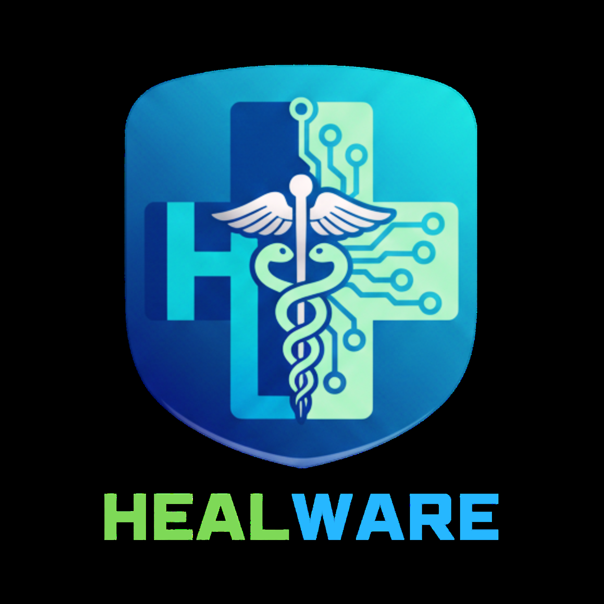
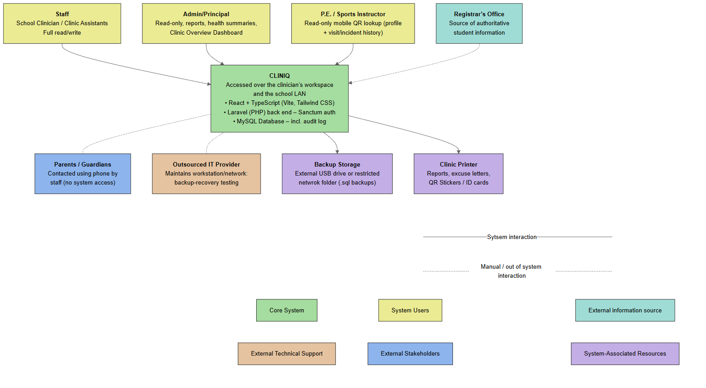
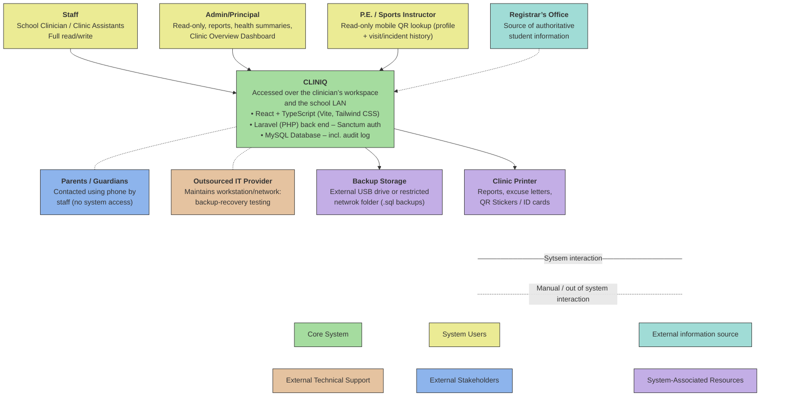

<!-- p.26 -->

 

Republic of the Philippines **CAVITE STATE UNIVERSITY** College of Engineering and Information Technology Don Severino delas Alas Campus, Indang, Cavite

# Software Requirements Specification

for

## CLINIQ: Intelligent Clinic Tracking and Monitoring System

**Version 1.0**

Prepared for: Mendez Christian Academy

Prepared by: HealWare Tinapay, Ghenly B.  – Project Manager Lugami, Christian John C. – System Analyst Balboa, Zean Kurt G. – Tester/Developer

DATE: 09/21/2026

<!-- p.27 -->

## Table of Contents

<table>
<tr><td><b>Table of Contents</b></td><td><b>2</b></td></tr>
<tr><td><b>Revision History</b></td><td><b>2</b></td></tr>
<tr><td><b>1. Introduction</b></td><td><b>2</b></td></tr>
<tr><td>1.1. Document Conventions</td><td>2</td></tr>
<tr><td>1.2. Purpose</td><td>3</td></tr>
<tr><td>1.3. Project Scope</td><td>3</td></tr>
<tr><td>1.4. Product Perspective</td><td>3</td></tr>
<tr><td>1.5. Product Functions</td><td>3</td></tr>
<tr><td>1.6. Design and Implementation Constraints</td><td>3</td></tr>
<tr><td>1.7. User Documentation</td><td>3</td></tr>
<tr><td>1.8. Assumptions and Dependencies</td><td>3</td></tr>
<tr><td><b>2. Data Requirements</b></td><td><b>3</b></td></tr>
<tr><td>2.1. Data Validation Rules</td><td>3</td></tr>
<tr><td>2.2. Data Security and Privacy Requirements</td><td>3</td></tr>
<tr><td>2.3. Data Retention and Backup Requirements</td><td>3</td></tr>
<tr><td><b>3. System Features</b></td><td><b>3</b></td></tr>
<tr><td>3.1. Functional Requirements</td><td>3</td></tr>
<tr><td>3.2. Nonfunctional Requirements</td><td>4</td></tr>
<tr><td><b>4. System Model and Diagrams</b></td><td><b>4</b></td></tr>
<tr><td>4.1. Use Case Diagrams</td><td>4</td></tr>
<tr><td>4.2. Entity Relationship Diagrams</td><td>4</td></tr>
<tr><td>4.3. Activity Diagrams</td><td>4</td></tr>
<tr><td><b>5. Other Requirements</b></td><td><b>4</b></td></tr>
<tr><td>Appendix A: Glossary</td><td>4</td></tr>
<tr><td>Appendix B: To Be Determined List</td><td>4</td></tr>
<tr><td>Appendix C: References</td><td>4</td></tr>
<tr><td>Requirements Validation / Consistency Review</td><td>4</td></tr>
</table>

## Revision History

| Name | Date | Reason For Changes | Version |
| --- | --- | --- | --- |
| HealWare | 09/28/26 | Initial draft that includes Section 1 (Introduction) and Section 2 (Data Requirements). | 1.0 (Draft) |

<!-- p.28 -->

## 16. Introduction

### 16.1. Document Conventions

This Software Requirements Specification (SRS) defines the requirements and overall characteristics of **CLINIQ: Intelligent Clinic Tracking and Monitoring System**, a proposed system for the School Clinic/Health Services Department of Mendez Christian Academy.

The following conventions are used throughout this document:

<table>
<tr><th>Term</th><th>Description</th></tr>
<tr><td>CLINIQ</td><td>The proposed Intelligent Clinic Tracking and Monitoring System for Mendez Christian Academy.</td></tr>
<tr><td>SRS</td><td>Refers to this Software Requirements Specification.</td></tr>
<tr><td>Staff</td><td>Authorized clinic staff who use CLINIQ to record, update, and manage clinic information.</td></tr>
<tr><td>Admin/Principal</td><td>The school administration users who have read-only access to reports and health summaries.</td></tr>
<tr><td>The Registrar's Office</td><td>The school office that provides student information used by the clinic.</td></tr>
<tr><td>PE Instructor/Coach</td><td>Personnel who submit student injury referrals to the clinic.</td></tr>
<tr><td>Student Number</td><td>The system-generated student identifier in YYYY-NNNNN format.</td></tr>
<tr><td>TBD</td><td>“To Be Determined” identifies information that has not been established.</td></tr>
</table>

Requirements in this SRS are categorized and numbered as follows. Numbering is sequential within each category, starting at 001, and is kept consistent across revisions; a requirement is not renumbered once assigned and numbering. Unless a detailed requirement states its own priority, it inherits the priority of the module or feature it belongs to.

<table>
<tr><th>Requirement Number</th><th>Description</th></tr>
<tr><td>FR-XXX</td><td>Functional Requirements</td></tr>
<tr><td>NFR-XXX</td><td>Non-Functional Requirements</td></tr>
<tr><td>DR-XXX</td><td>Data Requirements</td></tr>
<tr><td>BR-XXX</td><td>Business Rules</td></tr>
</table>

<!-- p.29 -->

### 16.2. Purpose

This document specifies the requirements for CLINIQ: Intelligent Clinic Tracking and Monitoring System, Version 1.0, developed by the HealWare project team for Mendez Christian Academy. CLINIQ is intended to digitalize the daily operations of the school’s Health Services / Clinic Department — reducing manual and paper-based processes and improving the accuracy and availability of student health records.

This SRS covers the complete CLINIQ system as a single, self-contained application; it does not describe a subsystem of a larger platform. It will serve as the foundation for the system’s design, development, and User Acceptance Testing (UAT) phases, and as the shared reference that keeps the development team, the subject professor, and the client (represented by the School Clinician) aligned on what CLINIQ will do.

### 16.3. Project Scope

#### 16.3.1. Scope

The system will provide centralized management of student health and clinic information around the following in scope:

- **User Management** – authentication and role-based access for Staff, Admin/Principal, and PE/Sports Instructor accounts.
- **Student Records**: encoding, medical history, allergies, and contact validation.
- **Clinic Visit Monitoring** – daily logging, complaints, treatment, excuse letters, PE/Sports referrals, and follow-up handling.
- **Emergency Response** – two-stage incident logging (fast capture, then completed detail), hospital referral tracking, and timestamped parent/guardian notification outcome logging.
- **Reports Generation** – monthly reports, incident reports, and health summaries.
- **Proposed enhancements** – QR Digital Health ID, Smart Triage Quick-Reference, and Medicine & Supply Inventory Tracker.
- PE/Sports Instructor read-only QR access to a student’s profile and injury history (brought into scope at the September 19, 2026 team meeting).
- A cross-cutting audit trail of logins, QR scans, form submissions, approvals, and record changes.
- Deployment on the school’s existing single workstation via XAMPP over the employee-tier intranet.
- RA 10173 (Data Privacy Act of 2012)–aligned data handling, audit logging, and daily backups.
- Staff training and a User Acceptance Testing (UAT) phase at the client site.

<!-- p.30 -->

The system will operate on the school’s existing desktop workstation and its internal intranet, with Staff-tier access for clinic personnel and read-only Admin/Principal-tier access for the School Principal and Administration.

#### 16.3.2. Limitations

The current implementation of CLINIQ has the following documented limitations:

- The system is intended to operate within the school's existing workstation and intranet environment.
- Parent/guardian self-service access is outside the current system scope.
- Remote or cloud access beyond the school intranet is outside the current implementation scope.
- Activities that require clinical judgment remain the responsibility of clinic staff.
- The system supports clinic personnel by providing organized and timely information but does not replace their professional responsibilities.
- The current environment has limited device availability, including dependence on a single workstation.
- Future remote access for the principal and school nurse is identified as a possible enhancement and is not part of the current implementation.
- Automated SMS or push-notification gateways; parents continue to be contacted by phone with the clinic staff.
- A fuller, separately managed school-events calendar. The current phase keeps a free-text event tag on visit and incident entries; ownership of a fuller calendar is an open decision.
- RFID, or biometric hardware.
- Billing, insurance, or Medicaid-style billing modules.
- Multi-school or cloud multi-tenant hosting.

**Functional limitations**:

- CLINIQ supports, but does not replace, clinical judgment. Steps that need human judgment — the parent phone call, print, review and signing of incident reports, and confirmation of treatment dispositions remain with clinic staff.
- Frequent-visitor flags and symptom-clustering alerts are warnings only, never a diagnosis or a suggested action.
- The excuse letter is a clinic-issued document distinct from a hospital-issued medical certificate, which CLINIQ does not generate.

<!-- p.31 -->

### 16.4. Product Perspective

CLINIQ is a new, self-contained system. Prior to this project, the School Clinic Department had no dedicated digital system: health records and clinic visits were managed manually through paper logbooks and partial Excel spreadsheets, with no backup system and no standardized data entry. CLINIQ is not a follow-on to, or replacement of, any prior digital clinic system, and it is not currently specified as a component of a larger, already-existing enterprise system.

CLINIQ interacts with Mendez Christian Academy’s stakeholders as follows:

- Staff (School Clinician, clinic assistants) – Primary operators; full read/write access on the clinic workstation and through mobile scan/lookup.
- School Administration / Principal – Read-only consumers of reports, health summaries, and the Clinic Overview Dashboard.
- PE/Sports Instructor – Refers injured students on a physical referral slip (logged by Staff); has read-only mobile QR access to a student’s profile and visit/incident history.
- Registrar’s Office – Source of authoritative student information; consulted to verify unreachable parent contact numbers.
- Parents and Guardians – Have no system access; receive emergency notifications, delivered through a phone call placed by clinic staff using contact information retrieved from the system (not through direct system access).
- Outsourced IT provider – Maintains the workstation and network; configures the automated backup script; performs quarterly recovery testing and major restoration.
- Existing clinic printer – Prints reports, excuse letters, and QR stickers/ID cards.
- Backup storage – External USB drive (locked cabinet) or restricted network folder that receives the .sql backups.

<!-- p.32 -->

*Figure 1. CLINIQ Components Interconnections.*

Diagram source (Mermaid)

<!-- diagram: figure-01-components-interconnections-draft-1.0 -->

The system will run on the school’s existing desktop workstation using XAMPP (Apache and MySQL) as the local server, and will be accessed only over the school’s intranet via the employee-tier Wi-Fi network. It does not interface with any external government, hospital, or health-information system; hospital referrals are recorded and tracked within CLINIQ but are not electronically transmitted to hospital systems.

### 16.5. Product Functions

CLINIQ consists of ten modules and one cross-cutting audit trail. Detailed functional requirements are given in Section 3. The table summarizes the major functions and role access.

1. **User Management**
    - Login/logout
    - 15-minute idle timeout
    - Account lockout
    - User account management
    - Password management
    - Role assignment
2. **Student Records**
    - Student encoding with auto-generated Student Number
    - Medical history
    - Allergy/food-restriction monitoring
    <!-- p.33 -->
    - Emergency contacts
    - Duplicate detection
    - Incomplete-record query
    - Parent-contact validation
    - Archiving
3. **Clinic Visit Monitoring**
    - Daily visit logging
    - Complaints
    - Treatment
    - Nurse-approved excuse letters
    - PE/Sports injury referral logging
    - Follow-up handling
4. **Emergency Response**
    - Two-stage incident recording
    - Hospital referral monitoring
    - Parent/guardian notification logging
    - Follow-up handling
5. **Reports Generation**
    - Monthly reports
    - Incident reports with nurse sign-off
    - Health summaries
    - Print/export
6. **QR Digital Health ID**
    - QR generation
    - Printing
    - Regeneration per student
    - Mobile scan/lookup with manual Student Number fallback
    - Quick-actions:
        - Record Visit
        - Log Emergency
        - View Full Profile
        - Dispense Medicine
7. **Smart Triage Quick-Reference**
    - Complaint-based standardized first-aid checklists during visit entry
    - Completion saved with the visit
    - Content edited by the School Clinician only
8. **Medicine & Supply Inventory Tracker**
    - Item management
    - Dispensing and restocking with usage history
    - Low-stock and expiration flags
    <!-- p.34 -->
9. **Clinic Overview Dashboard**
    - Clinic counts
    - Pending records
    - Common complaints
    - Symptom-clustering alerts
    - Frequent-visitor flags
    - Due follow-ups
    - Weekly/monthly/yearly calendar view
    - Date-range filter
    - Export/print
10. **Backup Verification Assistant**
    - Backup status
    - Manual status check
    - Guided recovery checklist
    - Nurse verification
    - Backup history

**Audit Trail (cross-cutting)**

- Logs who did what and when:
    - Login/logouts
    - Every QR scan
    - Form submissions
    - Approvals
    - Record create/update/delete/archive actions

### 16.6. Design and Implementation Constraints

**Technical Constraints**

- The system runs on the school’s existing desktop workstation, selected because it matches hardware/software already in use, as confirmed by the ICT Head.
- The system is accessible only over the school’s intranet, through the employee-tier Wi-Fi network secured with WPA2 encryption, and not exposed to the public internet.
- Minimum recommended hardware for the proposed stack is Intel Core i3 (or equivalent), 4GB RAM, and 100GB storage; the exact specifications of the existing clinic workstation were not recalled by the ICT Head at the time of the interview.
- Minimum network bandwidth is 20 Mbps; the school currently uses PLDT Fiber with two lines in a star topology (LAN/Wi-Fi) with separate access tiers for students, guests, and employees.
- Only one clinic workstation and one printer are currently available; no barcode reader, RFID, or biometric device is required or planned.

<!-- p.35 -->

**Technology Stack**

- Frontend: React, TypeScript, and Tailwind CSS.
- Backend: Laravel (PHP framework), handling system logic, routing, validation, authentication, and server-side processes.
- Database: MySQL, storing student records, clinic visits, user accounts, and reports.
- Authentication: Laravel Authentication, managing login, passwords, and role-based access.
- Testing: Playwright, for automated browser testing of key workflows.
- Collaboration tooling: Trello or ClickUp, for task organization and progress tracking.

**Regulatory Constraints**

- The system SHALL align with Republic Act No. 10173 (Data Privacy Act of 2012) in its handling of student health information (see Section 2.2).

**Business/Project Constraints**

- The development team is small — a Project Manager, a System Analyst, and a Tester/Developer — which the Project Plan gives as a reason for using a combined Iterative and Prototyping development approach, building and refining one working version at a time rather than running multiple parallel workstreams.
- The project follows the phased Gantt-chart timeline in the Project Plan, running from team formation (February 2026) through project turnover (targeted November 2026).
- Each development iteration is checked with the subject professor and revised with client feedback before the next round of fixes, culminating in formal User Acceptance Testing (UAT) and turnover.
- Total implementation cost should not exceed approximately PHP 10,000; an itemized breakdown has not yet been completed in the Project Plan's Budget Allocation section

**User Constraints**

- The system’s primary end user is a single School Clinician who also handles day-to-day clinic duties with limited time to spare for using or learning a new system, so the interface must minimize the workload added by digitalization rather than compound it.
- Clinic staff and the School Clinician are non-technical and will require hands-on training before full deployment; there is no dedicated IT staff. The solution must be inexpensive to acquire and run and simple enough to operate without ongoing dependence on paid support.

<!-- p.36 -->

### 16.7. User Documentation

The following documentation and training components are committed as deliverables. It will be produced and delivered alongside the system at project turnover.

- **User manual** — provides instructions for operating the deployed CLINIQ functions within the user's authorized role.
- **Training materials** — Materials used to conduct the staff training session.
- **Hands-on staff training** — Session(s) for the School Clinician and designated clinic staff before full deployment, led by the Developer/Tester. Topics include: login and password management; Student Records encoding, duplicate detection, and incomplete-record resolution; daily visit logging and excuse letters; emergency workflow; PE/Sports referral processing; backup verification and basic troubleshooting.
- **UAT at client site** — The School Clinician tests all modules under real clinic conditions; feedback is addressed before production use.
- **In-system guided recovery checklist** — A checklist inside the Backup Verification Assistant (a system feature, listed here for completeness).

### 16.8. Assumptions and Dependencies

**Assumptions**

- The client (Ms. Jenne Baas / Mendez Christian Academy) will continue to provide timely access, validation, and feedback during requirements confirmation, prototype review, and UAT.
- The clinic will continue to have access to at least the one existing workstation and the one existing printer used for health reports, excuse letters, and medical certificates.
- The school’s PLDT Fiber network connection and employee-tier Wi-Fi access will remain available at or above the stated minimum bandwidth of 20 Mbps.
- Student information supplied by the Registrar’s Office is assumed to be accurate and available when needed for encoding into Student Records.
- The project will continue to follow the combined Iterative and Prototyping approach described in the Project Plan, with successive rounds of client feedback and professor consultation before final turnover.
- Applicable data-privacy obligations under RA 10173 will remain in effect for the duration of the project and the system’s operation.

**Dependencies**

- The school’s outsourced IT provider is dependent on major system restoration, hardware replacement, quarterly recovery-testing, security patching, and configuration of the automated backup script.
<!-- p.37 -->
- The school’s ICT Head and outsourced IT provider are dependent on the network infrastructure (routers/switches) that CLINIQ’s intranet access relies on.
- Client sign-off from the School Clinician is depended on at the end of each development iteration, per the Iterative/Prototyping approach.
- Completion of earlier phases in the Project Plan’s Gantt chart (e.g., the System Development phase, targeted Oct 2–17, 2026) is a prerequisite for the System Consultation and User Acceptance Testing (UAT) phases that follow it.

## 17. Data Requirements

This section specifies CLINIQ's data-level requirements: the rules used to validate data as it is entered, the controls that protect data confidentiality and privacy, and the rules governing how long data is kept and how it is backed up.

### 17.1. Data Validation Rules

The following data validation rules are established for CLINIQ, which will be applied at the point of data entry.

<table>
<tr><th>ID</th><th>Requirement</th></tr>
<tr><td>DR-001</td><td>The system shall generate each Student Number automatically in the format YYYY-NNNNN (enrollment year plus a zero-padded 5-digit sequence, e.g., 2026-00001). The number shall not be entered manually, and the sequence shall restart each enrollment year.</td></tr>
<tr><td>DR-002</td><td>The database shall enforce UNIQUE and NOT NULL constraints at the database level.</td></tr>
<tr><td>DR-003</td><td>The system shall require the following fields before a new student record can be saved: full name, grade level, emergency contact, known allergies, and existing medical conditions.</td></tr>
<tr><td>DR-004</td><td>On saving a new student, the system shall check existing records for a full-name and grade-level match. If a potential match exists, the system shall show a warning and require Staff to confirm or cancel before a new entry is created.</td></tr>
<tr><td>DR-005</td><td>The system shall automatically flag any student record that is missing required fields as Incomplete, list it in the incomplete-records review queue, and log which Staff member resolved each flag.</td></tr>
<!-- p.38 -->
<tr><td>DR-006</td><td>The system shall not allow a record flagged Incomplete to be used in clinic visits or notifications until Staff supplements the missing information.</td></tr>
<tr><td>DR-007</td><td>On the first save of a student record, the system shall prompt Staff to verify the parent/guardian contact number before it is used for emergency notification. Staff shall be able to mark a contact number as verified or unverified.</td></tr>
<tr><td>DR-008</td><td>If a contact number proves unreachable during an emergency, the system shall re-flag the record and prompt Staff to verify the number with the class adviser or Registrar’s Office; the verification shall be logged.</td></tr>
<tr><td>DR-009</td><td>The system shall archive or deactivate a student record instead of deleting it. Archived records shall be excluded from default active-student lists, search results, and dropdowns unless Staff explicitly includes them.</td></tr>
<tr><td>DR-010</td><td>The QR code for a student shall encode the Student Number. Regenerating a QR code shall invalidate the previous one.</td></tr>
</table>

**Student recordsClinic visits, emergencies, and follow-ups**

<table>
<tr><th>ID</th><th>Requirement</th></tr>
<tr><td>DR-011</td><td>The system shall enforce mandatory fields on clinic-visit and incident records and shall not save a record until its required fields are complete, except for the Stage 1 emergency capture in the next requirement.</td></tr>
<tr><td>DR-012</td><td>For an emergency incident, Stage 1 shall require only the essential fields (complaint and immediate vitals) and shall save immediately. The record shall remain marked as an incomplete Stage 1 record until Staff completes Stage 2, and incident lists shall show each incident’s stage.</td></tr>
<tr><td>DR-013</td><td>A visit or PE/Sports referral disposition shall be one of: returned to class, sent home, or referred to hospital.</td></tr>
<tr><td>DR-014</td><td>A hospital referral shall record destination, mode of transport, and departure time.</td></tr>
<tr><td>DR-015</td><td>Each parent/guardian notification attempt shall be timestamped, tied to its incident record, and recorded with an outcome of exactly one of: Reached, Not Reached, Voicemail, or Left Message.</td></tr>
<tr><td>DR-016</td><td>A follow-up shall record the student, the related visit or incident, the follow-up date, the reason or monitoring <!-- p.39 --> instruction, and notes. Its status shall follow the lifecycle Pending → Completed, Missed, or Cancelled.</td></tr>
<tr><td>DR-017</td><td>An excuse letter shall be generated from a visit record and routed for nurse check and approval. Only after approval shall it be stored as a permanent, printable document in the student’s record. It shall be kept distinct from a hospital-issued medical certificate.</td></tr>
<tr><td>DR-018</td><td>An incident report shall be routed for nurse review and sign-off.</td></tr>
<tr><td>DR-019</td><td>A visit or incident entry may carry a free-text event tag (e.g., “MCA Dance Program”).</td></tr>
</table>

**Inventory**

<table>
<tr><th>ID</th><th>Requirement</th></tr>
<tr><td>DR-020</td><td>Each inventory item shall carry a current stock count, a low-stock threshold, and a single expiration date, tracked per item and not per batch.</td></tr>
<tr><td>DR-021</td><td>Dispensing shall decrease stock by the entered quantity and log the item, quantity, linked visit or incident (if any), staff member, and timestamp. If dispensing would take stock below zero, the system shall warn but shall not block the save.</td></tr>
<tr><td>DR-022</td><td>Restocking shall be a separate, manually initiated action that records the quantity received and the date, increases stock, clears a low-stock flag when the new total is back above the threshold, and requires Staff to confirm or update the item’s expiration date.</td></tr>
<tr><td>DR-023</td><td>After any stock decrease, the system shall automatically compare the new level with the item’s low-stock threshold and flag the item when it is crossed. The expiration check shall run independently, and both flags shall be shown as distinct badges.</td></tr>
</table>

**User accounts**

<table>
<tr><th>ID</th><th>Requirement</th></tr>
<tr><td>DR-024</td><td>Each user account shall have a unique username and exactly one role: Staff, Admin/Principal, or PE/Sports Instructor.</td></tr>
<!-- p.40 -->
<tr><td>DR-025</td><td>Passwords shall be at least 8 characters, shall be changed on first login, and shall not repeat any of the user’s last 5 passwords.</td></tr>
</table>

**Placeholders and proposals**

<table>
<tr><th>ID</th><th>Requirement</th></tr>
<tr><td>(TBD)</td><td>(Information needed: field-level formats — maximum lengths, allowed characters, contact-number format, grade-level values, date/time formats)</td></tr>
<tr><td>(TBD)</td><td>(Information needed: mandatory-field lists for visit and incident records, the vital signs captured, and the Stage 1 / Stage 2 field split beyond complaint and immediate vitals)</td></tr>
<tr><td>(TBD)</td><td>(Information needed: how “no known allergies” or “no existing medical conditions” is entered, since both fields are mandatory)</td></tr>
<tr><td>(TBD)</td><td>(Information needed: low-stock comparison rule and the “nearing expiration” window)</td></tr>
<tr><td>Proposed</td><td>Proposed: The Student Number shall be unique across all student records, including archived ones. (General data-integrity practice; not stated in the sources.)</td></tr>
<tr><td>Proposed</td><td>Proposed: Once the contact-number format is defined (TBD-08), the system shall reject contact numbers that do not match it.</td></tr>
</table>

### 17.2. Data Security and Privacy Requirements

CLINIQ handles student health information and these requirements protect it in line with RA 10173 (Data Privacy Act of 2012). The sources do not include a legal review; this SRS is not legal advice.

**Authentication, sessions, and role-based access**

<table>
<tr><th>ID</th><th>Requirement</th></tr>
<tr><td>DR-026</td><td>Every user shall authenticate with a unique username and password. The system shall not allow anonymous access.</td></tr>
<tr><td>DR-027</td><td>The system shall store passwords only in hashed form, never in plaintext.</td></tr>
<tr><td>DR-028</td><td>The system shall log a user out automatically after 15 minutes of inactivity.</td></tr>
<tr><td>DR-029</td><td>The system shall lock an account for 30 minutes after 5 consecutive failed login attempts.</td></tr>
<!-- p.41 -->
<tr><td>DR-030</td><td>The system shall enforce the role-based access levels in Table 4: Staff have full read/write access to all clinic modules; Admin/Principal have read-only access to reports, health summaries, and the Clinic Overview Dashboard, with no direct access to Student Records; PE/Sports Instructors have read-only access to a student’s full profile and visit/incident history and no operational actions.</td></tr>
<tr><td>DR-031</td><td>Only Staff shall create, edit, deactivate, and assign roles to user accounts.</td></tr>
<tr><td>DR-032</td><td>Only the School Clinician shall add or edit the standardized first-aid checklist content.</td></tr>
<tr><td>DR-033</td><td>Parents and guardians shall have no access to the system. Canteen Staff shall have no access in this phase.</td></tr>
<tr><td>(TBD)</td><td>(Information needed: session-cookie settings and hashing details under Laravel Sanctum — the PTD describes HTTP-only session cookies for the earlier plain-PHP design)</td></tr>
</table>

**Privacy and data exposure**

<table>
<tr><th>ID</th><th>Requirement</th></tr>
<tr><td>DR-034</td><td>The system shall operate on the school intranet only, over the employee-tier Wi-Fi/LAN secured with WPA2, and shall not expose student health records to the public internet.</td></tr>
<tr><td>DR-035</td><td>Visit Log, Incident Log, and the Dashboard’s frequent-visitor section shall display the Student Number by default instead of the full name.</td></tr>
<tr><td>DR-036</td><td>Screens for a single deliberate lookup — the QR scan result, the full profile, search results, and the masterlist — may show the full name. The masterlist shall not show medical or confidential fields (allergies, conditions, visit reasons) inline; these require opening the individual profile.</td></tr>
<tr><td>DR-037</td><td>Student health data shall be used only within the clinic context, and data shall be collected and used only for clinic operations.</td></tr>
<tr><td>DR-038</td><td>Parent/guardian notification records shall be retained as acknowledgment of data use for emergency purposes.</td></tr>
<tr><td>(TBD)</td><td>(Information needed: whether the database, backup files, and LAN traffic are encrypted, e.g., HTTPS on the intranet)</td></tr>
<tr><td>(TBD)</td><td>(Information needed: procedure for requests to access, correct, or delete personal data under RA 10173)</td></tr>
</table>

<!-- p.42 -->

**Audit trail**

<table>
<tr><th>ID</th><th>Requirement</th></tr>
<tr><td>DR-039</td><td>The system shall log, with the acting user and a timestamp: every login and logout; every QR scan (by Staff or PE/Sports Instructor) and which student was viewed; every form submission; every approval (excuse letter and incident report sign-off); and every create, update, delete, and archive action on a record.</td></tr>
<tr><td>DR-040</td><td>Every student profile opened by a PE/Sports Instructor shall be attributable to that instructor’s account and timestamped.</td></tr>
<tr><td>(TBD)</td><td>(Information needed: audit-log retention period and protection against alteration)</td></tr>
</table>

### 17.3. Data Retention and Backup Requirements

**Data retention**

<table>
<tr><th>ID</th><th>Requirement</th></tr>
<tr><td>DR-041</td><td>Archived student records shall be kept in the system for historical and audit continuity and shall not be deleted by the archive action.</td></tr>
<tr><td>DR-042</td><td>Daily backups shall be kept for a rolling 30 days; older backups shall be rotated out automatically by the backup script.</td></tr>
<tr><td>DR-043</td><td>Printed monthly health reports shall be retained as a supplementary physical backup of critical summary data.</td></tr>
<tr><td>(TBD)</td><td>(Information needed: retention periods for archived student, visit, incident, and inventory records — see conflict C-03)</td></tr>
</table>

**Backup and verification**

<table>
<tr><th>ID</th><th>Requirement</th></tr>
<tr><td>DR-044</td><td>The system shall run an automated database backup once daily, at the end of each school day, exporting the MySQL database as a .sql file using mysqldump.</td></tr>
<tr><td>DR-045</td><td>If the scheduled script does not run, the School Clinician shall be able to start the export manually (through phpMyAdmin per the PTD).</td></tr>
<!-- p.43 -->
<tr><td>DR-046</td><td>Each backup file shall be saved to an external USB drive kept in a locked cabinet in the clinic office, or to a designated network folder restricted to clinic and IT-provider access.</td></tr>
<tr><td>DR-047</td><td>The Backup Verification Assistant shall show the last backup date, file size, and status; let Staff (the School Clinician) trigger a manual backup-status check; let the nurse mark a backup as verified; and show the backup history/log. The backup status shall be visible to the nurse.</td></tr>
<tr><td>DR-048</td><td>The School Clinician shall verify that the backup file is accessible and intact before ending the workday, and a backup log shall record each backup’s date, file size, and verification status.</td></tr>
<tr><td>DR-049</td><td>The system shall provide a guided recovery checklist.</td></tr>
<tr><td>DR-050</td><td>Recovery shall follow this procedure: contact the outsourced IT provider; reinstall XAMPP on the replacement workstation; retrieve the most recent .sql backup; and restore it through phpMyAdmin import or the MySQL command line. Restoration is estimated at about 30 minutes once the IT provider begins, excluding response and travel time.</td></tr>
<tr><td>DR-051</td><td>The outsourced IT provider shall test backup integrity and restoration readiness quarterly.</td></tr>
<tr><td>DR-052</td><td>Responsibility shall be split as follows. The School Clinician monitors daily backups, checks that the scheduled script ran, and keeps the backup log. The outsourced IT provider handles major restoration, hardware replacement, quarterly recovery testing, and configuration of the automated backup script.</td></tr>
<tr><td>(TBD)</td><td>(Information needed: an additional backup layer beyond the local workstation and the external USB/network-folder copy — under evaluation; the current mysqldump design does not change)</td></tr>
<tr><td>(TBD)</td><td>(Information needed: Recovery Time Objective and Recovery Point Objective)</td></tr>
<tr><td>(TBD)</td><td>(Information needed: whether a UPS is procured; power loss was identified as the main operational risk but a UPS is not costed into the current scope)</td></tr>
</table>

<!-- p.44 -->

## 18. System Features

### 18.1. Functional Requirements

#### 18.1.1. System Feature #1

#### 18.1.2. System Feature #2

### 18.2. Nonfunctional Requirements

#### 18.2.1. Performance Requirements

#### 18.2.2. Safety Requirements

#### 18.2.3. Security Requirements

#### 18.2.4. Software Quality Attributes

#### 18.2.5. Business Rules

## 19. System Model and Diagrams

### 19.1. Use Case Diagrams

### 19.2. Entity Relationship Diagrams

### 19.3. Activity Diagrams

## 20. Other Requirements

### Appendix A: Glossary

### Appendix B: To Be Determined List

### Appendix C: References

### Requirements Validation / Consistency Review
