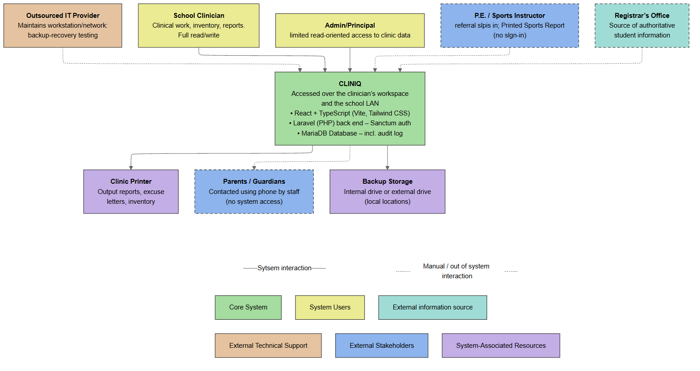
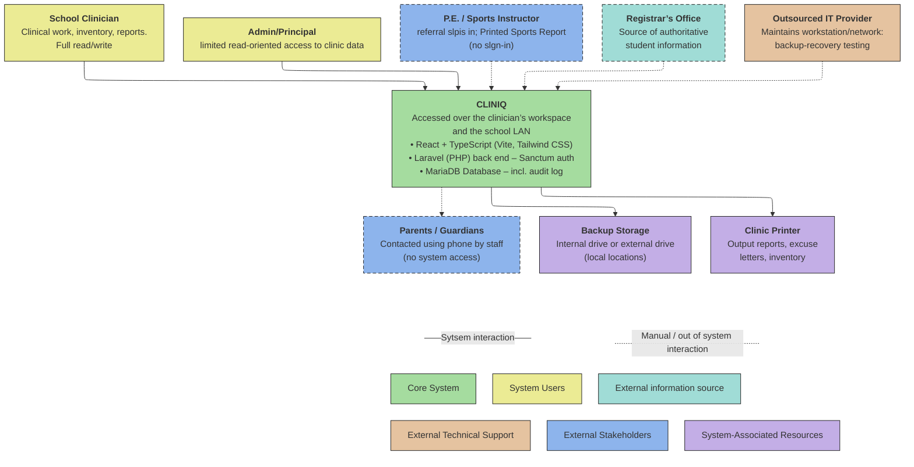

<!-- p.47 -->

## 21. Introduction

### 21.1. Document Conventions

This Software Requirements Specification (SRS) defines the requirements and overall characteristics of **CLINIQ: Intelligent Clinic Tracking and Monitoring System**, a proposed system for the School Clinic/Health Services Department of Mendez Christian Academy.

The following conventions are used throughout this document:

<table>
<tr><th>Term</th><th>Description</th></tr>
<tr><td>CLINIQ</td><td>The proposed Intelligent Clinic Tracking and Monitoring System for Mendez Christian Academy.</td></tr>
<tr><td>SRS</td><td>Refers to this Software Requirements Specification.</td></tr>
<tr><td>School Clinician</td><td>Authorized clinic user who records, updates, and manages clinic information in CLINIQ and performs the clinical work. The School Head Nurse is the main School Clinician; other designated staff who cover the clinic each have their own School Clinician account.</td></tr>
<tr><td>Admin/Principal</td><td>The school administration user who manages user accounts and has limited, read-oriented access to clinic data.</td></tr>
<tr><td>Student Patient</td><td>A student who receives care at the clinic, identified by Learner Reference Number (LRN).</td></tr>
<tr><td>Staff Patient</td><td>A teacher or school employee who receives care at the clinic, identified by Staff No. A staff patient is not a user account.</td></tr>
<tr><td>LRN</td><td>Learner Reference Number: the 12-digit identifier the school uses for each student.</td></tr>
<tr><td>Staff No.</td><td>The system-generated identifier of a staff patient, in the pattern STF-0001.</td></tr>
<tr><td>The Registrar's Office</td><td>The school office that provides student information used by the clinic.</td></tr>
<tr><td>PE Instructor/Coach</td><td>Personnel who submit student injury referrals to the clinic and receive the Sports Reports the School Clinician prepares. They do not sign in to CLINIQ.</td></tr>
<tr><td>TBD</td><td>“To Be Determined” identifies information that has not been established.</td></tr>
</table>

Requirements in this SRS are categorized and numbered as follows. Numbering is sequential within each category, starting at 001, and is kept consistent across revisions; a requirement is not renumbered once assigned, and the number of a withdrawn requirement is not reused.Unless a detailed <!-- p.48 --> requirement states its own priority, it inherits the priority of the module or feature it belongs to.

<table>
<tr><th>Requirement Number</th><th>Description</th></tr>
<tr><td>FR-XXX</td><td>Functional Requirements</td></tr>
<tr><td>NFR-XXX</td><td>Non-Functional Requirements</td></tr>
<tr><td>DR-XXX</td><td>Data Requirements</td></tr>
<tr><td>BR-XXX</td><td>Business Rules</td></tr>
</table>

### 21.2. Purpose

This document specifies the requirements for CLINIQ: Intelligent Clinic Tracking and Monitoring System, Version 1.1, developed by the HealWare project team for Mendez Christian Academy. CLINIQ is intended to digitalize the daily operations of the school’s Health Services / Clinic Department — reducing manual and paper-based processes and improving the accuracy and availability of student and staff health records.

This SRS covers the complete CLINIQ system as a single, self-contained application; it does not describe a subsystem of a larger platform. It will serve as the foundation for the system’s design, development, and User Acceptance Testing (UAT) phases, and as the shared reference that keeps the development team, the subject professor, and the client (represented by the School Clinician) aligned on what CLINIQ will do.

### 21.3. Project Scope

#### 21.3.1. Scope

The system will provide centralized management of student health and clinic information around the following in scope:

- **User Management** – authentication, role-based access for School Clinician and Admin/Principal accounts, and offline account recovery.
- **Student Records** – encoding, lookup by LRN or name, medical history, allergies, contact validation, and the annual registrar-list import.
- **Staff Patient Records** – records for teachers and school employees receiving care, with their own import and incomplete-record review.
- **Clinic Visit Monitoring** – daily logging, symptoms, treatment, excuse letters, PE/Sports referrals, and follow-up handling.
- **Emergency Response** – two-stage incident logging (fast capture, then completed detail), hospital referral tracking, <!-- p.49 --> timestamped parent/guardian call logging, and a printed incident report for the Principal’s signature.
- **Reports Generation** – four monthly report views, the Monthly Report as a PDF for the Principal, and clinician-prepared Sports Reports.
- First-Aid Checklist Quick-Reference, Medicine & Supply Inventory Tracker, and Backup Verification Assistant.
- **Clinic Overview Dashboard** and a separate **Activity Calendar** with school events and Philippine holidays.
- **Archive and School Year** – a read-only year-indexed Archive and manual school-year management.
- A cross-cutting **audit trail** of sign-ins, record opens, form submissions, approvals, with a read-only Audit Log Viewer, and a cross-cutting issue reporting window on every screen.
- Deployment on the school’s existing single workstation via XAMPP over the school’s internal network.
- RA 10173 (Data Privacy Act of 2012) – aligned data handling, audit logging, and local backups.
- Staff training and a User Acceptance Testing (UAT) phase at the client site.

The system will operate on the school’s existing desktop workstation and its internal network, with School Clinician access for clinic personnel and limited, read-oriented Admin/Principal access for the School Principal and Administration. Core work is available without public internet.

#### 21.3.2. Limitations

The current implementation of CLINIQ has the following documented limitations:

- The system is intended to operate on the clinic workstation only. It has no LAN access, no hostname, and no HTTPS, and it is not used from other computers.
- Parent/guardian self-service access is outside the current system scope.
- Remote or cloud access, including remote or cloud hosting, is outside the current implementation scope.
- Activities that require clinical judgment remain the responsibility of clinic staff.
- The system supports clinic personnel by providing organized and timely information but does not replace their professional responsibilities.
- The current environment has limited device availability, including dependence on a single workstation. When the workstation is unavailable during an emergency, the event is captured on paper and encoded later.
<!-- p.50 -->
- Future remote access for the principal and school nurse is identified as a possible enhancement and is not part of the current implementation.
- Automated SMS or push-notification gateways are not provided; parents continue to be contacted by phone by clinic staff.
- There is no patient QR code or integration with the school’s ID system, and no instructor sign-in or dedicated mobile interface.
- Cloud or off-site backup is not provided; backups are written to local drives only.
- RFID, barcode, or biometric hardware is not used.
- Billing, insurance, or Medicaid-style billing modules, immunization tracking, clinic passes, and queues are not provided.
- Multi-school or cloud multi-tenant hosting is not supported.
- Reports are printed on A4 or saved as PDF through the browser; Excel export is not provided.

**Functional limitations:**

- CLINIQ supports, but does not replace, clinical judgment. Steps that need human judgment — the parent phone call, contact verification with the Registrar’s Office, printing and handwritten signing of incident reports, and confirmation of treatment dispositions remain with clinic staff.
- Frequent-visitor flags and symptom-clustering alerts are warnings only, never a diagnosis or a suggested action.
- Allergy wording and vital-sign warnings are informational, and the system makes no automated dosing or safety decisions.
- The excuse letter is a clinic-issued document distinct from a hospital-issued medical certificate, which CLINIQ does not generate.
- Pain ratings, incident severity levels, and a head-injury watch list are not part of the system.

### 21.4. Product Perspective

CLINIQ is a new, self-contained system. Prior to this project, the School Clinic Department had no dedicated digital system: health records and clinic visits were managed manually through paper logbooks and partial Excel spreadsheets, with no backup system and no standardized data entry. CLINIQ is not a follow-on to, or replacement of, any prior digital clinic system, and it is not currently specified as a component of a larger, already-existing enterprise system.

CLINIQ interacts with Mendez Christian Academy’s stakeholders as follows:

<!-- p.51 -->

- School Clinician – Primary operator; performs clinical work, inventory, reports, backups, and printing on the clinic workstation. Other designated staff who cover the clinic when the School Clinician is away each have their own account.
- School Administration / Principal – Manages user accounts and has limited, read-oriented access to clinic data, reports, and the Clinic Overview Dashboard. Signs the printed incident report by hand.
- PE/Sports Instructor – Refers injured students on a physical referral slip (logged by the School Clinician); receives Sports Reports the School Clinician prepares. Has no system access.
- Registrar’s Office – Source of authoritative student information, including the yearly student list; consulted to verify unreachable parent contact numbers.
- Parents and Guardians – Have no system access; receive emergency notifications through a phone call placed by clinic staff using contact information retrieved from the system.
- Outsourced IT provider – Maintains the workstation and network and supports the clinic with backup recovery.
- Existing clinic printer – Prints reports, excuse letters, and incident reports on A4.
- Backup storage – Local backup locations (an internal drive and an external drive) that receive the backup files.

<!-- p.52 -->

*Figure 1. CLINIQ Components Interconnections.*

Diagram source (Mermaid)

<!-- diagram: figure-01-components-interconnections -->

The system will run on the school’s existing desktop workstation using XAMPP (Apache and MariaDB) as the local server. The compiled web application and the Laravel API are served from one origin on the clinic workstation, and the system is used at the clinic workstation only, at http://localhost. It is not reachable from the school network. It does not interface with any external government, hospital, or health-information system; hospital referrals are recorded and tracked within CLINIQ but are not electronically transmitted to hospital systems. The only use of the internet is an optional monthly refresh of the holiday list.

### 21.5. Product Functions

CLINIQ consists of ten modules and one cross-cutting audit trail. Detailed functional requirements are given in Section 3. The list below summarizes the major functions of each module.

1. **User Management**
    - Sign-in/sign-out
    - Fixed-length sessions and Admin idle cutoff
    - Account lockout
    - User account management (Admin)
    - Password management
    <!-- p.53 -->
    - Authenticator-based account recovery and an offline administrator reset
    - Role assignment
2. **Student Records**
    - Student encoding with LRN
    - Medical history
    - Allergy and condition recording
    - Ordered emergency contacts
    - Duplicate detection
    - Incomplete-record review queue
    - Parent-contact validation
    - Annual registrar-list import
    - Archiving
3. **Staff Patient Records**
    - Staff encoding with generated Staff No.
    - Allergy, condition, and emergency-contact recording
    - Incomplete-record review queue
    - Staff list import
    - Archiving
4. **Clinic Visit Monitoring**
    - Daily visit logging for student and staff patients
    - Symptoms and treatment
    - Dispositions, including resting in clinic
    - Excuse letters approved by the School Clinician
    - PE/Sports injury referral logging
    - Follow-up handling, including automatic closing of missed follow-ups
    - Entered-in-error handling
5. **Emergency Response**
    - Two-stage incident recording
    - Hospital referral monitoring
    - Parent/guardian and emergency-contact call logging
    - Incident report approval, printing, and Principal signature
    - Follow-up handling
6. **Reports Generation**
    - Four monthly report views: Monthly Report, Incident register, Symptom summary, Inventory sheet
    - Sports Reports for PE/Sports instructors
    - A4 print and Save as PDF (School Clinician)
7. **First-Aid Checklist Quick-Reference**
    <!-- p.54 -->
    - Symptom-based standardized first-aid checklists during visit entry
    - Completion saved with the visit
8. **Medicine & Supply Inventory Tracker**
    - Item management
    - Batch-based restocking with expiry dates
    - Dispensing and stock adjustment with usage history
    - Low-stock, near-expiry, and expired-stock flags
9. **Clinic Overview Dashboard**
    - Overview of urgent attention and routine to-do items
    - Clinic counts and pending records
    - Trends of common symptoms, activity over time, sex and grade
    - Symptom-clustering alerts
    - Frequent-visitor flags
    - Due and upcoming follow-ups
10. **Activity Calendar**
    - Weekly, monthly, yearly, and table views
    - School events managed by both roles
    - Read-only Philippine holidays with a monthly refresh that needs internet
11. **Archive and School Year**
    - Read-only year-indexed Archive
    - School-year date settings
    - Manual end and start of a school year
12. **Backup Verification Assistant**
    - Daily, sign-out, and manual backups to local locations
    - Backup status and history
    - Location management
    - Backup verification by the nurse
    - Guided recovery checklist

**Audit Trail (cross-cutting)**

- Logs who did what and when:
- Sign-in, sign-out, and lockouts
- Opening of student and staff profiles and incident reports
- Form submissions and record changes
- Approvals, archiving, stock movements, calendar changes, backup actions, and authorized prints
- Read-only Audit Log Viewer

<!-- p.55 -->

### 21.6. Design and Implementation Constraints

**Technical Constraints**

- The system runs on the school’s existing desktop workstation, selected because it matches hardware/software already in use, as confirmed by the ICT Head.
- The system is used at the clinic workstation only, at http://localhost. It is not reachable from the school network, has no HTTPS, and is not exposed to the public internet. Core work is available without public internet; the only use of the internet is the optional holiday-list refresh.
- Minimum recommended hardware for the proposed stack is Intel Core i3 (or equivalent), 4GB RAM, and 100GB storage; the exact specifications of the existing clinic workstation were not recalled by the ICT Head at the time of the interview.
- Only one clinic workstation and one printer are currently available; no barcode reader, RFID, or biometric device is required or planned.
- The clinic room is shared and unlocked; other staff use the workstation when the School Clinician is away (see Sections 2.2 and 3.2.3).

**Technology Stack**

- **Frontend:** React, TypeScript, Vite, Tailwind CSS, React Router, and Chart.js.
- **Backend:** Laravel (PHP framework) REST API, handling system logic, routing, validation, authentication, and server-side processes.
- **Database:** MariaDB via XAMPP, storing patient records, clinic visits, user accounts, inventory, and reports.
- **Authentication:** Laravel Sanctum in SPA cookie mode, managing sign-in, sessions, and role-based access.
- **Testing:** Vitest and React Testing Library for the frontend, Pest, Pint, and Larastan for the backend.
- **Collaboration tooling:** Trello, for task organization and progress tracking.

**Regulatory Constraints**

- The system SHALL align with Republic Act No. 10173 (Data Privacy Act of 2012) in its handling of student health information (see Section 2.2).

**Business/Project Constraints**

- The development team is small — a Project Manager, a System Analyst, and a Tester/Developer — which the Project Plan gives as a reason for using a combined Iterative and Prototyping development <!-- p.56 --> approach, building and refining one working version at a time rather than running multiple parallel workstreams.
- The project follows the phased Gantt-chart timeline in the Project Plan, running from team formation (February 2026): frontend development from October 2 to November 13, 2026, and backend development from November 14 to 20, 2026. The dates for UAT and turnover are TBD.
- Each development iteration is checked with the subject professor and revised with client feedback before the next round of fixes, culminating in formal User Acceptance Testing (UAT) and turnover.
- Total implementation cost should not exceed approximately PHP 10,000; the itemized budget in the Project Plan’s Budget Allocation (Tables 11 to 14) totals PHP 4,015.

**User Constraints**

- The system’s primary end user is the School Clinician, who also handles day-to-day clinic duties with limited time to spare for using or learning a new system, so the interface must minimize the workload added by digitalization rather than compound it. Other designated staff cover the clinic when the School Clinician is away, each with their own account.
- Clinic staff and the School Clinician are non-technical and will require hands-on training before full deployment; there is no dedicated IT staff. The solution must be inexpensive to acquire and run and simple enough to operate without ongoing dependence on paid support.

### 21.7. User Documentation

The following documentation and training components are committed as deliverables. It will be produced and delivered alongside the system at project turnover.

- **User manual** — provides instructions for operating the deployed CLINIQ functions within the user's authorized role.
- **Training materials** — materials used to conduct the staff training session.
- **Hands-on staff training** — session(s) for the School Clinician and designated clinic staff before full deployment, led by the Developer/Tester. Topics include: sign-in, password management, and account recovery; student and staff patient record encoding, duplicate detection, and incomplete-record resolution; daily visit logging and excuse letters; emergency workflow; PE/Sports referral processing and Sports Reports; inventory batches and stock adjustment; backup verification and basic troubleshooting.
- **UAT at client site** — the School Clinician tests all modules under real clinic conditions; feedback is addressed before production use.
<!-- p.57 -->
- **In-system guided recovery checklist** — a checklist inside the Backup Verification Assistant (a system feature, listed here for completeness).

### 21.8. Assumptions and Dependencies

**Assumptions**

- The client (Ms. Jenne Baas / Mendez Christian Academy) will continue to provide timely access, validation, and feedback during requirements confirmation, prototype review, and UAT.
- The clinic will continue to have access to at least the one existing workstation and the one existing printer used for health reports, excuse letters, and incident reports.
- Student information supplied by tAhe Registrar’s Office, including the yearly student list, is assumed to be accurate and available when needed for encoding into Student Records. Every student is assumed to have an LRN.
- The project will continue to follow the combined Iterative and Prototyping approach described in the Project Plan, with successive rounds of client feedback and professor consultation before final turnover.
- Applicable data-privacy obligations under RA 10173 will remain in effect for the duration of the project and the system’s operation.
- During an emergency, if the workstation is unavailable, clinic staff capture the event on paper and encode it later.
- Other staff use the clinic workstation when the School Clinician is away, and each covering person signs in with their own account.

**Dependencies**

- The school’s outsourced IT provider is depended on for major system restoration, hardware replacement, security patching, and support of the backup and recovery process.
- Client sign-off from the School Clinician is depended on at the end of each development iteration, per the Iterative/Prototyping approach.
- Completion of the frontend development phase (October 2 to November 13, 2026) and the backend development phase (November 14 to 20, 2026) in the Project Plan’s Gantt chart is a prerequisite for the System Consultation and User Acceptance Testing (UAT) phases that follow them.
- Connection of the frontend to the completed backend is a prerequisite for UAT; until then every screen runs on a sample-data layer.
- An internet connection is depended on only for the monthly holiday-list refresh.
